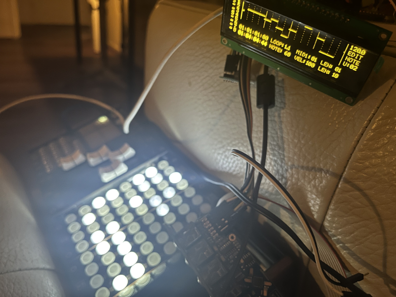
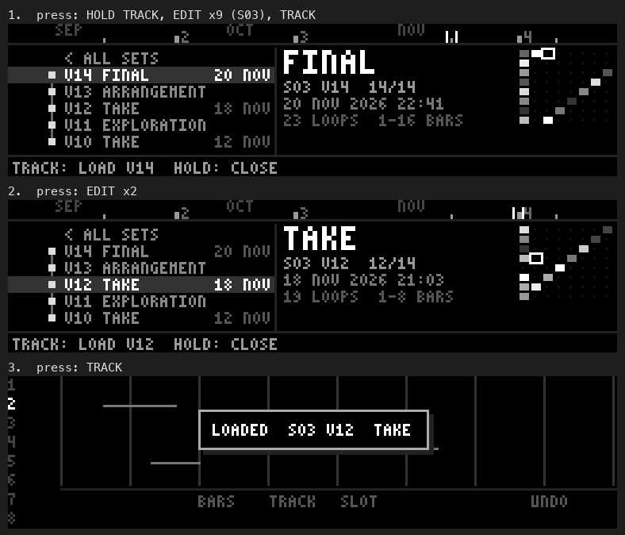

[](https://polyformproject.org/licenses/noncommercial/1.0.0/)

# Midi Looper Droid



A hands-on, eight-track MIDI looper for Teensy 4.1, with eight loop slots per track, a 192 PPQN clock, a piano roll on a 256×64 OLED, and hands-on MIDI control. Record, overdub, switch loops, edit notes and reshape loop boundaries while playing. The DROID button grid and four motorized faders shown above are one implementation of the MIDI controller interface.

## Keep playing, keep the vibe

**A song creation device that feels like playing an instrument, not operating software.**

The reference feeling is **Cubase on an Atari**: you sat down, ideas went in immediately, and the machine sort of disappeared. Only notes and parts to arrange, nothing more. One hand on the device, attention on the music.

The goal is to record MIDI the moment the idea happens, layer another part, overdub, undo something that did not work, redo it if you miss it, and keep playing. Finishing a recording or an overdub should be part of the performance: the loop carries on, ready for the next idea. **The music never needs to stop running to keep you in the vibe of the music.**

Undo and redo belong inside that flow. Try a phrase, take it away, bring it back; adjust a note or a loop boundary while listening to what the change does to the groove. The piano roll and editing controls are there to fix small mistakes on the fly and fine-tune grooves, with attention staying on the music.

Build variations in loop slots, bring tracks in and out, and remix earlier recorded loops into new jams. The longer-term aim is to capture that jam itself, then massage the captured vibe with the parts at hand into a finished song. **Building a song should feel like playing.** Jam/arrangement capture remains future work; see [what is available and what is next](#what-is-available-and-what-is-next).

This is the [project's guiding intent](docs/Authority/PROJECT_INTENT.md), shared by the minimal module and MIDI controller setup.

## Two control setups

### Minimal setup: four buttons and one encoder

The base module uses **4 physical buttons and 1 rotary encoder**, connected directly to the looper through GPIO. This is the compact, standalone control setup: the intended core workflow is recording, overdubbing, undo, track/slot navigation and basic editing through button gestures and the encoder. It does not require a DROID or another MIDI controller.

The hardware exists. In the fixed-memory engine its **encoder is connected** (it edits notes in NOTE_EDIT, see [the encoder](#the-encoder)); the four GPIO buttons are not yet. The full minimal-control workflow remains the [base-module goal](docs/Authority/PROJECT_INTENT.md); the MIDI mappings and four-fader controls below describe the currently active extension setup.

### MIDI controller setup: extra buttons and faders

An external MIDI controller gives direct access to tracks, slots and editing parameters. **DROID is the implementation example used here:** a button grid plus four motorized faders, configured with the supplied patch. Another controller can provide the same controls by sending the documented MIDI notes, CCs and pitch-bend messages.

The workflow, button table and fader table below apply to this MIDI controller setup. They describe looper actions; the later mapping tables explain how to assign those actions to your controller. The four faders belong to the extension setup, while the minimal setup uses its single encoder.

## Playing the looper

1. **Choose a track and an empty slot.** Press the slot to arm recording. With transport stopped, start transport to begin the take; on a running track, press the armed slot again to punch in.
2. **Record a loop.** Play your MIDI instrument, then press Record to finish the take at a bar boundary and keep listening as it loops.
3. **Layer more notes.** Press Record on the playing track to overdub; press again to finish the overdub while playback continues. Double Record undoes; triple redoes—try ideas and change your mind while the groove keeps running.
4. **Build variations.** Record into another slot, then press a filled slot to queue it at the playing loop's end (double-press to launch it at the next 16th instead). With the transport stopped, a press only selects the slot that the next start plays. Hold a slot to copy it onto another slot (see [copy mode](#copy-mode)). Select other tracks to build the arrangement; use mute and solo to bring parts in and out.
5. **Edit while listening.** Press Edit for NOTE_EDIT, press again for LOOP_EDIT, and hold Edit to return to performance. Use the four faders as described below.

Settled changes autosave once saving has been enabled during setup. See the [engine user guide](docs/Guides/FIXED_MEMORY_ENGINE.md) for recording states, editing details and storage behavior.

## MIDI controller: button gestures

The same buttons provide their main action with a short press and secondary actions with double, triple or long presses. A short press can wait for the double-press window; a long press is normally at least 600 ms.

| Control | Short press | Double press | Triple press | Long press / hold |
|---------|-------------|--------------|--------------|-------------------|
| **Slot 1–8** | Select / arm an empty slot; queue a filled slot at loop end; playing slot toggles mute; with the transport stopped, only select | Launch at the next launch step (1/16 by default) | Redo | [Copy mode](#copy-mode) |
| **Record** | Record / play / overdub according to track state | Undo; session undo while editing or overdubbing | Redo; session redo while editing or overdubbing | Clear the selected slot |
| **Track 1–8** | Select track; in mute mode (EDIT's short press): mute / unmute (mutes come back after a reboot) | Mute / unmute | — | Solo / unsolo |
| **Next track** | Select next track | Undo | Redo | Open the sets browser |
| **Transport** | Global start / stop (with an external clock: stop / start the tracks locally, also while the master is stopped — they start on its next clock pulse as a bar line); with NOTELEN held: the GROOVE window; in the GROOVE window: next field | Return to loop start | — | Open the GROOVE window (needs the patch's long-press note 43 on the DROID) |
| **Track play/stop** | Play / stop selected track (in the GROOVE window: next field) | — | — | Open the GROOVE window |
| **Edit** | Track buttons: switch between select and mute mode (in mute mode their LEDs show the mute state: bright playing, dim muted), in every mode | — | — | Long (0.6 s): enter NOTE_EDIT (LOOP_EDIT if empty), then cycle NOTE_EDIT ↔ LOOP_EDIT; held 1.5 s: leave edit mode |
| **NOTELEN in performance** | Switch the shown loop between its two remembered ranges | Play the whole stored loop | — | — |
| **NOTELEN in NOTE_EDIT** | Toggle start/end editing; create at an empty bracket | Delete selected note / create at empty bracket | — | Move F4 for velocity; release without moving F4 to create a note |
| **NOTELEN in LOOP_EDIT** | Switch between the two remembered button ranges, edits kept; an empty slot gets a four-bar loop | Play the whole stored loop | — | Open length popup (FULL, A, B, 1–8, 16–128 bars) |
| **16th steps 1–16** (performance) | Restart the playing slot at that 16th of the bar playing, at the next launch step | — | — | — |
| **Bars 1–8** (performance) | Restart the playing slot at that bar of the 8-bar page, at the next launch step | — | — | — |
| **16th steps 1–16** (NOTE_EDIT) | Select the step's note, again for the next one stacked there; an empty step gets a 16th C4 | Delete the step's note | — | Parameter lock: the faders / encoder edit that note while held, one undo step; held without editing, [copy mode](#copy-mode) |
| **Bars 1–8** (NOTE_EDIT) | — | — | — | [Copy mode](#copy-mode) for that bar |
| **16th steps / Bars** (LOOP_EDIT) | Hold one and press another (either way): that range becomes the loop — the left one its new start, the buttons covered its length (16ths allow odd lengths). The buttons are absolute places in the stored loop | That one bar / 16th becomes the loop | — | — |

Changing track during NOTE_EDIT keeps the previous session as one undo step and follows the new track. External clock controls transport when present. A long press of any button closes an open window (the sets browser, the get-a-loop picker, the length popup) back to playing. The launch step is set over serial: `!ENGINE launch-q 16|8|4|bar`.

### Copy mode

Hold a slot for 0.6 s — or, in NOTE_EDIT, a bar button, or a step you hold without editing its note. The held button's LED pulses and a small COPY window opens.

| While the COPY window is open | Action |
|---|---|
| Short press of another slot / bar / step | Paste there: a slot's loop replaces that slot; a bar or a note **replaces** what is on that bar / 16th. One undo step, the target flashes three times, the window closes |
| Double press of another bar / step | Paste and **merge** with the notes already there |
| Record / Edit short (bar / note copy) | Choose replace / merge first; the target's press then pastes at once |
| Track buttons | Choose another track first, to paste onto its slots — or, copying a bar or note, onto its bars and steps (NOTE_EDIT follows) |
| Slot buttons (bar / note copy) | Open NOTE_EDIT on that slot, to paste into it |
| Bar buttons (note copy) | Choose the bar the 16th steps paste in |
| Double press of the source | Clear it: the slot, or the bar's / the 16th's notes. One undo step, the window closes |
| Short press of the source | Cancel |
| Long hold of another slot / bar / step | Make that the source instead |
| Next track held, or the source slot held again | LOAD LOOP: the get-a-loop picker for that slot (Next track's short press still selects the next track) |
| Long press of any other button | Close at once |
| Nothing for 5 s | Closes by itself (a track switch restarts the countdown; the window's bottom edge shows the time left) |

A bar or step past the loop's end lengthens the loop to the end of that bar, then the paste follows. After a loop is shortened, the bar and 16th buttons whose notes now lie past its end light dim. Pasted notes follow the overlap rule of NOTE_EDIT: a note of the same pitch that starts inside a pasted note is hidden, and one that sounds into it is shortened to its start. A paste or a slot clear selects that slot, so a double Record afterwards undoes it.

### Undo is per slot

Each of the 64 slots has its own undo and redo history. Every change to a slot is one step in **that slot's** history: a recording, an overdub, a clear, a loop length or start change, an empty loop, a whole NOTE_EDIT visit, a loop fetched with get a loop, and a paste or clear from copy mode. A double Record (or double Next track) undoes the selected slot's last step and a triple redoes it; undoing one slot never touches another, so a copy is undone on the slot it landed on while its source stays as it is. While NOTE_EDIT or an overdub is open, the same gestures step inside that session first. The UNDO field shows the selected slot's steps. The histories share a 99-state pool (the oldest states go first when it is full), are saved with their slots and come back after a reboot; loading a set brings that set's slot histories with it.

### The encoder

The base module's encoder (Teensy pins 29 / 30, push on 31) works in NOTE_EDIT. A push steps through pitch, move, length and velocity, marked by a line under that label. A turn changes the selected note's value, faster when turned quickly (move up to ×24, length ×8, pitch and velocity ×4). With a step button held, a turn edits that step's note at once, a push adds a 16th C4 on the step and a double push deletes the selected note. The long push is reserved for a future CC menu.

### Loop length: ranges, switching and the full loop

A loop never loses notes when you shorten it. The notes you recorded form the **stored loop**, and the loop you hear is a range inside it. That makes shortening a loop a way to jam: pick a part, play it, switch to another part, and go back to the whole phrase.

**Pick a range (LOOP_EDIT).** Hold a bar button and press another, in either order: those bars become the loop. The 16th buttons do the same inside a bar, so odd lengths and off-beat starts work too. Double-press one bar or 16th to loop just that one. The buttons always name the same bars of the stored loop, so after looping bars 2–4 you can still pick bars 1–3. Choosing bars past the end of the stored loop makes it longer.

**See where you are.** The bar LEDs show the stored loop: bars in the loop are lit (brighter where they hold notes), and bars outside it that hold notes glow dim, so you can see which ranges still contain music. The progress bar spans the whole stored loop, with brackets around the part playing and gaps every 1, 4, 8, 16 or 32 bars, even while stopped.

**Switch while playing (performance and LOOP_EDIT).** The loop remembers the last two ranges you picked.

| NOTELEN | Action |
|---------|--------|
| Single press | Switch to the other remembered range |
| Double press | Play the whole stored loop |

A new range replaces the older of the two; the range that was playing becomes the other one. For example: an 8-bar phrase, pick bars 5–6, then bar 8. A single press now flips between bars 5–6 and bar 8, and a double press brings back all 8 bars. Every switch is one undo step, and note edits made in a range are kept.

The start, the length and both ranges are saved with the slot and come back after a reboot. F1 moves the loop start in 16ths of the stored loop and F2 sets the length; neither changes the remembered ranges.

### Groove

Groove moves the notes of the shown loop toward a swing or quantize template while keeping your recording: the original timing stays stored, so you can change or remove the groove at any time. Open the GROOVE window on a loop with content: hold **PLAY/STOP** on the DROID (the supplied patch sends that long press as note 43 — load the updated `midilooper_v1.ini`), or hold **NOTELEN** and press **PLAY/STOP** (works with any patch).

The window holds two grooves side by side, **A** and **B**: A is the loop's groove when you open it (straight 1/16 at 50 % if it has none), B starts as a copy for you to change. Above them `OFF  A  B` shows what you hear. The groove always applies to the whole loop.

| Row | A | B |
|-----|---|---|
| **Groove** | F1 | F3 |
| **Amount** (0–100 %: how far each note moves toward its swung place) | F2 | F4 |

The window has its own fader bank on the DROID (program 2; the supplied patch's `GrooveWindow` section): all four faders send CCs 20–23 on channel 16 — load the updated `midilooper_v1.ini`.

Grooves: STRAIGHT (plain 1/16 quantize), MPC 16 at 54 / 58 / 62 / 66 / 71 %, MPC 8 at 58 / 66 %, SP-1200 16 at 54 / 58 / 63 / 67 / 71 %, triplet 8 / 16, JAZZ RIDE, BOSSA, LAID BACK, PUSH.

| Key in the GROOVE window | |
|-----|---|
| **REC** / **EDIT** | Select the value above / below; the encoder turns it (its push selects the next) |
| **PLAY/STOP** | Step through OFF → A → B. While cycling: keep the one playing |
| **PLAY/STOP** twice | Cycle: A and B take turns of two bars, each from its bar line (again: stop) |
| **Next track** (`[TRK]`) | AUTO Q, the checkbox in the title bar: an overdub on this loop is grooved too once it ends |
| **Hold PLAY/STOP** | Apply: what is playing stays, and the window closes (a long press of any button does the same) |

A change is heard once you stop moving it: built in the background while the loop keeps playing, from the next beat — under a second at 120 BPM. Changing A or B makes that one heard (while cycling, its next turn plays it). A bar along the window's bottom fills while a change is on its way; `WAIT` or `TOO BIG` shows when the loop cannot be grooved yet or at all. One visit is one undo step, and the piano roll shows the notes where they now play. Notes you placed by hand in NOTE_EDIT keep their place.

### Loop-length popup

Long-press NOTELEN in LOOP_EDIT. The popup shows every choice in three rows — `FULL · A · B`, `1 … 8`, `16 32 64 128` bars — with the selected one highlighted. FULL is the whole stored loop, A and B the remembered ranges (dim while not set), and the numbers are lengths from the start of the stored loop. While the popup is open:

| Control | Action |
|---------|--------|
| Opening button: single press | Select the next choice, wrapping at the end |
| Opening button: double press | Select the previous choice |
| Opening button: hold | Cancel and restore the length from when the popup opened |
| F2 | Choose length using the fader scale below |
| No change for three seconds | Close the popup, keeping changes as one undo step |

## MIDI controller: fader usage

| Fader | NOTE_EDIT | LOOP_EDIT |
|-------|-----------|-----------|
| **F1** | Select a note or an empty 16th for creation | Loop start in 16ths of the stored loop |
| **F2** | Coarse note position; note end in length mode | Loop length, from 1/16 to 128 bars |
| **F3** | Fine note timing | Fine tempo, 0.1 BPM steps around the centre |
| **F4** | Note pitch; velocity while NOTELEN is held (zero mutes the note) | Whole tempo, 20–300 BPM; recentres F3 |

NOTELEN switches F2/F3 between start and end editing. Shortening a loop keeps notes beyond the new end so they return when lengthened. F2's loop-length scale has 25 positions: 1/16, 1/8, 1/4, 1/2, 3/4 bar; 1–16 bars; 32, 64, 96, 128 bars. Local tempo editing is inactive on external clock.

## MIDI controller example: DROID

The pictured DROID implementation uses a button grid, four motorized faders and the supplied [midilooper_v1.ini patch](droid/midilooper_v1.ini). The patch changes fader banks between NOTE_EDIT and LOOP_EDIT, and the firmware sends motor positions and button LED feedback. [Detailed fader and motor setup](docs/Guides/control-surface/Faders.md).

You can configure another MIDI controller to send the same messages. Button mappings below are **MIDI note numbers on channel 16**, with channels numbered 1–16. Use momentary buttons: NoteOn when pressed, NoteOff when released. The firmware detects the gestures; the controller does not need separate mappings for short, double or long presses.

| Looper control | MIDI note number | MIDI channel |
|----------------|------------------|--------------|
| NOTELEN | 35 | 16 |
| Record | 36 | 16 |
| Next track | 37 | 16 |
| Edit | 38 | 16 |
| Transport | 39 | 16 |
| Track play/stop | 40 | 16 |
| Slots 1–8 on the selected track | 50–57 | 16 |
| Tracks 1–8 | 60–67 | 16 |
| 16th steps 1–16 | 0–15 | 16 |
| Bars 1–8 | 17–24 | 16 |

For example, configure eight buttons to send notes 50–57 on channel 16 to control slots 1–8. These note numbers are controller messages, not the pitches recorded into the loop. Channels 13–16 are reserved for the engine control plane.

| Fader | NOTE_EDIT message | LOOP_EDIT message |
|-------|-------------------|-------------------|
| **F1** | Pitch bend, channel 16 | Pitch bend, channel 16 |
| **F2** | Pitch bend, channel 14 | CC 101, channel 16 (pitch bend on channel 14 also accepted) |
| **F3** | CC 2, channel 15 | CC 100, channel 16 |
| **F4** | CC 3, channel 15 | Pitch bend, channel 15 |

For the DROID's notched loop-length fader, use the scaling in the supplied patch; see the [fader guide](docs/Guides/control-surface/Faders.md#loop_edit).

## Hardware and setup

Use a Teensy 4.1 with 8 MB external PSRAM, a microSD card in the built-in socket, and the SSD1322 256×64 OLED. The engine uses a statically reserved external-memory arena; the legacy allocator's RAM2 fallback is not an engine setup option. A CR2032 connected to VBAT and GND keeps the RTC running without main power.

Choose the **minimal GPIO module (4 buttons + 1 encoder)** or a **MIDI extension controller** as the control hardware. The current engine implements the MIDI controller setup; the minimal GPIO path still needs to be reconnected. For the DROID example, use [midilooper_v1.ini](droid/midilooper_v1.ini).

Install PlatformIO and consult [platformio.ini](platformio.ini) before building. The fixed-memory runtime has its own explicit environment:

```sh
pio run -e teensy41-engine
pio run -e teensy41-engine -t upload
```

The repository's agent build/upload default remains `teensy41-capture-serial`; that environment builds the legacy runtime. Select `teensy41-engine` explicitly when you intend to build the engine. See the [upload guide](docs/Guides/TEENSY_FIRMWARE_UPLOAD.md) for macOS programming and independent boot verification.

On a fresh card, the engine reads without writing until the owner enables saving with `!ENGINE approve-saving`. That approval is remembered by the engine folder. Once enabled, settled changes autosave into `/MidiLooper/engine/store.bin`. Existing legacy workspace files remain untouched. See [storage and migration](docs/Guides/FIXED_MEMORY_ENGINE.md#storage-and-migration) before relying on imported content.

### Optional: groove templates from Samples From Mars

Groove (see [Groove](#groove)) works with its built-in templates. Reading further templates from MIDI files in the `/GROOVES/` folder on the SD card is the next step, not yet in the firmware (see the [groove design](docs/Plans/groove_quantize_design.md)). A good source is the free **Grooves From Mars** pack by Samples From Mars: timing captured from 27 drum machines, including the MPC60, MPC3000 and SP-1200.

The pack is **not included** in this repository and must not be added to it or shared. Samples From Mars' terms do not allow copying or redistributing their content without written permission. Everyone gets their own copy from the source:

1. Get the free pack from <https://samplesfrommars.com/products/grooves-from-mars> (it asks for a name and email).
2. Unzip it. Only the `MIDI` folder is needed; it has one subfolder per machine.
3. Put the machine folders into `/GROOVES/` on the looper's SD card, either:
   - with the card in a computer, by copying them into a `GROOVES` folder at the card's root; or
   - with the card in the looper, over USB:
     ```sh
     .venv/bin/python scripts/upload_grooves.py "path/to/Grooves From Mars/MIDI"
     ```
     The script checks each file on the card, skips the `Patterns` folders (whole drum patterns, not timing grooves) and can be limited to some machines with `--only "MPC60" "SP 1200"`.

Keep the pack outside the repository folder, or in a folder git ignores. A `grooves/` folder in a clone can be excluded locally with `echo "grooves/" >> .git/info/exclude`.

The firmware only reads `/GROOVES/`: it never changes, renames or deletes files there. A grooved loop will store the timing it uses with the loop itself, so your loops keep working if the folder changes.

## What is available, and what is next

The engine supports record/overdub, quantized slot switching and launch, step / bar restarts, track mute/solo, per-slot undo/redo, note creation/deletion and geometry/velocity editing (faders, step buttons and the encoder), copy / paste of slots, bars and notes, loop start/length editing, and autosave/boot restore. Shortening a loop keeps notes beyond its end for later lengthening.

The **sets browser** (Next track held) is available on this branch: saved milestones of the whole set, a save popup with stages, live loads with a return point, a trash, and get a loop — one slot of a saved stage onto a slot of the current set, auditioned first. The images below are the original design walkthroughs; the device screens differ in detail.

The legacy jam controls, multi-slot layering gestures, quantize, extended edit buttons 41–48 and the legacy load/save overlay are not available in the engine. Scene and jam capture remain future work.



See the [browser proposal and all walkthroughs](docs/Plans/engine_sets_browser_proposal.md), and the [current implementation scope](docs/Runtime/CURRENT_WORK.md).

## Firmware and development

The fixed-memory engine is the current development runtime. Its content lives in fixed PSRAM pages, immutable runs and versioned manifests; playback and display read bounded derived windows. The legacy firmware remains in the repository and builds in separate environments.

The current checkout is `feature/engine-sets-browser`, branched from `rewrite/fixed-memory-engine`. `dev` is the stable integration reference; its legacy UI and storage descriptions do not describe the engine. See [current work](docs/Runtime/CURRENT_WORK.md) and [project state](docs/Runtime/PROJECT_STATE.md) for progress.

Start with the [engine user guide](docs/Guides/FIXED_MEMORY_ENGINE.md). It covers recording, editing, memory limits, autosave and the current feature boundary. The [documentation index](docs/README.md) separates current engine guides from legacy references.

### Development and older versions

[Engine architecture and limits](docs/Guides/FIXED_MEMORY_ENGINE.md#engine-structure-and-limits) · [native test workflow](.cursor/rules/Testing-Workflow.mdc) · [architecture authority](docs/Authority/README.md) · [license](LICENSE)

Run the host suite with `python scripts/test_native.py full`. Firmware changes also need the applicable device verification; a successful upload alone does not prove boot or content parity.

Older firmware: [v1 (`main`)](https://github.com/Lytrix/MidiLooper/blob/main/README.md), [v2 (`midi-faders`)](https://github.com/Lytrix/MidiLooper/blob/midi-faders/README.md), and the legacy v3 runtime on `dev`. Legacy technical guides are retained for those code paths and explicitly marked where they differ from the engine.
