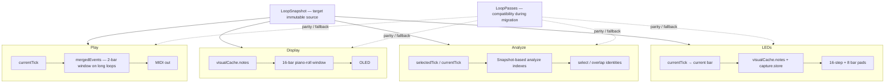

# Runtime architecture — derived representations

**Parent:** [RuntimeArchitecture.md](RuntimeArchitecture.md)

**Naming:** “Derived view” in diagrams means **derived representation** in prose and new docs. Avoid new `*View` type names in code ([NAMING.md](../NAMING.md)).

---

## Question

> How should the authoritative timeline be represented for runtime consumers?

A derived representation is **not** owned by a consumer. It has an owner, revision, invalidation rules, and build policy.

It is **not** the same as a window or interval — one representation can be projected onto many intervals.

In the snapshot target, `LoopSnapshot` is the complete immutable source for
normal derived representations. `Loop` owns snapshot publication and identity;
each derived-representation owner keeps its own storage, revision,
invalidation, and build policy. Compatibility `LoopPass` records on
`LoopPasses` remain a fallback source until their caller migration gates pass.

The approved logical source indexes are pitch → canonical 768-tick bar →
membership lists of `NoteRef`s for complete note spans, and bar → membership
lists of `EventRef`s for events whose ticks fall in that bar. The event lists
are indexed views of existing event-stream order, not a second ordering
authority. A derived representation reads one selected, self-contained
`LoopSnapshot`; it does not reconstruct missing content by walking a parent
snapshot.

---

## Consumers — play, display, analyze, LEDs

Hot-path work stays a **short window** of data, not the whole loop. Each consumer has its own origin tick, representation, and interval. They do not share one list.



The diagram shows the target source boundary. The rows below describe current
consumer reads while snapshot migration is incomplete.

| Consumer | Origin | Reads | Does not read |
|----------|--------|-------|----------------|
| **Play** | `currentTick` | `LoopPlaybackRuntime.mergedEvents` (MIDI events) | `visualCache` |
| **Display** | paint window | `visualCache.notes` / `capturePreview.notes` (`DisplayNote`s) | `mergedEvents` |
| **Analyze** | `selectedTick` (NOTE_EDIT) or `currentTick` (overdub overlap) | Prepared `LoopContentResolution` (`tickEvents`, `spanBoundaries`, `resolveState`, `resolveWindow`) | A reconstructed whole-loop `DisplayNote` list |
| **LEDs** | current bar / 16th | `visualCache.notes` (committed presence) + `loop.capture.store` when capture is active | `mergedEvents`; LCR; a gather into a private LED list |

**Snapshot target:** normal consumers read the selected complete `LoopSnapshot`
through their existing representation owner. The snapshot identity is the
source revision for invalidation. A stale representation may remain available
under its consumer policy while bounded rebuilding completes; snapshot
selection never requires a full-loop rebuild on a timing-critical path.

**Play today:** `Track::playMidiEvents` phases `currentTick`, then walks `mergedEvents` in `playbackOrder`. `ensurePlaybackMergedMidiEventsBuilt` fills that list from published `LoopSnapshot` event membership (`tryGatherPublishedSnapshotEventsInWindow` = 2 bars on long loops; full gather on short). A stale published root still supplies that window; unpublished session / pending-publish passes and their companions overlay on top. Compatibility pass gather runs only when no published root exists. Overdub session-exit queues construction; `processDeferredIdleMaintenance` applies one dirty bar via `stepPendingSnapshotPublish(1)` per serviced track. First-record starts from `capture.store` during RECORDING after the playhead has left bar 1 and continues on PLAYING. During OVERDUBBING it only advances an in-flight construction. After a root exists, PLAYING and OVERDUBBING do not step successor construction. The window records snapshot identity for freshness. Live overdub also walks `loop.capture.store`. NOTE_EDIT still full-replaces `mergedEvents` from `sessionMidiEvents()` — target is the play window plus settled overlay `NoteId`s (DEC-037 Editor amendment).

**Display today:** OLED filters `visualCache.notes`. Idle `rebuildVisualCacheIdleSlice` accepts current-root Snapshot membership only. Overlay (stale root) is discarded; idle continues to prepared LCR when `preparedWindowReady(playbackRevision)` or budgeted `gatherCommittedEventsInWindow`. Last-resort committed paint in `resolveDisplayNotesCommitted` applies the same Overlay reject and continues to `gatherCommittedEvents`. Overlay remains valid for playback and for windowed paint fallback `rebuildDisplayNotesInWindow` (`tryGatherPublishedSnapshotEventsInWindow`; live capture merges when that path needs it). When no published root exists, idle uses prepared LCR or compatibility gather. Paint is not playback.

**Analyze target:** same window shape as play. Overdub overlap already aims at `resolveState(currentTick)`. NOTE_EDIT hydrate moves select / overlap onto the same indexes around `selectedTick` ([`note_edit_hydrate_enhancement.md`](../../Plans/note_edit_hydrate_enhancement.md)). Prepared miss stays legacy (`visualCache` / today’s gather). LCR is not a second `visualCache`; it does not store `DisplayNote`s. **Overdub overlap authority** (consume vs display across wrap): [`overdub_lifecycle_representation_authority.md`](../../Plans/overdub_lifecycle_representation_authority.md).

**LEDs today:** `MidiLedManager::hasNoteOnInRangeForLed` is the content query. Sixteen-step pads (`analyzeAndUpdateBar`) and eight bar pads (`updateBarLeds`) ask “does a note start in this storage range?” They scan `visualCache.notes` (`DisplayNote` start ticks). While overdubbing they also scan `loop.capture.store`. Empty `visualCache.notes` means no committed presence — they do **not** flatten or gather. `prepareLedNoteLookup` does not fill a private list. Tick-row pads (notes 16–31) are clock only (`updateCurrentTick`). Track-select and loop-select pads are slot state (`updateTrackSelectLeds`: `trackHasData` / `slotVelocities`), not timeline content.

`visualCache` stays the piano-roll list. Deleting it is not this model. LED pads reuse that list; they do not own a second copy.

---

## Representation pipeline

```
LoopSnapshot (target immutable source)
        │
        ▼
Derived representations
        │
        ├──────────────┬──────────────┬──────────────┐
        ▼              ▼              ▼              ▼
   Play window    Display list    Analyze indexes  LED pads
   mergedEvents   visualCache     snapshot analyze indexes
        │              │              │              │
        ▼              ▼              ▼              ▼
   playMidiEvents  DisplayManager  select / overlap  MidiLedManager
                         │
                         └─ LED pads also read visualCache.notes + capture.store
```

---

## Owner table (brownfield)

The table below records the current implementation. In the snapshot target,
`LoopSnapshot` replaces `LoopPasses` as the source of the event and analyze
representations; the representation owners and their consumer-specific build
policies remain in place. `LoopContentResolution` is retained only as a
snapshot-based compatibility adapter until its caller gates pass.

| Representation | Owner | Storage (today) | Revision | Build policy | Consumers |
|----------------|-------|-----------------|----------|--------------|-----------|
| **Event (loop)** | `Loop` | `passesMaterializedStore_` / `midiEvents()` | Materialize dirty | On demand; not on MIDI-clock tick | Playback seed, display reconstruct input |
| **Event (NOTE_EDIT)** | `EditManager` | `NoteEditSession.store` | `sessionPreviewRevision_` | On geometry commit / store write | `sessionMidiEvents()`, overlap analyze |
| **Display** | `Loop` | `visualCache.notes`, `capturePreview.notes` | `revision` fields | **Target:** idle-deferred when dirty; not every PLAYING frame | `DisplayManager` |
| **Playback order** | `Track` / `LoopPlaybackRuntime` | `mergedEvents`, `playbackOrder` | Runtime rebuild flag | Prewarm off hot path; rebuild on transport / invalidation | `playMidiEvents` |
| **LED bar hint** | `MidiLedManager` | Reads `visualCache.notes` + `capture.store`; no private gather list | Inherits display revision | Bar change / wrap only; do not flatten when cache empty | 16-step + 8 bar pads |
| **Analyze indexes** | `Loop` / `LoopContentResolution` | Prepared `tickEvents` / `spanBoundaries` | `playbackRevision` stamp | Idle / STOPPED construct; consume when stamp matches | Overdub overlap today; NOTE_EDIT select / overlap (hydrate target) |

**Exception:** `NoteEditSession.store` is a live **overlay** on passes during edit — not a pure derivative of `materialize()` alone. Tier-2 playback audition **target** (DEC-037 Editor amendment 2026-08-16): overlay selected + participating overlap `NoteId`s onto the playback window around `currentTick`. Today’s firmware still full-replaces `mergedEvents` from `sessionMidiEvents()`; that replace is not the architecture.

---

## Runtime requests

Combine **representation + `TickInterval`**:

```
Runtime Request = Derived Representation × Interval → Consumer result
```

| Consumer | Representation | Interval example |
|----------|----------------|------------------|
| Play | Event representation (`mergedEvents`) | 2-bar window on long loops; full gather on short; phase at `projectionCycleStartTick` |
| Display | Display representation | Detailed 16-bar `TickInterval` on piano roll |
| LED (16-step + bar pads) | `visualCache.notes` + `capture.store` | Current bar (16 sixteenths) and bars 0–7 |
| NOTE_EDIT select | Prepared LCR `tickEvents` / `spanBoundaries` + Edit projection context | Bounded onset/navigation neighborhood around `selectedTick`. Not `resolveState` (DEC-037 Editor amendment 2026-08-16). v1 `[0, loopLength)` withdrawn |
| NOTE_EDIT overlap | Prepared LCR indexed identities (`resolveState` at S; window identities in `[S, E)`) + `NoteGeometryResolver` | Selected span after mover stop + one display-update trigger. Identities then `appendNoteEvents`; not a reconstructed `DisplayNote` vector. Prepared miss is legacy compatibility only. |

Same interval, different consumers:

```
TickInterval bars 8–24
    → Playback: send MIDI events in projected phase range
    → Display: filter DisplayNotes intersecting window
    → LEDs: note-present query for bar indices in range
```

---

## Invalidation rules

1. **LoopSnapshot publication or selection** → invalidate representations by snapshot identity → cascade to display + playback representations.
2. During compatibility migration, pass/materialized revisions may still trigger the same invalidation path; they are not a second normal authority.
3. **Consumer** checks source and representation revision; if stale, **asks owner** to rebuild (or accepts deferred staleness per policy).
4. **Consumers must not** call `ensureVisualCacheBuilt()` / `materializeToEventVector()` on hot paths (PLAYING, per-CC fader) — owner schedules on idle or explicit refresh.

---

## Incremental build

`VisualCache.dirtyBars` is the seed for **bar-granular** idle rebuild. That path is shipped. Overdub wrap publish (`commitCapturePass(OverdubWrap)` and `Track::commitOverdubWrapAtSessionStart`) calls `markAffectedDisplayCacheRanges` so the dirty set is the wrap-pass (and companion) span. A wrap-held pair (`endTick < startTick`) dirties the On bar and Off bar only — not the interior around the loop. Linear spans stay inclusive. After `slice_clean`, empty `dirtyBars` plus nonempty notes is not an all-bars dirty set: `markPassDerivedStale` does not emit `dsz=0`, and idle does not call `markAllVisualCacheBarsDirty`. `appendLastCommittedOverdubPassToSourceView` restamps `overdubSourceSpanCache` and merges the sealed pass into the source view only. It does not merge that pass into `visualCache` (`205138` wrap 2 `205→271`). New wrap body notes enter `visualCache` from idle slice. `appendOverdubPassDisplayNotes` adds wrap-held heads/tails only. Overdub paint assigns a grown cache after idle fill (`201556`). Source view still uses full wrap pairing.

`Loop::rebuildVisualCacheIdleSlice` finds the next dirty bar, rebuilds up to 2–4 consecutive dirty bars (plus one-bar gather pad), splices those notes into `visualCache.notes`, and clears those flags. `slice_clean` when none remain. Empty `dirtyBars` with notes still in cache is `slice_nodirty`, not a full-loop dirty expand. Overlay gather is discarded on this path so a stale snapshot cannot mark bars clean (`205917`).

STOPPED idle uses a budgeted fallback gather (`192` events) and `allowOverdubWrapAppend=false`. Wrap-pair fill runs later via `applyDeferredVisualCacheWrapAppend`. PLAYING already used that pair. STOPPED track/slot switch calls `markDisplayCachesStale()` and keeps `visualCache.notes`; `invalidateDisplayCaches()` (wipe) stays on PLAYING preview only. First paint filters the kept list.

Paint does **not** rebuild on window move: `resolveWindowedDisplayNotes` filters a non-empty `visualCache.notes` with `filterDisplayNotesByWindowInclusion` over the paint window plus follow margin (`kWindowedGatherMarginBars`, at least `kFollowReadyLookaheadBars`).

`visualCacheCoversWindow` authorizes a neighborhood when every bar in the window (plus optional lookahead) is clean, even if the rest of the loop is dirty. Incremental committed paint filters a non-empty cache while globally dirty so auto-follow can show the next bar, except after overdub stop: a dirty cache must not replace the RC5a composed handoff frame (committed + capture suffix). `overdubSourceViewNotes` is consume ownership, not display authority.

What is **not** per-bar yet:

- `rebuildVisualCacheFromPasses` still full-reconstructs (`ensureVisualCacheBuilt`, NOTE_EDIT open).
- `markDisplayCachesStale` still marks every bar dirty.

---

## Related

- [IntervalProjection.md](IntervalProjection.md) — interval math after representation exists
- [Display.md](Display.md), [Playback.md](Playback.md) — consumer contracts
- [note_edit_hydrate_enhancement.md](../../Plans/note_edit_hydrate_enhancement.md) — NOTE_EDIT analyze around `selectedTick`
- [INTERNAL_HEAP_AND_EXTERNAL_MEMORY.md](../../Guides/INTERNAL_HEAP_AND_EXTERNAL_MEMORY.md) — allocator tier for cold representations
