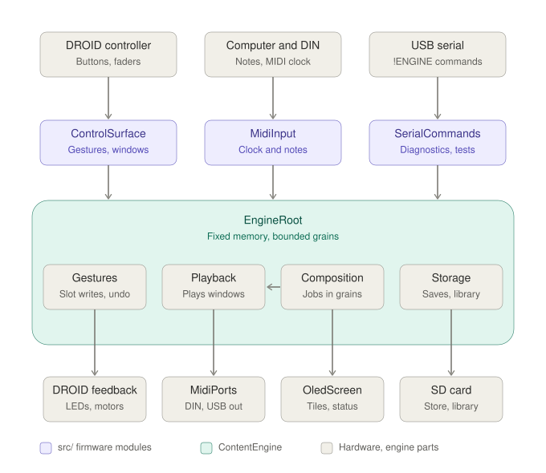
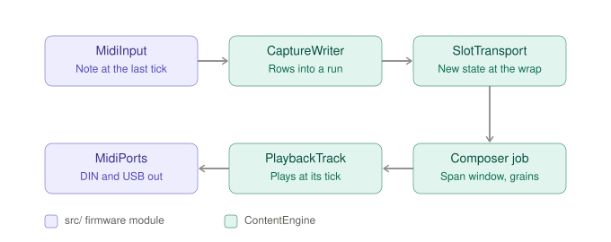

# How the firmware fits together

Two diagrams of the engine firmware: its components and how they connect, and the path one played note takes until
it plays back. For the structure in detail see [FIXED_MEMORY_ENGINE.md](FIXED_MEMORY_ENGINE.md); for the timing
budgets, [ENGINE_TIMING.md](ENGINE_TIMING.md); for the card, [ENGINE_STORAGE.md](ENGINE_STORAGE.md). Names follow
[NAMING.md § Engine source layout and vocabulary](../Authority/NAMING.md).

## The components

- **Inputs.** The DROID controller (buttons and motor faders, on MIDI channels 13–16 — the control plane, never
  recorded), the computer and a DIN interface (notes and MIDI clock), and USB serial (`!ENGINE …` commands from the
  host scripts).
- **The firmware modules** in `src/` translate the hardware for the engine. `ControlSurface` (in
  `include/ContentEngine/ControlSurface/`) turns the DROID's messages and the encoder into gestures and windows;
  `MidiInput` sends the clock to `EngineClock` and notes to the engine at the last played tick; `SerialCommands` is the
  console for diagnostics and tests. Beside them, not drawn: `LibraryOperations` (milestones, loads, get a loop),
  `SavedSelection`, `DeviceSettings`, `GpioEncoder`, `ScreenView` and `BootHealth` — all reach the engine through
  `EngineRoot`.
- **The engine.** `EngineRoot` owns everything in fixed memory. **Gestures** (`TrackControl`, `SlotTransport`)
  write a slot's states — a take, an overdub wrap, an edit, an undo. **Composition** jobs turn a state's runs into
  span windows ahead of time, in grains of at most 810 µs. **Playback** (`PlaybackTrack`, `ClockOutput`) plays the
  composed windows tick by tick. **Storage** (`Persistence`, the library) saves every slot and the milestones to the
  card in the background.
- **Outputs.** `MidiPorts` sends playback to DIN and the computer, and the surface's feedback (LEDs, fader bank, motor
  positions) to the DROID; `OledScreen` draws the piano roll from the display tiles and the status band; the SD card
  holds the store and the library.

`src/main.cpp` drives all of it: each pass of `loop()` calls the components in nine numbered stages — input, serial,
due ticks, jobs and grains, output, surface, feedback, screen, health.

## A note's path

1. **`MidiInput`** reads the note from DIN, USB or the USB host and hands it to the engine at the last played tick
   (input at tick *c* arrives after *c* was played).
2. **`CaptureWriter`** writes it as a row into the take's run; its NoteOff is reserved in the same run, so it can
   never be refused.
3. **`SlotTransport`** publishes the slot's new state at the loop wrap: the slot's runs plus the run just written. It
   is one undo step (`SlotUndoHistory` keeps a slot's list of states; older ones live on the card).
4. A **composer job** (`SpanWindowComposer`, run by the `WorkerScheduler`) merges the state's runs — applying the
   overlap rules — into the next span window, a few grains at a time, ahead of the playhead.
5. **`PlaybackTrack`** plays the composed window at its ticks: the tick path only plays what is already composed.
6. **`MidiPorts`** sends the note to DIN and USB.

The break between steps 3 and 4 is the engine's central rule: nothing is composed inside a tick. Work that grows with
the slot (binding a state's runs, composing, the loop wrap) is cut into grains, and a tick that comes due between two
grains is played first (DEC-297, deep-overdub timing).
