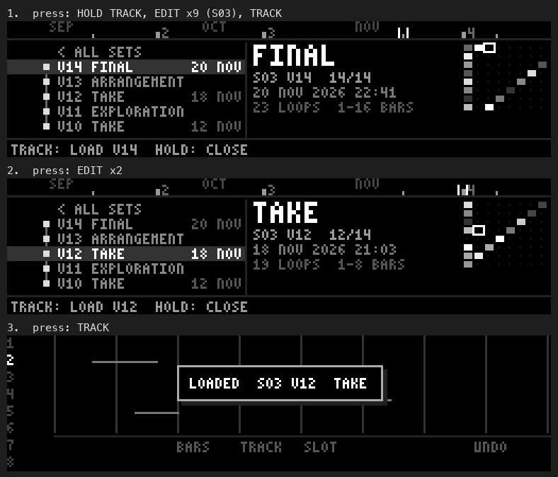
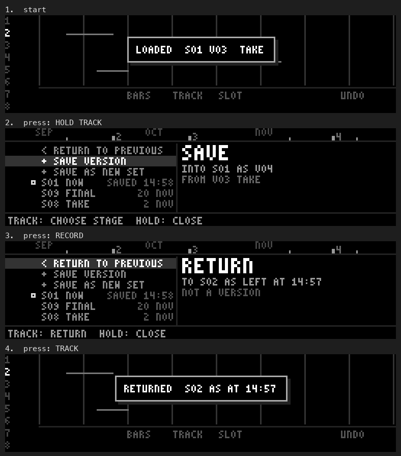

# Fixed-memory engine

Current behavior reference, checked against the engine sources on 2026-11-08. The [README](../../README.md) is the quick-start; [CURRENT_WORK](../Runtime/CURRENT_WORK.md) owns implementation scope. This guide describes existing behavior, without changing architecture decisions or closing outstanding qualification gates.

## Playing without breaking the flow

The guiding goal is to keep playing: record an idea, let it loop, overdub another, undo or redo, and refine the groove while the transport keeps running. Finishing a take and stopping global transport are separate actions. The intended feel is Cubase on an Atari: ideas go in immediately, with only notes and parts to arrange and attention on the music. See [project intent](../Authority/PROJECT_INTENT.md#keep-playing-keep-the-vibe) and the [README](../../README.md#keep-playing-keep-the-vibe) for that musical direction; the behavior and current limits are described below.

## Control setups

The minimal base module is **four GPIO buttons and one rotary encoder**. Its intended role is the full core workflow without an external controller, as defined in [project intent](../Authority/PROJECT_INTENT.md). Its GPIO path is currently dormant and is not connected to the engine.

The active engine surface is an **external MIDI controller**. DROID's grid and four motorized faders are the reference implementation; another controller can send the same messages. The button and fader behavior in this guide applies to that MIDI extension setup. See the [README control setups](../../README.md#two-control-setups) for the distinction and controller mapping tables.

## Performance workflow

Eight tracks each have eight slots. One track at a time records or overdubs. Select a track with channel 16 notes 60–67; select its slot with notes 50–57. An empty slot arms Record. With transport stopped, start it to begin the armed take; on a running track, a second slot press can punch in. A filled slot queues at the playing loop's end; on a stopped track it can start on the grid. A queued switch during a take first ends that take.

Record (36) short toggles record/overdub according to state. Record ends at a bar boundary; overdub ends immediately. Play/stop (40) controls the selected track. Transport (39) controls the internal clock; incoming external clock controls transport when active. A transport start starts the unmuted tracks' selected filled slots as well as armed recordings.

Track double toggles mute; long toggles solo. The playing slot's short press also toggles mute. Slot double launches a filled slot at the next launch step — a queued one sooner than its loop end; on an empty slot, or a track taking, it is the short press. The launch step is global: `!ENGINE launch-q 16|8|4|bar` (default 1/16, kept in EEPROM). Slot triple redoes. Record and track-switch (37) double/triple route undo/redo to the relevant session or slot. Record long clears.

## Note editing

Edit (38) short enters NOTE_EDIT on a filled shown slot, or LOOP_EDIT on an empty one, then cycles between them. Long leaves. Changing track closes the old note session and follows the new shown slot; an empty destination ends the note session.

NOTE_EDIT gathers notes in the current detailed window: the whole loop up to 16 bars, otherwise the 16-bar page at the playhead. The window freezes during editing. If its notes exceed the selection capacity, the window is narrowed around the playhead down to at least a bar. F1 selects a 16th and a note within a stack; empty positions leave a bracket for creation.

F2 moves the start with F3's fine offset retained; NOTELEN short switches to editing the end. F3 adjusts fine timing; F4 sets pitch. Hold NOTELEN and move F4 for velocity; zero mutes without deleting, and another value unmutes. A muted note remains visible and editable but emits no NoteOn. F4 returns to pitch on release.

NOTELEN short at an empty bracket creates. Double deletes the selected note or creates at an empty bracket. A long hold released without a manual F4 move creates too. Creation defaults to C3 (MIDI 60), velocity 80, a 32nd note.

Repeated adjustments to the selected note coalesce into one session step until selection changes; returning to its original value removes that step. Record double/triple undo/redo inside the session. Leaving commits the visit as one slot undo step. Overlap consequences are derived from the selected causing note and settled when selection changes.

## Loop editing and length popup

F1 rotates the start in 16ths, relative to the content found on entering LOOP_EDIT. F2 changes the play window after the fader rests. Notes keep recorded lengths; notes crossing the new end wrap, and notes beyond a shorter end remain stored and return when lengthened. A LOOP_EDIT visit coalesces start/length changes into one undo step while its previous result remains current.

F2 has 25 positions: 1/16, 1/8, 1/4, 1/2, 3/4 bar; 1–16 bars; 32, 64, 96, 128 bars. F4 sets whole BPM from 20–300 and recentres F3; F3 adds tenths from its centre. External clock disables local tempo editing.

Long-press a slot to open its length popup; an empty slot first becomes a selected, stopped one-bar loop. A long press of NOTELEN in LOOP_EDIT also opens it; a short press creates a one-bar loop only when empty. Its opening button's single press steps up through 1–8, 16, 32, 64, 128 bars; double steps down, wrapping at the ends. F2 also works. Hold the opening button to cancel and undo the popup's length changes. Otherwise it hides after three seconds idle. All its changes form one undo step.

## Display

The 256×64 SSD1322 screen has track numbers/activity at left, the piano roll above, and a status band below. While running, track activity decays from the last NoteOn velocity; stopped tracks show state letters. The roll shows the full loop up to 16 bars, otherwise a 16-bar page following playback. There is no separate overview strip.

Performance status shows position, BARS, TRACK, SLOT, output port/channel, UNDO and tempo. NOTE_EDIT shows note START, NOTE, VELOCITY and LENGTH, with the selected note and dotted bracket. LOOP_EDIT shows START, LENGTH and BPM with inverted labels. The undo field becomes ODUB or EDIT for an open session. Save dots indicate pending, writing, completed or failed saves; RO means saving is not yet approved. Queued actions show a countdown.

Implementation: [EngineDisplay.h](../../src/EngineFirmware/EngineDisplay.h). Browser mockups in Plans are a separate proposed UI.

## Storage and migration

The engine starts read-only until the owner types `!ENGINE approve-saving`. The engine folder remembers approval. Settled slot histories autosave one slot at a time when no take or NOTE_EDIT session is open on that slot. Selection state is saved separately.

The current store is `/MidiLooper/engine/store.bin`: preallocated sectors, two alternating copies per slot and two surface-state sectors. A save writes the inactive body and then its header; completion waits for the card to be idle. Boot chooses the newest valid copy and can fall back to the other. Failed slots are reported.

Earlier engine `.mle` files can be read and migrated to the store. Legacy `/MidiLooper/current/slots/loop_TT_SS.bin` files are imported read-only where supported: LSV1 snapshots supply current content; pass streams supply active passes, with legacy note edits discarded and reported. Loop-start-shifted or empty legacy slots are skipped and reported. Check boot import/failure masks before assuming parity. Legacy files are never rewritten by the engine.

The old Current/Set revision overlay and REVPK02 paths belong to the legacy runtime. The new library/milestone work is in progress; its proposed browser is not an available save/load UI yet.

The RTC is valid from 2025–2099; otherwise the engine reports TIME NOT SET rather than substituting build time. On this host the Teensy loader sets local time, so the display offset defaults to zero. `!ENGINE time` reports clock and last completed save, `!ENGINE time <unix>` sets the RTC, and `!ENGINE tz <minutes>` stores the display offset. [engine_set_time.py](../../scripts/engine_set_time.py) handles the host-local convention.

## Engine structure and limits

[EngineMain.cpp](../../src/EngineFirmware/EngineMain.cpp) wires hardware; [ContentEngine](../../include/ContentEngine/) owns platform-independent content. The `teensy41-engine` environment builds only `src/EngineFirmware/`. The legacy `src/main.cpp` is a separate runtime.

The accepted architecture is [DEC-252 — fixed pages, immutable runs and versioned manifests](../DECISION_LOG.md#dec-252--one-bounded-content-engine-direct-cutover-to-fixed-pages-immutable-runs-and-versioned-manifests), with [fixed-memory engine OpenSpec](../../openspec/changes/fixed-memory-engine/design.md). Allocations and capacities are reserved at boot; accepted note closures have reserved space. Composition derives overlap rather than storing its consequences. Jobs build derived playback windows, edit indexes and display tiles under manifest-qualified identities.

Current constants in [EngineConfig.h](../../include/ContentEngine/EngineConfig.h): 64 slots, one writer, 131,072 committed rows, 16 simultaneously sounding output notes per track, a 512-note edit selection, and a shared 99-state history pool across slots (including current states). These are distinct limits: output polyphony does not limit stored notes. The per-slot UNDO display does not mean 99 undos are reserved for every slot. Per-slot SD-backed history is a separate [DEC-254 — per-slot history proposal](../DECISION_LOG.md#dec-254--undo-history-per-slot-recent-steps-in-psram-every-step-on-the-card).

These constants are admission/storage limits, not proof that every maximum-density workload meets timing. OpenSpec tasks retain the remaining measurement and qualification gates.

## Hangs, the watchdog and boot diagnostics

A hardware watchdog (WDOG1, 4 s) is armed by the core's earliest startup hook and fed every main-loop pass and boot phase, so a hang anywhere after the reset handler — PSRAM, USB start, `setup`, the main loop, a stuck interrupt handler, or code with interrupts off — resets the board by itself instead of needing a PROGRAM press ([DEC-266 — watchdog and USB health check](../DECISION_LOG.md#dec-266--a-hardware-watchdog-and-a-usb-health-check-reset-a-hung-engine-boot-phases-place-the-hang)). Half a second before the reset its warning interrupt (highest priority) records the interrupted PC, LR and exception number. The watchdog cannot see USB stop while the loop runs (seen 2026-11-09: serial and the uploader dead, the screen and DROID fine; once the Mac's serial driver was the stuck side, as the uploader still reached the board), so every 250 ms the loop writes the live USB state to breadcrumbs 4–6 and resets the board (while stopped) on a wedge it can see itself, held for 1 s (stage 12). On the host, python-rtmidi's `MidiIn.close_port` can block forever in CoreMIDI: close MIDI ports in a child process with a timeout. Each boot prints `#CAP,…,DIAG,boot_reset,crash=…,cause=<SRC_SRSR hex>,watchdog=<0|1>` and `#CAP,…,DIAG,prev_crumbs,mask,stage,tick,phase,c4,c5,c6` for the previous boot: `phase` is how far it booted (1 reset handler … 9 main loop), `stage` its last main-loop stage (11: a clean `!REBOOT`; 12: a USB wedge reset), and `c4`–`c6` after a watchdog reset where it hung (PC, LR, exception number; the USB state if interrupts were off), otherwise the last USB state (`usbState` in [EngineMain.cpp](../../src/EngineFirmware/EngineMain.cpp); healthy: `c5=18`). `!ENGINE boot` prints both rows again for a host that opened the port late; `!ENGINE hang [irq]` (stopped only) stops the loop to test the watchdog. Output calls are bounded: USB device MIDI and serial give up after the core's 40 / 120 ms timeouts, DIN has a 512-byte transmit buffer beyond the core's 40, the DROID host port is admitted (`HostTx.h`). [engine_reboot_soak.py](../../scripts/engine_reboot_soak.py) reboots and reopens the ports in a loop and counts watchdog resets.

## Feature boundary and browser previews

Bars/16ths jam gestures, scenes, jam capture, multi-slot layering, extended edit buttons 41–48 and the legacy load/save overlay are outside the current engine surface. MIDI channels 13–16 are the control plane and are neither recorded nor passed through as musical input.

The [Sets browser proposal](../Plans/engine_sets_browser_proposal.md) describes milestones, staged saves, ancestry, live switching, a return checkpoint and loop retrieval. Its images are proposed walkthroughs, not device acceptance evidence:

See [current work](../Runtime/CURRENT_WORK.md) for the authorized browser slice and its non-goals.
