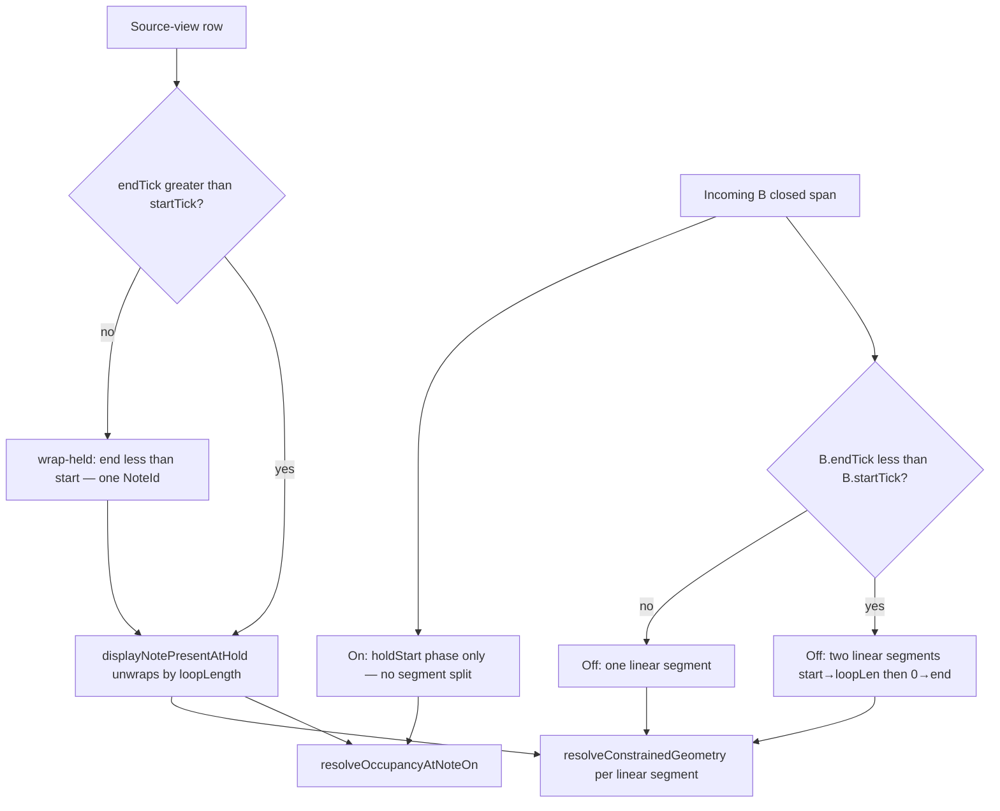

# Note Wrapping and Loop Shortening Logic

**Date:** 2026-09-02  
**Companion:** occupy resolve [`OVERDUB_OVERLAP_RESOLVE_NOTE_EVALUATIONS.md`](OVERDUB_OVERLAP_RESOLVE_NOTE_EVALUATIONS.md) · ledger [`OVERDUB_LEDGER_NOTE_EVALUATIONS.md`](OVERDUB_LEDGER_NOTE_EVALUATIONS.md)

## Overview

This document explains the note reconstruction logic used in the MIDI looper when loop lengths are dynamically changed, and how wrap-held display rows interact with overdub occupy resolve. The system handles both loop extension and shortening while preserving musical integrity.

## Core Concepts

### Display Notes vs MIDI Events

- **MIDI Events**: Raw note-on/note-off events stored with absolute tick positions
- **Display Notes**: Reconstructed note objects with start/end positions for UI display
- **Key Principle**: Original MIDI events are never modified; wrapping is calculated dynamically

### Loop Boundary Handling

The system distinguishes between two scenarios:

1. **Loop Extension** (e.g., 3 bars → 5 bars): All existing notes remain valid
2. **Loop Shortening** (e.g., 5 bars → 2 bars): Notes beyond the new boundary need special handling

## Algorithm Flow

### 1. Note-On Event Processing

```cpp
if (noteOnTick >= loopLength) {
    // CRITICAL: Discard notes that start beyond current loop boundary
    logger.log("Discarding note-on beyond loop boundary");
    continue;
}
```

**Design Decision**: When shortening loops, notes that start beyond the new loop boundary are completely discarded rather than wrapped. This prevents overcrowding and maintains musical coherence.

### 2. Note-Off Event Processing

```cpp
if (noteOffTick >= loopLength) {
    // Wrap note-off position for notes that extend beyond loop
    noteOffTick = noteOffTick % loopLength;
    logger.log("Wrapped note-off");
}
```

**Design Decision**: Note-off events are wrapped because they belong to notes that started within the valid loop range but extend beyond it.

### 3. Deduplication

```cpp
std::set<std::tuple<uint8_t, uint32_t, uint32_t>> seenNotes;
auto key = std::make_tuple(note.note, note.startTick, note.endTick);
```

**Purpose**: Removes exact duplicates that might occur during complex wrapping scenarios.

### 4. Equal-tick completed pairs

A same-channel same-pitch NoteOn and NoteOff at the same tick is a completed zero-duration pair. Reconstruct consumes both events and does not emit a display span or finish the On open to loop end. Off-before-On chronological order (Gate 5A) is unchanged: an Off that closes an earlier open note at that tick still pairs with `startTick < offTick` first. See [`overdub_reconstruct_equal_tick_pair_not_open_bugfix.md`](../Plans/overdub_reconstruct_equal_tick_pair_not_open_bugfix.md).

### 5. Linear closer vs wrap-head Off

Reconstruct span build (`isPreferredWrapTailForHeadOffInSpanBuild`) does not wrap-pair a tail On that already has a linear Off. A leftover head Off must not lengthen that On into a tick-0 wrap head ([`174646`](../../captures/session_20260908_174646.log) `81@4752`/`4800` vs `F,192`). Edit apply still uses `isPreferredWrapTailForHeadOff` so a wrap home with a leftover linear Off can find the wrap Off ([`201446`](../../captures/session_20260816_201446.log)).

When two same-pitch Offs share one head tick, reconstruct shortens the wrap head to the earliest head-window On minus one and keeps the incoming linear note (`174646` D# two `F,576` → head `0–191` + `192–576`). Pairing stays LIFO (DEC-023); each Off closes one On.

See [`wrap_head_last_off_pairing_bugfix.md`](../Plans/wrap_head_last_off_pairing_bugfix.md).

## Examples

### Scenario 1: Loop Extension (3 bars → 5 bars)

```
Original: 3 bars (2304 ticks)
New:      5 bars (3840 ticks)

All notes remain unchanged:
- Note at tick 1000 → stays at tick 1000
- Note at tick 2000 → stays at tick 2000
- No wrapping occurs
```

### Scenario 2: Loop Shortening (5 bars → 2 bars)

```
Original: 5 bars (3840 ticks)
New:      2 bars (1536 ticks)

Note Processing:
- Note-on at tick 1000 → kept (within new boundary)
- Note-on at tick 2000 → DISCARDED (beyond new boundary)
- Note-off at tick 2500 → wrapped to tick 964 (2500 % 1536)
```

### Scenario 3: Extreme Shortening (5 bars → 1 bar)

```
Original: 5 bars (3840 ticks)
New:      1 bar (768 ticks)

Note Processing:
- Note-on at tick 100 → kept
- Note-on at tick 900 → DISCARDED (900 >= 768)
- Note-on at tick 1500 → DISCARDED
- Note-on at tick 2200 → DISCARDED
- Note-on at tick 3000 → DISCARDED

Result: Only notes that originally started in the first bar remain
```

## Key Design Decisions

### 1. Discard vs Wrap for Note-On Events

**Decision**: Discard notes that start beyond the new loop boundary.

**Rationale**: 
- Prevents musical overcrowding
- Maintains temporal relationships between notes
- Avoids creating artificial overlaps

**Alternative Considered**: Wrap all note-on events using modulo
- **Problem**: Would cram multiple bars worth of notes into a single bar
- **Result**: Unmusical dense note clusters

### 2. Wrap Note-Off Events

**Decision**: Always wrap note-off events using modulo.

**Rationale**:
- Completes notes that legitimately started within the loop
- Preserves the "cut-off" behavior for notes that extend beyond the loop
- Maintains note pairing integrity

### Display: wrap-held head segment (`resolveWrapHeadSegment`)

Wrap-held notes split into a **tail** segment (high ticks → `loopLength - 1`) and an optional **head** segment (tick `0` → inclusive end). Visibility is centralized in `NoteUtils::resolveWrapHeadSegment`:

| Context | `headEndInclusive == 0` | `headEndInclusive` in `1 .. loopLength-2` |
|---------|-------------------------|-------------------------------------------|
| `LivePlayhead` (open note during record/overdub) | **visible** `[0..0]` — fixes 1-tick blink at playhead wrap | visible `[0..headEnd]` when `headEnd < tailOnTick`; hidden while playhead is still in the tail |
| `CommittedHeadOff` (closed split after reconstruct) | **not visible** — end-at-boundary, tail only | visible `[0..headEnd]` |

Tail-region open notes without a loop-end off yet use `isLiveWrapHeadContinuationDisplay` during live capture: when playhead wraps before `tailOnTick`, display splits tail + head even before seal classifies wrap-held storage.

**Growing live RECORD** (`isRecording && !isPlaying`): wrap-head continuation is disabled. `closeTick < noteOn` means the playhead is catching up to a frontier note-on, not a loop wrap — open notes get a temporary display note-off at the current capture tick only (no head from tick 0).

**Overdub:** wrap continuation is also off. Wrap seals when the playhead crosses loop end (phase 0), not session start S ([DEC-051](../DECISION_LOG.md#dec-051--overdub-wrap-seals-at-loop-end-not-session-start)). Session wrap extracts only preview-open held ONs and re-appends them after `beginCapture(Overdub, S)`. A completed wrap-held pair stays in the sealed overdub wrap ([`014937`](../../captures/session_20260816_014937.log) note 12 ON@2976 / OFF@96). Merged reconstruct pairing stays on the original `allLaterOnsInTailOrNone` rule — relaxing it on record+overdub together rewrote record-pass lengths around wrap ([`015618`](../../captures/session_20260816_015618.log)). `Loop::appendOverdubPassWrapPairedNotes` reconstructs each Active overdub pass with `overdubPassWrapPairing` and appends notes merged reconstruct omitted when that pitch+start is not already in the list. Visual-cache callers use `appendOverdubPassDisplayNotes` (`wrapHeldOnly`): wrap-held heads/tails only. Interior wrap-paired body notes (204132 source-view `192–592` beside `192–16`) stay off the piano-roll list. Wrap-tick `appendLastCommittedOverdubPassToSourceView` does not merge the sealed pass into `visualCache` (`205138` wrap 2 `205→271`). Idle slice is the fill. Idle rejects Overlay gather and fills from current committed content (`205917`); playback Overlay is unchanged. NOTE_EDIT open `rebuildVisualCacheFromPasses` uses the same display append, so it must not lengthen the STOPPED slice. Source view still uses full wrap pairing. `rebuildOverdubSourceView` copies prepared `NoteSpan`s when LCR is ready; wrap-paired fill stays on the visual-cache path and on the unprepared MIDI fallback only. Visual cache uses the same primitive (`rebuildVisualCacheFromPasses`; idle slices only when the slice keeps bar 0 or the last bar). Interior idle slices use the gather or LCR window only — merged reconstruct cannot take wrap pairing ([`015618`](../../captures/session_20260816_015618.log)). Device PASS [`021218`](../../captures/session_20260816_021218.log): `WRAP,2976,96,4,12`, VCACHE 63→87. Live overlay extends to the playhead only. Sealed wrap-held heads still appear on NoteOff via the capture-preview wrap path.

Piano-roll drawing uses `wrapHeadExclusiveEndForDraw` to map inclusive head ends to exclusive pixel ends (main piano roll and overview strip).

### Overdub occupy vs wrap-held rows

Display wrap (this guide) reconstructs piano-roll segments. Occupy resolve does **not** pass a circular `[start, end)` into `resolveConstrainedGeometry`. The two representations stay separate.



| Representation | Shape | Occupy use |
|---|---|---|
| Linear source row | `endTick > startTick` | `displayNotePresentAtHold`: `start <= hold < end` |
| Wrap-held source row | `endTick < startTick`, same `NoteId` after `collapseSplitHeadTailToWrapHeld` | Same present-at-hold helper unwraps by `loopLength` (`linearSoundingSpan`) |
| Incoming B On | one phase `holdStart` | Shorten if `A.start < holdStart`, else Hide. No wrap split |
| Incoming B Off, linear | `[start, end)` | Consume overlap + starts strictly inside `(start, end)` |
| Incoming B Off, wrap-crossing | `end < start` | Two resolver calls in order: `[start, loopLen)` then `[0, end)`. Strictly-inside is `start < tick OR tick < end` |

`resolveConstrainedGeometry` never receives `end < start`. Do not “simplify” wrap by passing a wrapped pair into it.

On does not re-resolve across wrap: `occupancyResolvedNoteIds` stay skipped at Off. Live capture continuation of an open B is not B’s resolved source-view span. See occupy lifecycle in the overlap-resolve catalog.

### 3. Preserve Original MIDI Data

**Decision**: Never modify the original MIDI events.

**Rationale**:
- Allows dynamic loop length changes without data loss
- Enables "undo" functionality
- Maintains data integrity for future loop extensions

## Implementation Details

### Data Structures

```cpp
struct DisplayNote {
    uint8_t note;        // MIDI note number
    uint8_t velocity;    // Note velocity
    uint32_t startTick;  // Start position in ticks
    uint32_t endTick;    // End position in ticks
};
```

### LIFO Note Pairing

The system uses Last-In-First-Out (LIFO) pairing for note events:
- Multiple note-on events for the same pitch create a stack
- Note-off events complete the most recent note-on for that pitch
- Handles overlapping notes of the same pitch correctly

### Error Handling

```cpp
if (activeNoteStacks[pitch].empty()) {
    logger.log("Note-off without matching note-on");
    continue;
}
```

Gracefully handles malformed MIDI data where note-off events don't have corresponding note-on events.

## Performance Considerations

### Complexity
- **Time**: O(n) where n is the number of MIDI events
- **Space**: O(k) where k is the number of simultaneously active notes

### Optimization Opportunities
- **Caching**: Results are cached based on MIDI hash and loop length
- **Early Termination**: Processing stops for events beyond relevance
- **Minimal Allocations**: Reuses data structures where possible

## Testing Scenarios

### Critical Test Cases

1. **Empty Loop**: No MIDI events
2. **Single Note**: One note-on/note-off pair
3. **Overlapping Notes**: Multiple notes of same pitch
4. **Notes Without Ends**: Note-on without corresponding note-off
5. **Extreme Shortening**: Loop reduced to minimum size
6. **Multiple Shortenings**: Repeated loop length reductions

### Expected Debug Output

```
[DEBUG] Reconstructing notes with loop length: 1536 ticks
[DEBUG] Note-on: pitch=52, tick=112
[DEBUG] Discarding note-on beyond loop boundary: pitch=52, tick=2416, loop=1536
[DEBUG] Wrapped note-off: pitch=52, original_tick=1713 -> wrapped_tick=177
[DEBUG] Final note: pitch=52, start=112, end=177
[DEBUG] Reconstruction complete: 14 notes total (0 duplicates removed)
```

## Integration Points

### NOTE_EDIT live geometry (not display wrap)

Display reconstruction in this guide is **read-only** for piano roll / LEDs. **NOTE_EDIT** overlap hide, shorten, and restore during move / length / pitch uses a separate pipeline that mutates **linear** pairs in **`NoteEditSession.store`**:

- Normative spec: [`openspec/specs/edit-session-action-geometry/spec.md`](../../openspec/specs/edit-session-action-geometry/spec.md)
- Design narrative: archived [`openspec/changes/archive/2026-08-05-edit-session-action-geometry/design.md`](../../openspec/changes/archive/2026-08-05-edit-session-action-geometry/design.md)
- Movement guide: [`MOVE_NOTE_LOGIC.md`](MOVE_NOTE_LOGIC.md)
- Storage / pairing: [`LOOP_MIDI_STORAGE_AND_VALIDATION.md`](LOOP_MIDI_STORAGE_AND_VALIDATION.md) § NOTE_EDIT live store

**Edit projection (D20)** linearizes spans before overlap analysis; that is independent of the display wrap rules in §2 above.

**HITL regression matrix (D14):** full per-interaction device matrix is **parked** — see [`m8_edit_note_edit_hitl_automation_refinement.md`](../Plans/m8_edit_note_edit_hitl_automation_refinement.md). Interim smoke: `edit_minimal` preset only.

### Display System
- **File**: `DisplayManager.cpp`
- **Method**: `drawNoteBar()`
- **Responsibility**: Renders wrapped notes as two visual segments when they cross loop boundaries

### Track Management
- **File**: `Track.cpp`
- **Method**: `setLoopLength()`
- **Responsibility**: Triggers note reconstruction when loop length changes

### Caching Layer
- **File**: `NoteUtils.h`
- **Class**: `CachedNoteList`
- **Responsibility**: Avoids expensive recalculation for unchanged data

## Future Enhancements

### Potential Improvements

1. **Quantization**: Snap wrapped notes to musical boundaries
2. **Velocity Scaling**: Adjust velocity for wrapped note segments
3. **Smart Wrapping**: Preserve musical phrases when possible
4. **Undo Stack**: Track changes for complex undo operations

### Backwards Compatibility

The current implementation maintains backwards compatibility with existing MIDI files and doesn't require migration of stored data.

## Conclusion

This note wrapping system provides a robust foundation for dynamic loop length changes while maintaining musical integrity and system performance. The key insight is distinguishing between note-on events (which should be discarded when beyond boundaries) and note-off events (which should be wrapped to complete legitimate notes). 