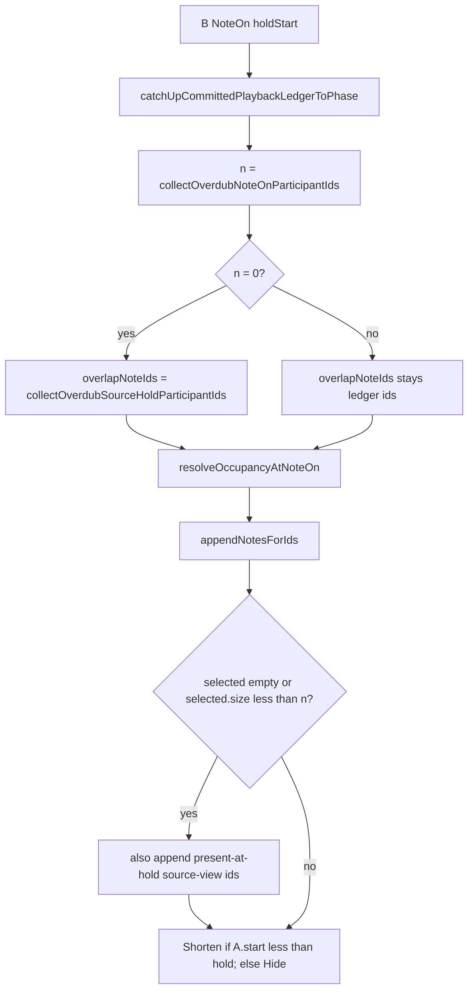

# Overdub ledger note evaluations

**Status:** Durable evaluation catalog. **Not architecture authority.** Update this file when ledger / occupy-catch-up / playback-order owners change.  
**Date:** 2026-09-02  
**Companion:** [`OVERDUB_OVERLAP_RESOLVE_NOTE_EVALUATIONS.md`](OVERDUB_OVERLAP_RESOLVE_NOTE_EVALUATIONS.md) · wrap display: [`NOTE_WRAPPING_LOGIC.md`](NOTE_WRAPPING_LOGIC.md)  
**Closed (FROZEN):** [`../Plans/overdub_occupy_source_view_keeps_resolver_geometry_bugfix.md`](../Plans/overdub_occupy_source_view_keeps_resolver_geometry_bugfix.md) · [`../Plans/overdub_wrap_source_view_display_drops_committed_bugfix.md`](../Plans/overdub_wrap_source_view_display_drops_committed_bugfix.md)

**2026-10-16 — I5 — actual rolling growth HITL evidence:** full07/full08 growth leg verifies ordered USB62/64/60 pairs at98/0, exact6-row record/effective inventory and NoteIds1/2/3 matching source-qualified window endpoints; ledger closes, corrected frozen mismatch verified, critical-loss0. Full recipe NOTpassed: empty reused take stalls, held/no-retrigger and matching physical Stop remain unverified. Visual private-worker cancellation fixed; stale idle-shell fix has focused505/fullnative3281pass7skip/ASan10/build proof only, not device proof. Exact default restored/guard15/two drains/nolatch; retry approval needed. Original metadata hash caveat and upload-chain pins in [I5 — actual execution](../../openspec/changes/windowed-playback-generation/evidence/2026-10-13-i5-running-capture-service/ROLLING-RECORD-HITL-EXECUTION.md); no full ledger/lifecycle/physical timing acceptance from this partial leg.

**2026-10-15 — I5 — growing live Record coverage:** qualified Record windows now rotate across later raw intervals and wrap-only period growth, preserving the same shared ledger/MIDI owner. `applyPlaybackLedgerEvent` uses bounded `isActive(channel,pitch,NoteId)` to suppress only a still-open identity's retriggered On after growth; its original Off in the next interval closes it. Committed/overdub policy and ledger layout unchanged. Normal-maintenance source736/800 emits one On1504, no second On2272, Off2336; withheld-main crossing and matching subinterval/mismatching Stop also pass. Focused500/fullnative3275pass7skip/ASan8, retrigger-removal specificRED; no hardware/physical timing claim. [I5 — current coverage/ledger evidence](../../openspec/changes/windowed-playback-generation/evidence/2026-10-13-i5-running-capture-service/ROLLING-RECORD-COVERAGE.md). Supersedes initial-only functional scope in the prior note.

**2026-10-15 — I5 — connected first-bar rolling Record:** `applyPlaybackLedgerEvent` and `sendMidiEvent` admit RECORDING only when `hasAudiblePlaybackSource` qualifies the exact live Capture recipe/current; the global audible-state predicate is unchanged. The existing fixed-view stream remains the ledger/MIDI owner. Real USB/DIN/host cases assert original NoteId/exact scheduled704/736 rows at1472/1504, ledger0→1→0 and duplicate silence; matching Stop768 preserves current/cursor/ledger, existing mismatch/root-lifetime controls remain. ASan5/fullnative3267pass7skip and emission-removalRED pass. Initial[0,768)/period768 only; no general growing/overdub/timing/device qualification. [I5 — evidence](../../openspec/changes/windowed-playback-generation/evidence/2026-10-13-i5-running-capture-service/ROLLING-RECORD-VERTICAL.md).

This catalog is every **note evaluation** that decides whether an identity is open in `ActiveNoteLedger` (**open ledger identities**) or whether a committed playback event is applied to the ledger. It is **not** overlap geometry and **not** source-view covering identities.

CAP `n=` = open ledger identities (`collectOverdubNoteOnParticipantIds`). CAP `a=` = source-view covering identities (`collectOverdubSourceHoldParticipantIds`). CAP `b=` = prepared LCR present-at-hold (diagnostic only). They are allowed to differ: they answer different questions.

**RC closed (FROZEN).** Gate 5A shipped. D2-D HITL [`174246`](../../captures/session_20260819_174246.log). **`n>a` is diagnostic only** — do not patch occupy collect. Gate 5B **withdrawn**.

**Update this catalog in the same change** if any of these moved: `ActiveNoteLedger::applyPlaybackEvent` / `noteOn`, `rebuildPlaybackOrder`, `CommittedPlaybackLedgerCatchUp`, `collectOverdubNoteOnParticipantIds`, `Track::snapshotOverlapHoldCandidates`, wrap catch-up exclusion.

**2026-10-15 — builder cancellation boundary:** DEC-130 — builder-call cancellation
and live-source exclusion defers private Fill/Order discard until an executing call
returns; a busy runtime reset refuses before clearing ledger or published sibling
views. Both-builder interruption fixtures assert a retained open identity and exact
accepted source. Ledger evaluation, occupy catch-up and ordering criteria are unchanged;
this is not all-Track adoption or device timing qualification. See
[I5 — source concurrency evidence](../../openspec/changes/windowed-playback-generation/evidence/2026-10-13-i5-running-capture-service/SOURCE-CONCURRENCY-EXECUTION.md).

**Record-return cursor/overdub continuity (2026-10-11).** The default frozen
Record reader remains eligible while an overdub is audible; physical window
adoption resets only that window's order index, not the tick crossing floor or
ledger. Repeated edges cannot retrigger an emitted pair, and accepted live
Capture keeps its own echo path (not a second committed-ledger writer). The
shared-finalization regressions assert exact first/second-bar, live overdub and
wrap MIDI plus zero remaining open ledger notes. Source-current retention does
not change identity pairing or closure policy. [Evidence](../../openspec/changes/runtime-working-set-ownership/evidence/2026-10-11-record-return-recovery/EXECUTION.md).
Bound first-bar identity handoff likewise seeks past the last serviced phase,
not the current tick: the regression preserves Off60 then On61 at tick720,
rejects a duplicate same-tick emission, and closes the remaining ledger note
at tick760. This is cursor correctness, not a changed overlap/closure policy.
Ready-before-pass-publication is covered separately: the qualified frozen ready
keeps its source stamp through one maintenance turn, then emits its second-bar
pair during overdub with zero remaining ledger identities. No canonical-revision
relabel or change to ledger pairing/closure policy is involved.

---

## What this catalog answers

Given a committed playback NoteOn or NoteOff, is this identity in the open set, and in which order are equal-phase events applied?

Ledger contents: zero or more applied NoteOns whose Off has not yet been applied. Sparse table of `Entry { channel, note, noteId, startTick, velocity }`. No `endTick`. No exclusive-end math.

**Ledger Entry identity:** `(channel, pitch, noteId)`. `Loop::allocateNoteId` is a per-loop monotonic counter (`nextNoteId_`, starts at 1). `kInvalidNoteId` is 0. Identity is **loop-local**, not global across tracks or slots.

Two different membership tests — do not collapse them:

| Test | Key | Where |
|---|---|---|
| Duplicate / open lookup, tagged Off | `(channel, pitch, noteId)` | `findIndexByNoteId` |
| Untagged Off | `(channel, pitch)` LIFO newest | `findNewestIndex` |
| Full-loop reconciliation | `noteId` only (any NoteOn in merged events) | `eraseOpenNotesMissingFromCommittedNoteOns` |

Offs are identity-bearing only when `evt.noteId != 0`. Committed Offs are often untagged (DEC-042: do not stamp capture Offs). A second apply of an Off after catch-up uses **whatever tagging that playback event actually carries**, not “the same logical Off as tagged.”

---

## Three predicates — not one

`applyPlaybackEvent` return is **not** “the ledger mutated.” Header contract: *“Returns false if the event must not be emitted.”*

```
event selected for ledger processing
        ↓
ledger state mutated?          (Entry push / erase / no-op)
        ↓
caller permitted to emit MIDI? (applyPlaybackEvent return)
```

| # | Predicate | Owner | Meaning |
|---|---|---|---|
| 1 | Reach the ledger? | Clock cursor / USB `shouldApply` | This committed event is offered to `applyPlaybackEvent` |
| 2 | Ledger mutated? | `noteOn` / erase / no-op | Did an Entry appear, disappear, or stay unchanged |
| 3 | May emit? | `applyPlaybackEvent` return | Clock `playbackCursorAdvanceSend` sends only when true. Catch-up **ignores** the return (`(void)applyPlaybackEvent`) and never sends |

**Ledger application success is not equivalent to ledger mutation.** Do not “fix” a duplicate On by returning false — that would skip MIDI emission (`playbackCursorAdvanceSend` returns before `sendMidiEvent`). Duplicate-On no-op is intentional ([`overdub_occupy_duplicate_open_identity_bugfix.md`](../Plans/overdub_occupy_duplicate_open_identity_bugfix.md)): mutation skipped, return **true**, clock still emits.

| Event | Mutation | Return | Clock emit |
|---|---|---|---|
| NoteOn, first time | push Entry | true | yes |
| NoteOn, same `(channel, pitch, noteId)` already open | **no** (no-op push) | **true** | **yes** |
| NoteOn, table full (`kMaxOpenNotes`) | **no** (refuse, never evict; `overflowed_`) | **true** | **yes** |
| NoteOn, untagged (`noteId == 0`) | always push (duplicate check requires a known id) | true | yes |
| NoteOff, known id, Entry found | erase that Entry | true | yes |
| NoteOff, known id, Entry **not** found | **no** (orphan; no LIFO fallback) | **false** | **no** |
| NoteOff, untagged, lane has an Entry | LIFO erase newest on `(channel, pitch)` | true | yes |
| NoteOff, untagged, lane empty | **no** | **false** | **no** |
| other (CC, etc.) | **no** | **true** | yes |

Table-full On does **not** return false. Overflow still permits emit; the extra identity is absent from the open ledger identities.

---

## Owner chain

```
committed merged MIDI
    ↓
rebuildPlaybackOrder          (clock apply order)
    ↓
playCommittedLoopMidi
    ↓
Track::applyPlaybackLedgerEvent
    ↓
ActiveNoteLedger::applyPlaybackEvent
    ↓
open Entries  →  open ledger identities  via collectOverdubNoteOnParticipantIds

USB occupy (separate writer, same ledger):
    ↓
CommittedPlaybackLedgerCatchUp::shouldApply
    ↓
applyOpenClosedIntervalEvents     (phase order, Off then On per phase)
    ↓
applyPlaybackEvent                (return ignored; no MIDI)
```

Capture overdub emit (`playbackCursorAdvanceSendCapture`) does **not** write the ledger. Mute still writes it (`playbackCursorAdvanceApplyLedger`).

---

## Evaluations, in order

### 1. May this event reach the ledger?

| Evaluation | Owner | Reach | Skip |
|---|---|---|---|
| Clock path | `playCommittedLoopMidi` → `playbackCursorAdvanceSend` / mute apply | Committed playback On/Off in cursor order | Capture-only emit |
| USB occupy catch-up gate | `CommittedPlaybackLedgerCatchUp::shouldApply` | `lastTickInLoop != UINT32_MAX` **and** `occupyPhase > lastTickInLoop` **and** not an overdub wrap commit interval. `occupyPhase` is `Track::capturePhaseTick(pending.startNoteTick)` from `snapshotOverlapHoldCandidates` | Equal tick (`occupyPhase <= lastTick`); wrap interval — see wrap exclusion below |
| Interval membership | `IntervalProjection::didPlaybackEventCross` | Event phase in `(lastTickInLoop, occupyPhase]` | Outside the open-closed interval |

### 2. Catch-up vs clock ownership (lifecycle)

Catch-up **only advances the ledger's knowledge** of committed playback events. It does **not** establish that those events have been consumed by the normal playback cursor. It does **not** send MIDI, rebuild merged events, or mutate `lastTickInLoop` / `nextEventIndex`.

| Evaluation | Owner | Meaning |
|---|---|---|
| Catch-up vs cursor | Catch-up + playback cursor | Catch-up may reconstruct ledger state without consuming or repositioning the cursor. Clock later owns whatever cursor interval its current `lastTickInLoop` defines; catch-up does not consume or advance that cursor |

**Duplicate application of the same committed playback interval is expected** after USB catch-up (pin [`101319`](../../captures/session_20260819_101319.log); HITL [`103234`](../../captures/session_20260819_103234.log)). The second application is not guaranteed to be the same event representation: it uses **whatever identity tagging the playback event actually carries**.

| Second apply (clock after catch-up) | Ledger | Emit |
|---|---|---|
| Tagged NoteOn, same `(channel, pitch, noteId)` already open | no-op push (one Entry) | yes — do not skip send when already open |
| Tagged NoteOff, Entry already gone | orphan, no mutation, no LIFO fallback | **no** (`applyPlaybackEvent` false) |
| Untagged NoteOff, lane nonempty | LIFO pop of whatever is now newest on `(channel, pitch)` | **yes** |
| Untagged NoteOff, lane empty | no mutation | **no** |

Do not treat the tagged-orphan row as the default for “the same Off.” Committed Offs are often untagged (DEC-042). An untagged second Off is LIFO, not an orphan.

Do not make occupy catch-up run when `occupyPhase <= lastTick`. That would be occupy repairing clock, rejected on this branch.

### 3. Wrap interval exclusion — why

`shouldApply` is false when `Loop::shouldCommitOverdubWrap(lastTickInLoop, occupyPhase)`.

**The wrap commit interval is excluded from USB catch-up because those events are expected to enter the ledger through the normal clock/wrap path** (`catchUpOverdubWrapPlaybackLedger` → `advancePlaybackCursorAcrossOverdubWrap` offers old-stream `(prev, L-1]` then `[0, S]` to `ActiveNoteLedger::applyPlaybackEvent`, then `applyCommittedOverdubPassPlaybackInterval` on newly sealed pass chunks), **preventing two writers from independently establishing ledger state for the same committed interval.** Head-only `atLoopStart` is not that walk — it never reaches an untagged loop-end Off (`174151` `id=112`).

The wrap clock tick does **not** call `ensurePlaybackMergedMidiEventsBuilt`, `rebuildPlaybackOrder`, `rebuildOverdubSourceView`, span-cache reconstruct, or `publishPreparedOverdubPass`. Occupy `a=` on that tick reads the existing source view after `appendLastCommittedOverdubPassToSourceView`. A later `playCommittedLoopMidi` incrementally admits a proven single overdub seal into the existing full-loop merged stream (`tryAdmitLastOverdubSealIntoMergedEvents`). Full-loop `playback_build,compatibility` remains the fallback when that receipt is missing or incomplete. Idle VisualCache while OVERDUBBING rebuilds the source view only when `!overdubSourceSpanCacheReady()`.

Do not remove this exclusion merely because the wrap ticks also lie in `(lastTick, occupy]`. Do not move wrap ledger ownership onto USB occupy or onto the source-view handoff.

### 4. What `lastTickInLoop` is

`playCommittedLoopMidi` assigns `loop.lastTickInLoop = tickInLoop` on the clock path. Catch-up reads it and **must not** write it.

**`lastTickInLoop` is a playback-cursor boundary, not a statement about the latest event existing in storage and not “the last phase whose events were applied to the ledger.”** Empty phases still advance it. Sparse committed streams do not. Catch-up may inspect occupy phases beyond that boundary; the cursor does not move.

```
clock owns cursor boundary
occupy may inspect beyond cursor
occupy never advances cursor
```

`lastTickInLoop` can therefore lag the most recently inspected occupy phase indefinitely.

### 5. Empty phases / sparse streams

Example: `lastTickInLoop = 100`, next committed event at 300, occupy = 200.

| What happens | Result |
|---|---|
| Catch-up `shouldApply` | true (`200 > 100`, assuming no wrap) |
| Interval walk | no event crosses `(100, 200]` — ledger unchanged |
| `lastTickInLoop` after catch-up | **still 100** |
| Later clock to 300 | cursor still owns `(100, 300]`; event at 300 is not lost |

Do not advance `lastTickInLoop` merely because an interval was inspected. That would silently drop later events from both catch-up and (if someone then skipped clock) from apply.

### 6. How the event is applied (mutation)

`ActiveNoteLedger::applyPlaybackEvent` / `applyPlaybackEventBody`. Off does **not** compute an exclusive end. Nested same-pitch notes can both be open (more than one open ledger identity on one pitch). DEC-042: the ledger is not one Entry per `(channel, pitch)`.

**Untagged Off vs tagged Entries — same lane:**

Tagged and untagged state **coexist** on one `(channel, pitch)` lane. An untagged Off uses `findNewestIndex(channel, pitch)` and **does pop a tagged Entry**. Proven: `test_ledger_note_on_pushes_untagged_off_pops_lifo` — On id=42, On id=99, untagged Off removes 99, then 42.

```
On C60 id=A
On C60 id=B
Off C60 untagged  →  removes B (newest), A remains
```

A **tagged** Off for a missing id does **not** fall back to LIFO (orphan, return false). That is a different identity model from untagged Off and can change the open ledger identities without matching a specific id.

### 7. In which order are equal-phase events applied?

| Path | Owner | Order |
|---|---|---|
| Clock | `rebuildPlaybackOrder` in [`TrackPlaybackWindowBuild.cpp`](../../src/Track/TrackPlaybackWindowBuild.cpp) | Sort by phase then tick; then reorder equal-phase+tick groups **Off before On** (same keys as `NoteUtils::sortMidiEventsChronologically`) |
| USB catch-up | `applyEventsAtPhase` | Per phase in `(lastTick, occupy]`: all Offs, then non-Offs. A global Off-then-On two-pass cannot close a NoteOn that starts in the same interval (DEC-042) |

Shipped clock invariant ([`overdub_occupy_clock_same_tick_off_before_on_bugfix.md`](../Plans/overdub_occupy_clock_same_tick_off_before_on_bugfix.md), HITL **PASS** [`001021`](../../captures/session_20260819_001021.log)): at equal phase, abutting same-pitch replacement last-writes the new On. **Do not change this** as part of wrap-continuity or source-view geometry work.

### 8. After a full-loop rebuild, which open Entries survive?

`reconcilePlaybackLedgerAfterFullLoopRebuild(loop, runtime, currentTick, servedThroughPhase)`, and its handoff result.
`servedThroughPhase` is `playbackClosureServeFloor`'s answer — the phase this pass has already served on that loop
(`loop.lastTickInLoop`, the term the walk's own `reanchorPlaybackIndex` resumes from; `UINT32_MAX` when there is no
position yet or the playhead wrapped backward, i.e. the pass starts or restarts, so every closure is reachable again):

| Evaluation | Owner | Keeps Entry | Closes + discharges | Drops Entry |
|---|---|---|---|---|
| Stream is full-loop | `isFullLoopMergedPlaybackWindow` | — | — | Windowed gather — skip the handoff entirely |
| Replacement carries events at all | `handoffAbsenceMeansRemoval(true, empty)` | An **event-empty** whole-loop replacement keeps every Entry (its absence is not evidence, and nothing is dropped) | — | — |
| On still in committed stream | `ActiveNoteLedger::planHandoffClosures` | Tagged Entry whose `noteId` has a NoteOn **anywhere** in the merged events (`evt.isNoteOn() && evt.noteId == id`; channel/pitch not consulted) | Tagged Entry whose On is gone: `closePlannedHandoffClosures` sends its NoteOff (at the handoff's own tick) and `applyPlaybackEvent` discharges it by identity | `erasePlannedOpenNotes` is the drop path for callers that owe no wire half; the serving handoff closes instead of dropping (`DIAG,ledger,erase` still marks a drop) |
| Its own closing NoteOff is still ahead of `servedThroughPhase` (or the stream carries none) | `ActiveNoteLedger::planHandoffClosures` | Kept untouched: the walk will still deliver that note-off at its own tick this pass, and a revision that carries **no** NoteOff for an open identity says nothing — the absence of a closure is not evidence that the note ends | — | — |
| Its own closing NoteOff is **at or behind** `servedThroughPhase` (task 4.5 — the moving closure) | `ActiveNoteLedger::planHandoffClosures` | — | The obligation the walk can no longer discharge: `closePlannedHandoffClosures` closes it at the handoff's own tick. `advancePlaybackCursor` skips anything at or behind the phase it resumes from, so that note-off is unreachable for the rest of the pass; leaving it would keep the sounding audible past the end its own revision gives it and re-articulate it at the wrap | — |

**Both halves are one predicate in one scan** (`planHandoffClosures`), so the owner that *plans*, the owner that
*closes* on the wire and the owner that *drops* cannot disagree about the set. `planOpenNotesMissingFromCommittedNoteOns`
is the same predicate with nothing served yet — the structural half, for callers that owe no wire half.

**Reconciliation answers “does this `noteId` still have a NoteOn in the committed stream, and can the incoming stream still close it in this pass?”, not “should this identity currently be sounding?”** It is **not** the ledger Entry key `(channel, pitch, noteId)`. A NoteOn at any tick in the rebuilt stream keeps the currently open Entry for that `noteId`, even if channel/pitch on the stream event differ from the Entry. Untagged Entries are skipped and stay. The **plan** above states both halves once, so the owner that drops an obligation and the owner that closes it on the wire cannot disagree about the set.

**The handoff is audible (3.7 / 4.5 § 13(g)):** a planned Entry is closed on the MIDI wire **before** the replacement's note-ons (the reconcile runs ahead of the walk that serves them), because the replacement's own NoteOff carries the *new* identity and the identity-exact resolution refuses an unknown identity as an orphan — dropping the obligation silently left the old sounding on until a stop or a clear. The closure is stamped with the **handoff's own tick**, which is the only tick available in either half: the invalidated sounding's own note-off is gone, and the moved one lies behind the phase the walk resumes from.

### 9. What are the open ledger identities at occupy?

| Evaluation | Owner | Counts |
|---|---|---|
| Lane filter | `Loop::collectOverdubNoteOnParticipantIds` | Every open Entry with matching `channel` and `pitch` (inserts `entry.noteId`) |
| Newest-on-lane accessor | `ActiveNoteLedger::noteId` | Compatibility only — **not** occupy. Occupy uses `forEachActive` / the collect above |

The open-ledger-identity count is the size of that id set. Capture `#CAP DIAG,lcr,part` `n=` is this collect. `a=` is the source-view covering identity count (`collectOverdubSourceHoldParticipantIds`) — see overlap-resolve current occupy resolve.

### How ledger feeds occupy resolve

`Track::snapshotOverlapHoldCandidates` builds the On candidate set, then `resolveOccupancyAtNoteOn` writes Shorten/Hide. Ledger is the first source of identities. Source-view covering is the fallback when the ledger set cannot produce rows. `holdStart` handed to `catchUpCommittedPlaybackLedgerToPhase` is the same shared capture phase (`Track::capturePhaseTick`) used for occupy present-at-hold and capture storage ticks. Origin-0 phase is not catch-up input.



| Step | Owner | Uses |
|---|---|---|
| 1 | `collectOverdubNoteOnParticipantIds` | Every open ledger Entry on `(channel, pitch)` → `n` |
| 2 | if `n == 0` | `collectOverdubSourceHoldParticipantIds` fills `overlapNoteIds` |
| 3 | `resolveOccupancyAtNoteOn` | Rows for `overlapNoteIds`. If selected is empty **or** `selected.size() < n`, also collect present-at-hold source-view ids |
| 4 | geometry | `A.startTick < holdStart` → Shorten `end = holdStart - 1`. Else Hide |

`n ≠ a` stays diagnostic. Do not patch occupy collect to force equality. Resolve may still Shorten/Hide from ledger ids when `a=0` (`n>0`), or from source-view when `n=0`. Empty `n` and `a` means nothing is present at the hold — On writes no transform; Off may still resolve interiors.

---

## What the ledger does **not** evaluate

| Not evaluated | Where that lives instead |
|---|---|
| Exclusive end / Shorten / Hide | `resolveOccupancyAtNoteOn` (On) and `resolveConstrainedGeometry` (Off / NOTE_EDIT) |
| Present-at-hold covering | `displayNotePresentAtHold` on source-view notes |
| Whether a NoteOn is still live capture (uncommitted) | `extractOpenCaptureNoteOns` — open B never reaches this ledger |
| Pairing Off to On in storage | `reconstructDisplayNotes` |
| Source-view membership after wrap | `appendLastCommittedOverdubPassToSourceView` | Newly sealed pass notes only; skip NoteIds already present. Does **not** merge the pass into `visualCache` (`205138` wrap 2 `205→271`). Idle slice fills wrap body notes from current committed content (Overlay gather is rejected; `205917`). Wrap-edge / NOTE_EDIT rebuild uses `appendOverdubPassDisplayNotes` (wrap-held heads/tails only). Source-view span cache still uses full `appendOverdubPassWrapPairedNotes`. Span cache restamps to `playbackRevision` so OVERDUBBING idle does not `rebuildOverdubSourceView("idle")` `from=passes`. Full rebuild is idle / later only when the span cache is not ready |
| Source-view membership after rebuild | `rebuildOverdubSourceView` / `retainValidOverdubSourceViewIdentities` | Identity filter runs only on revision-fresh full-loop merged stream |
| Source-view membership `from=snapshot` | `rebuildOverdubSourceSpanCache` | Current published NoteRefs only — no `mergeOmitted` / NoteId upsert. Sealed Hide/Shorten still apply after the seed. Publish completeness: `handoffLiveRecordProgressToCommittedPass` (membership RC-A). Non-snapshot origins keep omitted-identity merge. Catalog: [`OVERDUB_OVERLAP_RESOLVE_NOTE_EVALUATIONS.md`](OVERDUB_OVERLAP_RESOLVE_NOTE_EVALUATIONS.md) § Committed occupy source |
| Whether open ledger identities should equal source-view covering identities | It must not be forced. Mismatch is a diagnostic, not a coupling license |

An open B that has no recorded NoteOff is not a ledger Entry. Wrap carries it as live capture only.

---

## Open ledger identities vs source-view covering identities (deliberate)

```
clock applies committed On/Off  →  ledger Entries     →  open ledger identities
resolver geometry in source view → present-at-hold    →  source-view covering identities
```

Example that is **correct** once A's Length-167 DisplayNote is preserved (`endTick=167`, covering `s < 167`):

| Hold | Open ledger identities | Source-view covering identities | Why |
|---|---|---|---|
| 150 | `{A, B}` if both Ons applied | `{A}` | DisplayNote A `144–167` covers 150 (`150 < 167`). Canonical exclusive `[144,168)` exists only inside reconstruct |
| 312 | `{A}` (Off@264 closed B; Off@360 not yet applied) | `{}` if A is Length-167 and B is `168–264` | A covering `s < 167`; B covering `s < 264`. Neither covers 312. **`a=0` does not mean the ledger is wrong.** Do not write a hold-312 occupy oracle that expects B covering 312 |

Mismatch logs (CAP `n=` ≠ `a=`) are diagnostics. They are not a license to patch occupy collect, stamp Offs, or couple ledger Entries to source-view spans.

## Committed snapshot window ordering — deferred preparation gate

The windowed-playback-generation continuation binds window event-membership
cursors to the existing runtime builders. Membership traversal is not global
canonical order: bounded ordering first uses full32-bit `(canonicalOrder,eventId)`
keys, assigns canonical ranks, then uses normal phase/Off-before-On/raw-tick order
with canonical-rank ties. Temporary event-ID metadata never qualifies as pass
provenance (`passOriginsReady` stays false). This does not alter overdub overlap,
open-ledger identity or closure authority. Initial demoted launches now consume a
completed immutable window; later coverage keeps the mutable fallback. Native parity uses the production
snapshot gather plus existing flat playback builder as its reference.
Evidence: `openspec/changes/windowed-playback-generation/evidence/requester-retry-integration/RUNTIME_BINDING.md`.

Ordering work now alternates the existing order/merge arrays, with at most one
final normalization into the caller's order array. Comparison keys are unchanged:
canonical/event-ID sorting, rank assignment, then phase/Off-before-On/raw-tick/rank.
Borrowed-index sources remain read-only. At2,048 entries the measured worst-case
sort is26,624 entry steps (555 turns at48), not47,104 (982). The complete dense
snapshot fixture still exceeds the continuous two-bar service supply. This is a
work reduction, not a ledger/closure policy change or a timing qualification.
Evidence: `evidence/requester-retry-integration/ORDER_WORK.md` in the window change.

Snapshot qualification now uses the same typed fill to encode canonical keys and
full event IDs directly into the private build role. It pauses before ordering;
no new comparison/ledger/closure rule is introduced. Admission does not rewind or
copy those events again. The existing rank and playback-order passes run only
after the original deadline/source checks. Dense lifecycle1,226->1,191 turns;
this remains far above the continuous two-bar service supply.
Evidence: `evidence/requester-retry-integration/SINGLE_PASS_QUALIFICATION.md`.

## I5 — Track completion authority boundary (2026-10-15)

DEC-131 — exact Track completion authority changes publication authority, not note
classification or ledger closure policy. A complete private build cannot become ready
as a side effect of adopting another ready view; the preparation owner must explicitly
publish it. Destination-generation checks prevent old cleanup from invalidating reused
metadata. Track final completion receipts reject interrupted/reset work, and fixed
publication/adoption metadata uses saved-mask guards. Existing exact MIDI/ledger tests
remain controls in the passing native suite; these new tests do not establish running
Capture deadline readiness. DEC-132 — preparation acquisition and Record exclusion now
adds the non-masking preparation/reset/Record boundary and bridge role revalidation,
without changing ledger closure policy. Registered default-path Record/Stop compatibility
HITL now passes; finite timing/running-request integration remains open. No deadline
safety or full content-inventory claim. [I5 — acquisition and hardware evidence](../../openspec/changes/windowed-playback-generation/evidence/2026-10-13-i5-running-capture-service/ACQUISITION-CONCURRENCY.md).
