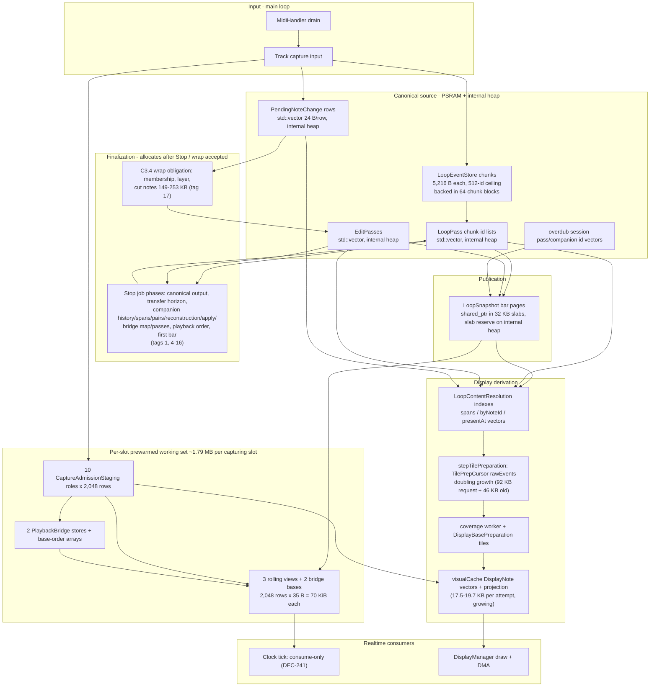
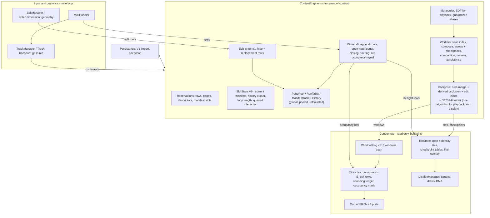
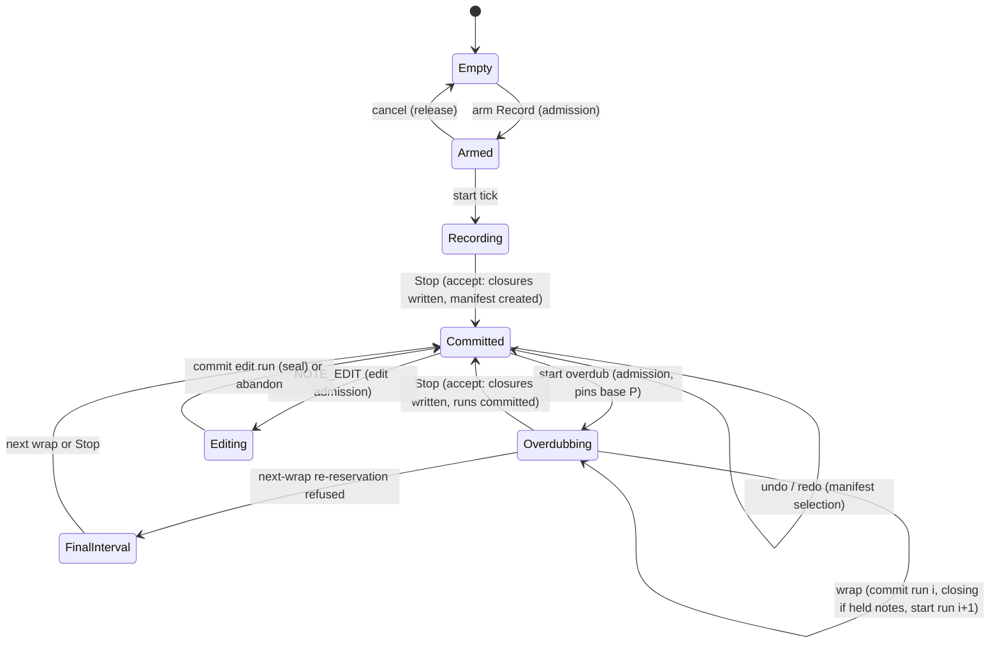

# Fixed-memory MIDI engine — direct cutover plan

Status: **revision 3, for owner review. No production code.**
- Revision 2 was approved as the architectural direction on 2026-11-04: one authoritative `ContentEngine`, immutable
  pages/runs/manifests, fixed worker scratch, three-window playback, independent raster/density display, direct cutover
  with no coexistence.
- E1 waits for this revision. E0 may proceed now.
- Revision 1 (staged, routed track) stays withdrawn.

C3.4 / DEC-251 containment remains paused (DEC-250 — wrap obligation off the Clock, DEC-251 — non-fatal tile-preparation
allocation); both mechanisms are deleted by this plan. Not authority: approval records a `DEC-###` and an OpenSpec change
(§ 12).

**What revision 3 changes (owner review items):**

| # | Review item | Where | Change |
|---|---|---|---|
| 1 | Reservation proof altered accepted notes | § 6 | Overlap consequences are no longer stored rows. They are **derived at composition** from the later note's own span (occlusion), so an accepted note costs a fixed, fully reserved number of rows (NoteOn, NoteOff, ≤ 8 checkpoint carry rows) and is never closed early. Every MIDI class is accounted. |
| 2 | Real scheduling envelope | § 7 | No assumed turn interval. Demand is stated per window period as CPU time; feasibility is an inequality over measured terms (other main-loop CPU, longest non-engine block, ISR load). EDF for playback, guaranteed display share and freshness bound, per-tick and per-port output bounds, storage density vs MIDI bandwidth. |
| 3 | DEC-159 | § 8.3 | Record Stop creates the Record manifest at acceptance; an immediate overdub pins it as its base without waiting for any later Record work. |
| 4 | Complete memory budget | § 4, § 5 | Joint workload (full committed content **and** the active writer **and** one NOTE_EDIT session **and** all consumers); partial-page and directory proof; descriptor, manifest and pin accounting; reserves that optional work cannot borrow; RAM2 initialization; the non-content allowance as a measured precondition. |
| 5 | E0 oracle | § 10 | Expected outcomes come from ratified contracts and reviewed fixtures, written independently of the legacy code. Legacy output is only a cross-check, and its disagreements are classified. Known defects are listed as historical incorrect behavior. |
| 6 | Development model | § 10 | Unchanged: RED/unbootable branch, small commits, no transition-only abstractions. Milestones change only where items 1–5 change dependencies. |

Contents:
1. Current state (input evidence)
2. Target invariants and supported workload
3. Module boundaries and ownership
4. Boot-time memory budgets
5. Pages, descriptors, reclamation and source pinning
6. Event encoding, derived consequences and the reservation proof
7. Realtime scheduling envelope
8. State transitions (Record, overdub, DEC-159 handoff, Stop, undo, redo)
9. Playback, output and display consumer contracts
10. E0 semantic oracle and implementation milestones
11. Final acceptance gates
12. Reuse, deletion, DEC disposition and owner decisions

Evidence base: intense lane-cadence run on DEC-251 image `3b95b40e…` (`captures/session_20261104_190805.log`); B.5b
session high-water; stage A/B `RevisionStore` qualification (B.4b, B.5d timings); ELF section and symbol sizes of
`3b95b40e…`; `RevisionStore` struct sizes compiled with the Teensy toolchain; Teensy `startup.c` (only DTCM `.bss` is
zeroed at reset); `docs/Guides/OVERDUB_OVERLAP_RESOLVE_NOTE_EVALUATIONS.md` for the ratified occupy/overlap rules.

---

## 1. Current state (input evidence)

### Why the current model cannot be bounded

1. **Every derived representation copies content into its own growable container.** One accepted note is held as
   event-chunk rows, capture-staging rows, rolling-view rows, snapshot bar-page membership, `visualCache`
   `DisplayNote`s, tile-preparation `rawEvents`/layer, wrap-cut notes and stop-job canonical/companion buffers.
   Measured in the intense run: PSRAM grows about **240 B per accepted note** against 32–40 B of source rows, so
   roughly **6–7 simultaneous copies plus per-note indexes**.
2. **The derived copies are sized by content, not by window.** Several derivations widen to the whole loop under
   dense overdubs, and `std::vector` doubling makes the transient peak up to 3×.
3. **Accepted work allocates after acceptance.** Stop, wrap obligations, snapshot publication, undo entries and display
   rebuilds allocate after the interaction was accepted; at exhaustion they wait without end (Stop in
   `AtomicTransfer` for 176 s) or degrade (piano roll `win=0` for 55 beats).
4. **Two heaps run out independently.** PSRAM at about 200 s; the internal heap at its 4 KB floor from about 70 s.

The resource map below (from revision 1) is the input the end-state is sized against.

### 1.1 Resource and dependency map (revision 1, unchanged)

#### 1.1.1 Data flow and owners

Reading the arrows: each one is a **copy into a growable container owned by the receiving box**, except the
`TICK` and `PAINT` reads. Whether a consumer can serve depends on a chain of upstream derivations being current
(DEC-073 — coverage, not revision stamp; DEC-108 — windowed playback generation), each with its own retry and
fallback rules.

#### 1.1.2 Inventory: bounded vs unbounded terms

| # | Owner | Unit cost | Growth | Bound today |
|---|---|---|---|---|
| 1 | Event chunks | 5,216 B per chunk (256 × 20 B rows + header); a pass takes whole chunks | per pass | ceiling 512 chunks = 2.67 MB; ~5 KB waste per short pass (B.5b: 1,000 rows cost 63 chunks) |
| 2 | Chunk-id lists, bar index | 2–8 B per chunk/bar | `std::vector`, internal heap | no |
| 3 | Capture stagings | 10 roles × 2,048 rows per capturing slot | prewarmed at Record admission | fixed per slot (part of 1.79 MB) |
| 4 | Rolling views + bridge bases | 2,048 rows × 35 B = 70 KiB each, 5 per slot | prewarmed; DEC-243 — boot reserves the three rolling views per enabled slot | fixed per slot, × enabled slots |
| 5 | Bridges | 2,048 records + ~11 order/rank arrays | prewarmed | fixed per slot |
| 6 | `PendingNoteChange` | 24 B/row | `std::vector` per session, internal heap | no |
| 7 | `EditPasses` | per edit pass + id lists | `std::vector`, internal heap | no |
| 8 | Session pass/companion ids | 2–4 B/id | `std::vector` | no |
| 9 | `LoopSnapshot` | bar-page membership; 32 KB slabs; slab reserve 8 KB from internal heap | per published root, older roots while pinned | no — *measured* 292–378 KB here |
| 10 | Stop job (tags 1, 4–16) | O(rows of the session and its base) | allocates during `CanonicalOrder`…`DeferredCleanup` | no — tag 1 *measured* 336 KB at boot → 630 KB |
| 11 | C3.4 wrap cut (tag 17) | O(loop rows owed at the wrap) | per obligation, 2 slots | no — *measured* 166 KB live, 150,400 B + 78,560 B refused 42/41× |
| 12 | Content-resolution indexes | O(rows in derive window); the window widens to the loop | per derive | no |
| 13 | Tile preparation | 20 B per raw event, doubling | per tile; per-lane cursor | no — 92,160 B request + 46,080 B live at failure |
| 14 | `visualCache` / display projection | ~16 B per `DisplayNote` | per slot; projection rebuilt on refusal | no — request grew 17.5 → 19.7 KB across retries |
| 15 | `RevisionStore` shadow (probe image only) | 320 pages × 1 KiB | fixed | ≤ 0.5 MiB (DEC-246 — stage C reader cap) |
| 16 | Session capture ring (capture builds only) | 1 MiB | fixed | fixed |
| 17 | Undo (global + session) | entries + prepared publication | `std::vector`; depth 99 / 32 | no |

Codebase-wide: 522 `std::vector`, 49 `std::shared_ptr`, 34 `std::unordered_map`, 12 `std::map`, 3 `std::deque` uses;
the densest content-path files are `NoteUtils.cpp`, `LoopSnapshot.cpp`, `LoopContentResolution.cpp`, `EditApply.cpp`
and the NOTE_EDIT focus code.

#### 1.1.3 Measured timeline of the intense run (one slot, track 8 slot 4, 300 BPM)

| Time | PSRAM live | Internal heap free | What happened |
|---|---|---|---|
| 10 s | 4,459 KB (260 blocks; > 128 KB: 1,381 KB, 32–128 KB: 1,879 KB in 45 blocks) | 172 KB | after boot restore; includes the 1 MiB capture ring; the 32–128 KB class is *inferred* to be mostly DEC-243 boot views (~215 KB per enabled slot) |
| 40 s | 6,946 KB | 96 KB | Record admission prewarm (~1.79 MB) + take |
| 70 s | 7,232 KB | → 4 KB | first `snapshot_reserve` refusal (internal heap) at 69.3 s |
| 175 s | ~7,810 KB | 4 KB | first wrap-cut refusal (150,400 B) |
| 200 s | 7,876 KB (high 8,032 KB) | 4 KB | pool at its ceiling; DEC-251 refusals instead of the old abort |
| 209 s | 7,911 KB | 4 KB | Stop accepted → companion path skipped ("canonical derivation unavailable") → `AtomicTransfer` waits on the wrap obligation |
| 385 s | 7,866 KB | 4 KB | Stop still in `AtomicTransfer`; 396 `#MEM_DENIED`; piano roll `win=0` in 55 beats, 248 slow frames |

#### 1.1.4 Duplication of the same content

| Copy | Lifetime | Retires when |
|---|---|---|
| chunk rows (canonical) | slot lifetime | pass deleted |
| capture staging rows (live + frozen roles) | interval → stop finalization | role released after finalization |
| rolling views / bridge bases | per window / per bridge | window retired; bridge base on bridge retirement |
| snapshot membership | per published root | last pin released |
| `visualCache` notes + projection | per slot | rebuild |
| tile-prep `rawEvents` + layer + notes | per tile step | tile done (DEC-251 releases early) |
| wrap cut | per obligation | sealed |
| stop canonical output / companion history | per stop job | job retired |
| RevisionStore pages (probe only) | per import | re-import |

#### 1.1.5 Source retention that blocks reclamation

- A **pinned snapshot root** keeps its bar pages and the chunks they reference while any reader or bridge holds it.
- **Frozen capture stagings** stay until finalization releases the role; a stuck finalization holds them forever.
- **Stop job prepared companion horizons** survive a superseded base (`restoreSupersededPreparedCompanionHistory`).
- **Wrap obligations** keep the interval's pending set and cut until sealed; a refused cut keeps everything.
- **Undo entries** keep passes, edit passes and prepared publications for depth 99.
- **Chunk refcounts** keep a chunk while any pass, snapshot or persistence job names it.

#### 1.1.6 Allocations after Stop has been accepted

From the allocation tags (scoped to these phases) and the growth sites in the stop, publication and undo paths:

1. stop job: canonical output, transfer horizon, companion history, playback order, reset pass timeline, prepare
   first bar, companion pair lookup / spans / reconstruction / apply / bridge map / passes, canonical pass inputs
   (tags 4–16, in `TrackOverdubLifecycle.cpp`, `TrackPlaybackRuntime.cpp`, `TrackPlaybackWindowBuild.cpp`,
   `TrackCaptureInput.cpp`);
2. C3.4 wrap cut for the stopping session's owed obligations (tag 17), which `AtomicTransfer`/`DeferredCleanup`
   wait on (DEC-250);
3. snapshot publication of the stopped revision (slab pages; 8 KB slab reserve on the internal heap;
   45 growth sites in `LoopSnapshotPublish.cpp`);
4. `EditPasses` / session id vector appends and the session-exit receipt;
5. the undo entry (`TrackUndo.cpp`, 9 growth sites; protected undo prewarm is the only reserved part);
6. `visualCache` / display projection rebuild for the new revision;
7. persistence queue staging for the save.

Every item can be refused after the user's Stop was accepted. DEC-078 (every interaction is accepted) holds only
because the work is allowed to wait, and under exhaustion it waits without end.

---

## 2. Target invariants and supported workload

| | Invariant (owner, 2026-11-04) | Discharged in |
|---|---|---|
| I1 | All MIDI content and edit history in fixed PSRAM pages, immutable runs, versioned manifests | § 5, § 6 |
| I2 | No dynamic content-path heap allocation after boot | § 4, gate H2 |
| I3 | Record, overdub, NoteOff, wrap, Stop, undo, redo fully accounted and pre-reserved | § 6.4 |
| I4 | Stop acceptance constant-time; completion bounded, never waits for allocation | § 8.4 |
| I5 | Playback only from qualified moving windows, deterministic succession, source identity | § 9.1 |
| I6 | Piano roll from independent fixed raster/density tiles; never blanks on delay or exhaustion | § 9.3 |
| I7 | Clock path: no content-sized work, scans, allocation or historical resolution | § 9.1, § 9.2, gate H5 |
| I8 | Deferred workers bounded, with progress or a defined capacity outcome | § 7 |
| I9 | Budget fits the hardware under the worst **jointly** supported workload | § 4, § 5 |
| I10 | Musical behavior equivalent to the ratified DEC contracts | § 10 E0, gate H1 |

**Supported workload W.** All limits hold **at the same time**: full committed content *and* the writer *and* one
NOTE_EDIT session *and* all consumers. Anything beyond W gets a named capacity outcome at admission of *new* input, never
a change to accepted content. The values are proposals for the owner (§ 12.3).

| Parameter | W |
|---|---|
| Tracks × slots | 8 × 8 = 64 slots |
| Concurrent writers (Record / overdub) | **1**: one track records or overdubs at a time (owner 2026-11-05); a second Record / overdub gesture is refused by name while one is active. Budgets in § 4 and § 5 reserve one writer [8] |
| Concurrent NOTE_EDIT sessions | 1, selection ≤ 512 notes |
| Loop length | ≤ 64 bars (49,152 ticks) |
| Tempo | ≤ 300 BPM: window period P = 2 bars = 1.6 s |
| Content rows (committed + in flight + reserved), all slots and history | ≤ 132,768 [133,888] |
| Committed rows guaranteed alongside full writer reservations | ≤ 131,072 (today's admission ceiling) |
| Live runs (committed, history, writer, edit, compaction) | ≤ 520 descriptors [544], of which ≤ 512 committed |
| Runs per manifest | ≤ 60 committed + ≤ 3 writer runs |
| Edit-hidden note ids per manifest | ≤ 4,096 |
| Source rows per slot per 2-bar window | ≤ 2,816 (admission); window buffer 3,072 rows |
| Open notes per writer | ≤ 128 (`ActiveNoteLedger::kMaxOpenNotes`) |
| Effective sounding notes per playing track | ≤ 128 (the same ledger capacity as today) |
| Checkpoint entries per slot per 8-bar checkpoint | 56 occluder pairs + 32 open instances (beyond that, the checkpoint is marked unusable; § 7.2) |
| Controller closures per writer | ≤ 32 (tracked set fixed by E0) |
| Undo history | ≤ 99 states shared by all slots, including overdub and NOTE_EDIT session steps (owner 2026-11-05; NOTE_EDIT session limit 99 [32]) |
| Playing tracks | 8 (one slot each) |
| Display | 1 focused slot + 1 successor in detail; density for all 64 slots |
| MIDI outputs | DIN (Serial8, 31,250 baud), USB device, USB host |

---

## 3. Module boundaries and ownership

Unchanged from revision 2 except where marked ⟳.

| Module | Owns | Never |
|---|---|---|
| `PagePool` | 4,096 pages, free stack | resize; heap |
| `RunTable` / `ManifestTable` / `History` | 544 runs, 288 manifests, 512-entry history ring (global, refcounted) | per-slot tables (a per-slot `StoreCore` is 49,592 B; × 64 does not fit) |
| `Reservations` | every quota in § 6.4 | lend a reserve to another owner |
| `Writer` ×8 ⟳ | active run, ≤ 2 closing runs, open-note ledger, live occupancy bits | compute or store overlap consequences (they are derived, § 6.2) |
| `EditWriter` ×1 ⟳ | the NOTE_EDIT edit run (hides + replacements for the selection) | exceed its admitted selection |
| `SlotState` ×64 | current manifest, history cursor, loop length, one queued interaction | read pages |
| `Compose` ⟳ | the single effective-content algorithm (§ 6.2, § 7.1) | allocate; run on the Clock |
| Workers + `Scheduler` | job cursors, fixed scratch | run on the Clock |
| `WindowRing` ×8 | 3 window buffers + stamps | read pages |
| Clock tick ⟳ | sounding ledger, occupancy mask, per-tick emission cursor | compose, scan, allocate |
| Output FIFOs ⟳ | 3 × 512 messages | grow |
| `TileStore` ⟳ | span tiles, density tiles, checkpoint tables, overlay | read pages on the draw path |
| `Persistence` | file cursors, I/O scratch | write user files outside the save rule (§ 12.3) |

---

## 4. Boot-time memory budgets

All regions are carved once at boot, sized by `constexpr`, checked by `static_assert` and reported by one
`#CAP,MEM_REGION` census row per region. After boot no content-path code calls `malloc`, `new`, `extmem_malloc` or a
growing container.

### 4.1 PSRAM (measured pool 8,376,828 B = 8 MiB − 11,776 B `.bss.extram`)

| Region | Bytes | Sizing |
|---|---|---|
| Page pool data | 4,151,296 | 4,054 pages [4,096] × 1,024 B (64 rows × 16 B); split in § 5.1 |
| Page free stack | 8,108 | 4,054 × 2 B |
| Playback windows | 1,179,648 | 8 tracks × 3 windows × 3,072 rows × 16 B |
| Compose carry state | 221,184 | 18 cursors × 12 KiB: 16 playback (2 per track: steady + transition) + 2 display. Each holds 128 sounding entries × 12 B, 128 pitch × 64 run occluder counters, 128 run masks |
| Checkpoint tables | 262,144 | 64 slots × 8 checkpoints × 64 entries × 8 B |
| Display span tiles | 337,920 | (2 slots × 64 bars + 4 spares) × 2,560 B |
| Display density tiles | 262,400 | 64 slots × 64 bars × 64 B + 4 spares |
| Live overlay raster | 8,192 | 256 × 64 px × 4 bit |
| Worker scratch | 50,176 | persistence 2 × 16 KiB, import 16 KiB, merge heap 64 × 16 B |
| **Engine total** | **6,481,068** [6,524,160] | |
| Session capture ring (capture builds only) | 1,048,576 | existing |
| **Allowance left for non-content PSRAM users** | **847,184** (capture build) / **1,895,760** (shipping) | must cover the E0-measured non-content census (§ 4.4) |

Revision 2 → 3: windows shrink from 4,096 to 3,072 rows (source admission 2,816 + 256 generated NoteOffs). Checkpoint
tables and compose carry state are new. Pages are 4,096 for the joint workload (§ 5.1).

### 4.2 RAM2 (DMAMEM, 524,288 B)

| Item | Bytes |
|---|---|
| Today's statics (`.bss.dma`, `3b95b40e…`) | 186,597 |
| − `RevisionShadow` `gShadow` | −98,304 |
| − `RollingSuccessorProbe::gCounters` | −4,920 |
| + RunTable 520 × 128 B | +66,560 |
| + ManifestTable 256 × 148 B (`RevisionManifest` with 64 run ids, measured 148 B) | +37,888 |
| + History (99 shared states, per-slot chains and currents, overdub and NOTE_EDIT sessions; measured 1,608 B) | +1,608 |
| + SlotState 64 × 32 B | +2,048 |
| + Writer 1 × 2,612 B (measured on ARM: open-note table 128 × 16 B, cursors, reservation counters, occupancy bits) | +2,612 |
| + Edit writer selection 512 × 8 B | +4,096 |
| + Headers: 24 windows, 18 cursors, 132 span tiles, 18 index slots | +4,352 |
| + Output FIFOs 3 × 512 × 4 B | +6,144 |
| + Scheduler job table | +1,024 |
| **Statics after cutover** | **209,705** [225,581] |
| Heap left for libraries (USB host, SD, Serial) | **314,583** [298,707] (today: 337,568 arena, 172 KB free after boot) |

**Initialization:** Teensy `startup.c` zeroes only DTCM `.bss`; `.bss.dma` (RAM2) and `.bss.extram` are **not**
cleared. C++ constructors still run, but plain arrays keep garbage (DEC-183 records the same trap). Every engine table
therefore has an explicit `init()` called once in `setup()` before any input. It writes every field the engine reads
before writing: free stack, run and manifest tables, history, slot states, writer state, window, tile and checkpoint
headers, and FIFO indices. It never relies on zero. Page and window bodies are never read before written, so they need
no clearing. Init cost is ≤ 4,096 + 544 + 288 + 512 + 64 + 24 + 132 + 4,096 (checkpoint headers) stores, well under
1 ms. Gate H2b fills both regions with a poison pattern before `init()` and runs the corpus.

### 4.3 RAM1 (512 KiB: ITCM + DTCM)

Today (`3b95b40e…`): DTCM variables 96,224 B; ITCM 393,216 B (code 392,040 + padding 1,176); free for locals 34,848 B.

| Budget (build gate) | Value |
|---|---|
| DTCM variables | ≤ 96,224 B; engine hot counters ≤ 2 KiB, paid for by deleted statics |
| ITCM | ≤ 393,216 B, padding ≥ 840 B |
| Free for locals | ≥ 34,848 B |
| ITCM-resident engine code | row append, NoteOff, wrap handover, tick consume, FIFO enqueue; everything else `FLASHMEM` |

### 4.4 The non-content allowance is a measured precondition, not an assumption

Today's 4.46 MB PSRAM after boot mixes content (chunks), prewarmed views and non-content users, and no census
attributes them. Before E1 (milestone E0, § 10):
- one heap-owner attribution run of the current image at boot (no stimulus), classifying every live PSRAM and RAM2
  block by allocating caller into *content* (retired by this plan) and *non-content* (stays: SD library, USB host,
  storage buffers, telemetry);
- the budget closes iff `non-content PSRAM ≤ 847,184 B` on capture builds (≤ 1,895,760 B shipping) and
  `non-content RAM2 heap ≤ 314,583 B`.

If it does not close, these levers apply, in order. Each is a W change for the owner, not a hidden borrow.

| Lever | Saves |
|---|---|
| Capture ring 1 MiB → 512 KiB in capture builds | 524,288 B |
| Windows 3,072 → 2,560 rows (source admission 2,304) | 196,608 B |
| Detail tiles for the focused slot only, no successor | 163,840 B |
| Checkpoint entries 64 → 32 | 131,072 B |

---

## 5. Pages, descriptors, reclamation and source pinning

### 5.1 Page pool (4,096 pages) — joint-workload proof

| Part | Pages | Derivation |
|---|---|---|
| Content quota | 3,222 | rows ≤ 132,768 → ≤ 2,075 full pages; partial pages ≤ 1 per live run (Midi region; controller and closure rows share it) = 520, + 1 hide partial per edit run with hides, capped at 500 → ≤ 1,020; directory pages (16 inline pages per run, 512 ids per directory page) ≤ ⌊2,075 / 17⌋ + ⌈2,075 / 512⌉ = 122 + 5 = 127. **Total ≤ 2,075 + 1,020 + 127 = 3,222** (`Config::kContentQuotaPages`, derived and asserted) |
| Compaction reserve | 256 | one history-closed range in flight with its directories (design D5c); used by compaction only |
| Edit-index reserve | 576 | 18 index slots (one per compose cursor) × 32 pages (4,096 ids × 8 B); used only by index builds for those cursors |

The **132,768 rows** are 131,072 committed rows plus the standing reservations of the one writer:
1 × (128 NoteOff + 32 controller closures) + 1,536 NOTE_EDIT rows = 1,696. So full committed content and the writer
coexist by construction.

### 5.2 Descriptors and manifest slots

| Table | Capacity | Holders, worst case at once |
|---|---|---|
| RunTable | 520 | committed and history runs ≤ 512; per writer ≤ 3 descriptors at once (active + closing + next-wrap reservation: a wrap turns the reservation into the active run, so a writer with 2 closing runs holds no separate reservation and its wrap is owed, § 8.4) → 1 × 3 = 3; edit run 1; compaction output 1 → **517 ≤ 520**. Committed runs are admitted against 512. |
| ManifestTable | 256 | history 99 (slot currents, overdub and NOTE_EDIT session steps are history states); writer pending commits (2 closing + next) 1 × 3 = 3; manifests kept alive only by pins after replacement: windows 24, compose cursors 18, display tiles 6, workers 3 → **153 ≤ 256** |
| History | 99 states | shared across all slots (owner 2026-11-05); a full table evicts the oldest step in the set, never refuses a commit (§ 8.5) |

### 5.3 Reference counting, reclamation, retention

- A run counts the manifests that list it. A manifest counts its slot current, history entries, writer bases and
  reader pins (design D6).
- At zero the object goes to the **reclaim worker**, which returns pages in grains of 64. Nothing is freed on the Clock
  path or inside a command.
- **Retention bound:** after a manifest stops being current, it is held at most until (a) its last window retires at
  succession (≤ 2 window periods), (b) its tiles are replaced, (c) its history entry is evicted or its redo branch
  dropped. Only (c) holds pages indefinitely, and it is bounded by the 99-entry history inside the 512-run and
  131,072-row caps.

### 5.4 Pins

| Holder | Pins | Released when |
|---|---|---|
| Slot current | 1 manifest | next commit / undo / redo selects another |
| History entry | 1 manifest | evicted at depth, or redo branch dropped |
| Writer | base manifest P (the interval's immutable source cut) | its last closing run seals |
| Playback window | manifest + open-run serial and append ordinal | window retired |
| Compose cursor | manifest + open-run prefix | cursor ends or is superseded |
| Display tile / checkpoint table | manifest swept | replaced |
| Worker job | its source manifest | job ends or is superseded |

### 5.5 Reserved resources are never borrowed

| Reserve | Only for | Optional work that may *not* use it |
|---|---|---|
| Writer holdings: rows, its partial pages, 3 descriptors, 3 manifest slots | that writer's accepted notes, wrap and Stop | NOTE_EDIT, compaction, persistence, display |
| Edit holdings: 1,536 rows, 1 descriptor, slots | that session's selection | all others |
| Compaction 256 pages | compaction | — (compaction is itself optional; it can never take content quota) |
| Index 576 pages, 18 fixed slots | the compose cursor the slot belongs to | — |
| Compose carry, windows, tiles, checkpoints, FIFOs | their fixed owner | — (fixed regions, no pool) |

Persistence *load* (boot or set load) is a writer-class admission. It reserves the file's row count against content
quota before reading, or is denied by name. Persistence *save*, display, reclaim and compaction take nothing from
content quota.

---

## 6. Event encoding, derived consequences and the reservation proof

### 6.1 Rows (16 B, `PassEvent`, unchanged)

`tick u32 | noteId u32 | seq u32 | status u8 | data1 u8 | data2 u8 | origin u8`.

| Region | Holds |
|---|---|
| Midi | every channel message as recorded (NoteOn, NoteOff, CC, pitch bend, program change, channel and poly aftertouch) and engine-generated closure rows (flagged). ≤ 8 sorted segments while appending (design D5b). |
| Hide (edit runs only) | `HideNote` rows by target `noteId`, sorted at seal |

SysEx stays unsupported (design Q6). Playback window rows use the same 16-byte layout, with `seq` carrying the
composed rank (DEC-244 — equal-tick order).

### 6.2 Overlap consequences are derived, not stored

Revision 2 stored ≤ 3 rows per affected earlier note and had to close an accepted note early when they could not be
reserved. The ratified occupy/overlap rules (`OVERDUB_OVERLAP_RESOLVE_NOTE_EVALUATIONS.md`; DEC-033 — pitch only,
channel ignored) depend only on spans at the same pitch and on run order:

| Earlier note A (run i) vs later note B (run j > i), same pitch | Ratified outcome |
|---|---|
| A sounding when B starts (`A.start < B.start < A.end`) | Shorten A to end at `B.start − 1` (occupy at B's NoteOn, or `OverlapNoteOff`) |
| A starts at B's start (`A.start == B.start`) | Hide A |
| A starts strictly inside B (`B.start < A.start < B.end`) | Hide A (`CompleteCover` / `OverlapNoteOn`) |
| A ends exactly where B starts | unchanged (`BoundaryTouch`) |
| Shortened remnant shorter than the min length | Hide (min-length remove) |
| Wrap-crossing spans | linearized into two segments, as today |

So the composer derives them while merging runs (§ 7.1). It needs no stored consequence and no per-note growth:
- an earlier-run NoteOn is **hidden** if a later-run note at that pitch is active at its tick (a 64-bit run mask per
  pitch);
- a sounding earlier note is **shortened** (generated NoteOff at `B.start − 1`, its own NoteOff suppressed) when a
  later-run NoteOn at that pitch arrives.

Undo needs nothing either: selecting an older manifest removes the later run, and with it its occlusion.

**Live effect during the interval being recorded:**
- When B's NoteOn is accepted, the writer sets B's pitch in the track's **occupancy mask** (128 bits).
- The tick consumer then ends any sounding earlier note at that pitch and suppresses earlier-content NoteOns at that
  pitch until B's NoteOff clears the bit.
- This is O(1) per event and reproduces "occupy at hold" live. From the next cycle on, the composed windows produce the
  same result from the stored runs.
- E0 must prove the live and composed results equal for every occupy fixture.

**Adequacy is an E0 exit criterion.** Any ratified overlap or ledger clause that is not a pure function of (spans,
pitch, run order) must be expressed by a bounded per-note flag stored in the note's own rows. Such a flag adds 0 rows,
because it lives in `origin` or flag bits. If neither is possible, E1 does not start.

### 6.3 What every accepted input costs

| Accepted input | Rows now | Rows owed later | Owed rows reserved |
|---|---|---|---|
| Writer admission | 0 | ≤ 128 NoteOff closures, ≤ 32 controller closures; next-wrap run start | at admission (the writer's standing reservation) |
| NoteOn | 1 | its NoteOff: 1 (inside the standing 128) | yes, since `ow < 128` is checked at acceptance |
| NoteOff of an open note | 1, taken from its reservation | — | — |
| CC, pitch bend, program, aftertouch | 1 | ≤ 1 closure per tracked (channel, controller) inside the standing 32, if E0 confirms a closure contract | yes |
| Overlap consequence (any time) | **0** (derived, § 6.2) | — | — |
| Wrap | 0 rows; 1 descriptor + 1 manifest slot + the next run's first page | next wrap's start | the next wrap is reserved before this wrap releases its own |
| Record / overdub Stop | ≤ `ow` closures + ≤ 32 controller closures | — | inside the standing reservation |
| NOTE_EDIT session admission | 0 | hide + replacement NoteOn + NoteOff per selected note: ≤ 3 × 512 | at admission |
| Undo / redo | 0 | — | — |
| Load (boot / set) | the file's rows | — | at admission |

### 6.4 Reservation invariant and proof

Counters, all O(1), in `Reservations`:

| Counter | Meaning |
|---|---|
| `Q` | content rows free = 132,768 − rows written − rows reserved |
| `ow` | open notes of writer w |
| `kw` | controller closures reserved by writer w (≤ 32) |
| `Hw` | rows writer w holds and has not written: 128 + `kw` while admitted |
| `Dfree`, `Dres` | free and reserved run descriptors |
| `Mfree`, `Mres` | free and reserved manifest slots |

Pages are derived from rows (§ 5.1), so row accounting is sufficient: the content quota in pages is proven to hold
132,768 rows across ≤ 520 runs.

**Invariant R:** `Q ≥ 0`; for each writer `ow ≤ 128`, `Hw = 128 + 32` while admitted; `Dfree ≥ Dres`;
`Mfree ≥ Mres`.

Each operation checks before it mutates, all or nothing:

| Op | Precondition | Effect | Why R still holds |
|---|---|---|---|
| admit(w) | `Q ≥ 160`, `Dfree − Dres ≥ 2`, `Mfree − Mres ≥ 2` | `Q −= 160`, `Hw = 160`, reserve 2 descriptors (active, next) + 2 slots | all quantities checked |
| new NoteOn | `ow < 128`, `Q ≥ 1` | write 1 row: `Q −= 1`, `ow += 1` | its NoteOff is one of the 128 already in `Hw` |
| NoteOff (open note) | none | write 1 row from `Hw`, `ow −= 1` | `ow ≤ 128` rows are always in `Hw`; **cannot fail** |
| other channel message | `Q ≥ 1` | write 1 row: `Q −= 1` | — |
| overlap discovered | none | nothing written | consequence is derived |
| wrap | next-wrap reservation held | commit the active run with its reserved slot; the run becomes closing if `ow(run) > 0`; start the next run on the reserved descriptor; re-reserve the following wrap (`Dfree − Dres ≥ 1`, `Mfree − Mres ≥ 1`, else **FinalInterval**) | commit uses only reserved items |
| closing run seal | its last NoteOff written | publish with its reserved slot | reserved |
| Stop | none | write `ow` NoteOffs + ≤ `kw` controller closures from `Hw`; seal; publish with reserved slots; push the undo entry (evicting the oldest at depth is the normal rule); return unused `Hw` to `Q` and unused descriptors/slots | uses only held items; **cannot fail or wait** |
| edit admission | `Q ≥ 1,536`, 1 descriptor, slots | hold them | — |
| edit commit / abandon | none | write ≤ 3 rows per selected note from the hold; seal; publish; or return everything | reserved |
| undo / redo | none | move cursor and current pin | no rows |
| commit after undo | none | drop the redo branch to reclaim | frees only |
| compaction / index | their own reserves | — | never touch `Q`, `Hw`, `D`, `M` of writers |

New input is refused by name **only at the first row of a new note or message**, never in the middle of an accepted note.
Accepted notes are never shortened, closed early or dropped because of storage. Whether a refused NoteOn also ends the
pass is the owner's latch decision (§ 12.3).

By induction over the operations, R holds at every step. Every row owed by accepted input is reserved before that input
is accepted (I3), and Stop consumes only held items (I4). Gate H3 fuzzes this and asserts accepted-content preservation
against the reference model.

---

## 7. Realtime scheduling envelope

**Measured bounds (E5.9, 2026-11-05).** The figures below are the device measurements of E5 / E5.8
(`teensy41-engine-bench`, production placement, image `4285a123…`;
[design.md E5.8](../../openspec/changes/fixed-memory-engine/design.md)). They replace revision 3's estimates, which
are kept in brackets where they changed.

### 7.1 Units of work

- **Grain g = 810 µs** [500 µs]: the non-preemptible engine work unit (the Clock ISR still preempts). One grain is 128
  row units of composition (8 look-ahead reads = 1 unit), 256 index units, one cursor seek, one checkpoint-resume half,
  or one persistence / reclaim step. Worst measured: clustered compose 782–800 µs; every other job type ≤ 719 µs
  (sweep 684, seek 689, resume bind 418 + seek 358, index 446, `begin` 420, capture 70, scheduler decision 4.8 µs).
- **Window compose** (2 bars, ≤ 2,816 source NoteOns): composition merges NoteOffs and counts look-ahead reads, so a
  window is **47 grains** when its rows are spread [23], and up to **100 grains** in the adversarial clustered case
  (59 passes starting 6 notes each inside every 9-tick OVL-6 range, pitches rotating so the onset-pitch mask cannot
  skip a pass). Steady composition carries state and needs no seek; a fresh `begin` is one grain.
- **Edit index:** ≤ 4,096 hides → **58 grains** [16]: gather, heap, sort and collapse phases, 256 units each.
- Test ceiling for open notes per track: 20 (owner 2026-11-05). The composer's open-instance table holds 48.

### 7.2 Cold start and checkpoints

- Steady playback composes windows in sequence, carrying state (sounding notes, occluder counters, OUT-2 open
  instances) from window k into k+1, so steady composition never replays.
- A wrap commit needs no replay either. The next cycle's first windows are composed during the current cycle over
  (M + the writer's open-run prefix). Their rows were appended a full loop earlier, so the window composed before the
  commit already equals the window of the committed manifest. The exception is a loop no longer than one window, which
  recomposes its single window (≤ 47 / 100 grains).
- **Mid-loop cold starts** (undo, redo, edit commit, slot switch) begin from the nearest usable **checkpoint** at or
  before the start position. Checkpoints sit every 8 bars (8 per slot); each holds ≤ 56 occluder pairs and ≤ 32 open
  instances. The checkpoint sweep writes them (below).
  - With a usable checkpoint: 2 resume grains + ≤ 4 windows → **190 grains** spread, **402** clustered [89]. Measured
    on device: 3 grains when the start position is the checkpoint itself.
  - Without one (not yet swept, or overflowed): OUT-2 needs the carried-in set at the loop start, so the composer
    warms up one whole cycle and then replays to the position: 1 + 64 windows (64-bar loop) → **3,009 grains** spread,
    **6,401** clustered [705]. Same algorithm, bounded cost; not a fallback reader.
  - Plus the edit index (58 grains) when the manifest has edit hides and its index is not resident.
- **Checkpoint sweep** (per committed manifest; owner-approved E3.3): composes two loops, publishing only the steady
  second-cycle checkpoints: ≤ 2 × 32 windows → **3,008 grains** spread (+ 58 index). It is background work under a
  source lease; a newer commit cancels and supersedes it, so a slot overdubbed every cycle never completes a sweep and
  its cold starts warm up instead. It is therefore not part of the sustained sum below.

### 7.3 Demand per window period (P = 1.6 s at 300 BPM), all 8 tracks

| Class | Job | Grains per P, worst (spread / clustered) |
|---|---|---|
| Hard (deadline: next window boundary) | steady compose, 8 tracks | 8 × 47 = **376** / 8 × 100 = **800** [184] |
| Hard | edit-run seal (one session) | ≤ ⌈512 × 9 / 256⌉ = 18 per edit commit (not yet measured) |
| Hard | one cold start (gesture), checkpoint usable / worst | 190 + 58 / 3,009 + 58 (clustered 402 + 58 / 6,401 + 58) |
| Soft, bounded | display: focused slot, visible-first after its commit | 24 bars × ⌈1,408/128⌉ = 264, then 40 bars × 11 = 440 (not yet measured) |
| Soft, bounded | density after any slot commit | ≤ 11 grains per bar of the committing slot; one overdub at a time commits at most once per loop → ≤ 11 × 2 = **22 per P** [176, 8 overdubs] (not yet measured). A Record's Stop is a one-off 704 per slot |
| Background | checkpoint sweep | 3,008 + 58 per committed manifest, superseded by the next commit |
| Soft | persistence save | ≤ 4 MiB / 16 KiB = 256 per save (autosave every 300 s) |
| Soft | reclaim, compaction | ≤ released pages / 64; range size / 256 |

Sustained worst (all 8 tracks playing, the one overdubbing track on a 2-bar loop and focused, committing every P;
22 = its density, 22 = its 2 visible bars):
- spread: 376 + 22 + 22 = **420 grains per P = 340 ms per 1.6 s = 21 % CPU** [12 %];
- clustered on all 8 tracks: 800 + 22 + 22 = **844 grains per P = 684 ms = 42.7 % CPU**.
(Revision 3 assumed 8 overdubs at once: 176 density grains, which made the clustered case 50.5 %.)

Burst (scene switch of 8 tracks with usable checkpoints): 8 × (190 + 58) = 1,984 grains = 1.6 s of CPU [420 ms].
Without usable checkpoints: 8 × 3,067 = 24,536 grains = 19.9 s [2.9 s], spread over the following periods (clustered:
42 s). The switching tracks keep playing their previous source until the new windows are complete, so nothing goes
silent; the cost is switch latency.

### 7.4 Feasibility condition (no assumed loop-turn interval)

The main loop runs the engine grains and other tasks. No turn period is assumed. Instead three device-measured terms
must satisfy:

- **U_isr:** share of CPU used by interrupts (Clock tick, USB, serial), measured over any interval of length P.
- **U_other:** worst share of CPU used by non-engine main-loop tasks over any interval of length P: MIDI ingress drain,
  display draw (banded, § 9.3), DMA setup, USB host, SD, telemetry flush.
- **B_max:** the longest single non-engine block in the main loop.

The engine gets `U_e = 1 − U_isr − U_other`. With W = grains per window per track (47 spread, 100 clustered):

| Condition | Meaning |
|---|---|
| C1: `(8 × W + 18) × g ≤ U_e × P − B_max − g` | every playing track's next window is ready by its boundary, even if the composer is blocked once for B_max and one grain is in flight |
| C2: `(8 × W + 22 + 22) × g ≤ U_e × P` | sustained work does not accumulate (one overdub at a time) |
| C3: `B_max ≤ P / 4` (400 ms at 300 BPM) | a single blocking task cannot eat a window's lead |

At g = 810 µs:
- spread: C1 needs `U_e ≥ 20 % + B_max / P`; C2 needs `U_e ≥ 21 %`;
- clustered on all 8 tracks: C1 needs `U_e ≥ 41.5 % + B_max / P`, so at U_e = 50 % **B_max ≤ 136 ms** (tighter than
  C3); C2 needs `U_e ≥ 42.7 %`, within the 50 % engine budget. The density term (22) is the plan's estimate, not a
  measurement; E6 measures it.
- The E5 feasibility gate (`test_feasibility_gate_clustered_eight_tracks`) simulates C1 for the clustered case at
  g = 810 µs and U_e = 50 % with the scheduler's shares: 0 missed deadlines.

Today's evidence shows the blocking terms are the risk, not compute:
- `disp_frame_slow` measured a 6.4 ms draw and 20 ms resolve. Resolve disappears with tiles, but draw must be banded:
  ≤ 8 bands of ≤ 1 ms each.
- SD write latency on a busy card is unmeasured.

E7 and E9 must measure SD worst-case latency. If it breaks C3 (or 136 ms for the clustered case), persistence moves to
a non-blocking (DMA / multi-turn) write path; it does not get an exception.

### 7.5 Scheduler

- **Hard jobs:** earliest-deadline-first by window boundary. Before taking a soft grain, the scheduler checks that every
  hard job's remaining grains × g fit in its slack minus B_max.
- **Display share:** while display work is pending, at least every fourth grain goes to display, unless the slack check
  above fails.
- **Persistence share:** at least 1 in 16.
- **Background (checkpoint sweeps, reclaim, compaction):** take the rest.
- **Display freshness bound:** with grain rate `r = U_e / g`:
  - visible bars of the focused slot reflect a new manifest within `F_vis = 264 / (r / 4)`;
  - the whole slot reflects it within `704 / (r / 4)`.
  - At U_e = 50 %, r = 617 grains/s: **F_vis ≤ 1.71 s** [1.06 s], whole slot ≤ 4.6 s [2.8 s].
  - Non-focused density: ≤ 4.6 s per committed slot, queued; worst 8 pending → ≤ 36.5 s for the last [22.5 s].
  - Until then the previous tiles show, so the roll never blanks.
- **Progress:** every job has a declared worst-case grain count (above). It either completes within it or ends named
  (`CapacityDenied`, `Superseded`). The scheduler reports any job exceeding its count.

---

## 8. State transitions

### 8.1 States

### 8.2 Record

- **Arm:** admission (§ 6.4), or a named denial before anything starts.
- **Recording:** rows append to R0. Checkpoints every 8 bars from the take's start are written by the sweep after Stop,
  not during recording.
- **Stop (acceptance, constant bound):**
  1. Record the stop tick.
  2. Set the loop length.
  3. Write the closure rows by the ratified Record-stop terminal rules (DEC-136 / 137 / 138 / 144 — held-leg Stop
     terminals): ≤ 128 + 32 rows from the reservation, about 100 µs worst; E9 measures it.
  4. Create manifest M_A = {R0} with a fresh identity from the reserved slot.
  5. Make it the slot current and push the undo entry.

  A Record run has no hide region, so there is no seal work. The **only** later work is derived: windows, tiles,
  checkpoints, persistence.

### 8.3 DEC-159 — immediate Record → Overdub handoff

DEC-159 (immediate first overdub with pre-admitted per-interval custody) requires:
- the Record predecessor A stays immutable and need not be published;
- overdub B accepts and stops, then C accepts and stops;
- A's late completion preserves exact content, causal overlap, geometry, undo and save;
- overdub never waits for Record publication.

| Step | Engine action | Identity and lifetime |
|---|---|---|
| A Stop accepted | closures written, M_A = {R0} created (§ 8.2) | identity I_A is monotonic and never reused; R0 is immutable from this instant |
| B start (same turn or later) | admission pins **P = M_A** as B's base; no check of any A derived work | B's writer holds a pin on M_A, so M_A and R0 live at least until B's last closing run seals |
| B writing | consequences derived against M_A + B's rows (§ 6.2); live occupancy against what is sounding | B never reads A's windows, tiles or files |
| B Stop | M_B = {R0, R_B}; slot current = M_B; undo entry B | M_B pins R0 through its run list |
| C start / Stop | same with P = M_B | — |
| A's late completion (windows, tiles, checkpoints, save) | each job is stamped with I_A and reads only M_A | stays correct because M_A is immutable; a job for I_A that is no longer current finishes or ends `Superseded`, never writes into B's or C's state |
| Undo C, B | select M_B, then M_A | exact content of each; nothing to rebuild except windows |

"Unpublished" in DEC-159 means today's snapshot and publication machinery. In the engine, a manifest exists at Stop
acceptance, and all later Record work is derived and stamped. Overdub therefore can never wait for it.

**Playback across the handoff:**
- For a take longer than one window, window 0 of M_A was composed during recording over the open R0 prefix, so it is
  ready at Stop.
- A take of one window or less composes it at Stop: ≤ 47 grains (100 clustered; § 7.1).

### 8.4 Overdub, wrap and Stop

- **Start:** admission pins P (DEC-250 cut rule: records before P visible; P's and later excluded).
- **Wrap:** constant-time handover (DEC-069 — the wrap is a revision transition; DEC-051 — the wrap seals at loop end):
  - The active run commits with its reserved slot. If it still has open notes it becomes a **closing run**: it accepts
    only its own NoteOffs (DEC-250 — late companions belong to the originating record P) and seals when they arrive.
  - Manifests publish in run order.
  - If both closing slots are taken, the wrap's commit is owed (DEC-069 owed commit). The active run continues across
    the wrap as a new segment, up to 8 segments, then seals with its counted commit-time sort (design D5b).
- **C1 owed pitches:** the live occupancy mask and derived occlusion cover the musical intent. E0 checks C1's fixtures
  against both; if a clause remains, it becomes a writer-local rule with no queue.
- **Stop:**
  - *Acceptance:* record the tick, close input (DEC-233 — input closes independently), write closures from the
    reservation, commit the active run. All are bounded constants, so acceptance is constant-time.
  - *Completion:* closing runs seal as soon as their closures are written, which happens in acceptance. Publishes use
    reserved slots. Edit runs only sort their hides: ≤ 18 grains.
  - So a record or overdub Stop **completes inside acceptance plus ≤ 1 grain**, and an edit commit within ≤ 19 grains,
    from held resources only.
  - Gestures during completion follow DEC-096.

### 8.5 Undo / redo

- Acceptance O(1): cursor move and current swap (DEC-095 — one undo entry per interval; DEC-038 — wrap commit and session
  undo).
- Audible at the first window boundary after the new source's window is ready: ≤ 105 grains with a usable checkpoint,
  ≤ 721 worst.
- A commit after undo drops the redo branch to reclaim.
- NOTE_EDIT session undo (E:, limit 99 shared — owner 2026-11-05 [32]) selects among the session's manifests.
- **Owner decisions 2026-11-05 (E4, `ContentEngine::History`):** undo / redo act per slot; at most 99 states are held
  across the whole set; a commit drops its slot's redo branch and, when full, forgets the oldest step in the set (the
  oldest-committed state that is no slot's current — an undo state raises that slot's floor, a redo state takes its
  whole redo branch). Recording is never refused for history.
- **Overdub session (DEC-038, E4.2):** each non-empty wrap is a step (O:); while overdubbing, undo on that slot stops
  at the session start; Stop drops the session's redo and folds its steps into one (none if every wrap was undone), so
  U: undoes the whole session. Session steps share the 99 and are forgotten like any oldest step.
- **NOTE_EDIT session (E4.3):** each edit action is a step (E:), with the same bound and fold when NOTE_EDIT is left;
  abandon returns the slot to its session-start state, which the session protects from eviction (owner 2026-11-05:
  the pre-session state is the restore point; a long session forgets its own oldest steps instead). One overdub and
  one NOTE_EDIT session may be open at once, on different slots; redo from before a session is out of reach while it
  is open and kept by an empty abandon.
- Load rebuilds history from saved runs (DEC-088).

---

## 9. Consumer contracts

### 9.1 Playback windows

- A **window** = `{slot, manifest identity, open-run serial + append ordinal, loop length, index k, [start, end), rows ≤
  3,072, status}`. It is written only by the compose worker and is immutable once `Complete`.
- **Three per track:** current, next (same source), transition (new source being prepared).
- **Succession is deterministic.** At a boundary the tick takes the `Complete` window whose stamp names the slot's
  current source and whose start equals the boundary. Otherwise it takes the next window of the previous source, and
  counts a named late switch. Equal stamps imply equal content.
- **Capacity:** source rows per window are admitted ≤ 2,816 per slot. Generated NoteOffs (shortening, closure) need
  ≤ 128 per window, because the sounding ledger holds ≤ 128. 2,816 + 128 ≤ 3,072, so `OutputFull` is impossible
  inside W.

### 9.2 Clock tick and physical output

**Per tick, per playing track:**
1. Take up to **E_tick = 32** due rows from the current window cursor.
2. Apply the occupancy mask.
3. Update the sounding ledger (DEC-148 — a NoteOff behind the served position ends the sounding instance; a closure
   the ledger no longer holds is suppressed).
4. Enqueue to the port FIFOs.

**Bounds:**
- Rows still due stay for the next tick (counted `tick_spill`).
- Work per tick ≤ 8 × 32 = 256 row moves, each a bounded copy, ledger probe and enqueue. E9 measures the cost; the
  target is ≤ 1 µs per row, so ≤ 256 µs per tick worst.
- If a port FIFO is full, the track stops for this tick (counted `fifo_full`).
- **Sustained ISR work is bounded by the drain rate, not by content:** enqueues per second ≤ the sum of port drain
  rates.
- No composition, page read, scan or allocation (DEC-241).

**Storage density vs physical bandwidth** (300 BPM, P = 1.6 s):

| | Messages per P |
|---|---|
| Storage admitted, one track | ≤ 2,816 |
| Storage admitted, 8 tracks | ≤ 22,528 (≈ 14,080/s) |
| DIN (31,250 baud, 3-byte / running-status 2-byte messages) | ≈ 1,667 / 2,500 (1,042–1,562/s) |
| USB device MIDI (4-byte events, 64-byte packets per 1 ms frame) | ≤ ~25,600 theoretical (16,000/s); practical rate measured in E9 |
| USB host MIDI | same order; measured in E9 |

- W lets one dense track exceed DIN by about 1.7×, and all 8 tracks exceed it by about 13×. Storage density is
  therefore not output feasibility.
- On overload, output is **late, never unbounded work**:
  - FIFOs hold 512 messages per port;
  - NoteOffs and closures are never dropped;
  - lateness is counted per port.
- Whether NoteOns later than a threshold are dropped instead of sent late is an owner decision (§ 12.3).

### 9.3 Piano roll

- **Span tile** per (slot, bar): ≤ 256 note segments × 8 B plus a 32 × 128 × 1-bit raster = 2,560 B, stamped
  `(manifest identity, sweep id)`. A bar with > 256 notes draws its raster in a named **dense** state.
- **Density tile** per (slot, bar): 64 B for all 64 slots. The same sweep writes it, along with the checkpoint table.
- **Draw rule:** for each visible bar draw the span tile, else the density tile. A tile is replaced only by a complete
  one (atomic swap with a spare). A starved sweep, a focus switch, an undo or pool exhaustion therefore show the
  previous or the density content, never blank. Nothing on the display path allocates.
- **Live overlay:** writer rows for the visible bars are painted O(1) per appended row into the 8 KiB overlay.
  NOTE_EDIT selection draws from `EditManager` geometry.
- **Draw cost:** the frame is drawn in ≤ 8 bands of ≤ 1 ms each, so drawing never contributes more than 1 ms to B_max.
- **Freshness:** bounded by § 7.5.
- A loaded slot has density tiles before it becomes playable; an empty slot is legitimately empty.

---

## 10. E0 semantic oracle and implementation milestones

### 10.1 E0 — semantic oracle (may proceed now)

The legacy implementation is **not** the oracle. E0 has six deliverables:

1. **Contract register.**
   - Every musical clause of every ratified DEC and of the guides they ratify, numbered, quoted by reference
     (`DEC-xxx §y`).
   - Each tagged *musical* or *mechanism*. Mechanism DECs are listed as superseded by the cutover.
   - The owner reviews the register.
2. **Reference semantic model.** A small host-only executable specification written from the register, not from the
   legacy code; no legacy includes. It covers:
   - effective content of runs (§ 6.2 occlusion, edit hides, DEC-244 order);
   - live occupancy;
   - wrap and closing-run rules;
   - Record / overdub / Stop closures (DEC-136–138 / 144);
   - undo / redo;
   - emission with ledger closure (DEC-148).

   Each function cites the clauses it implements.
3. **Fixtures.**
   - Each fixture is a scenario (input timeline, gestures, tempo, loop length) with expected outcomes: effective
     content per revision, emitted MIDI stream per cycle, undo/redo states and closures.
   - Small fixtures are written by hand from the clause text. Larger ones are computed by the reference model and
     spot-checked by hand.
   - Every fixture lists its clauses and has a status: `draft` → `reviewed` (owner, in batches).
4. **Legacy cross-check.**
   - Run today's native model on the same scenarios where a harness exists, and diff.
   - Each disagreement is classified:
     - (a) **historical incorrect behavior** in legacy, with evidence;
     - (b) an error in the reference model or fixture, which gets fixed;
     - (c) a contract ambiguity, which becomes an owner question.
   - Legacy output is never adopted unclassified.
5. **Historical incorrect behavior register** (initial entries, each to be cited in fixtures that touch it):

   | Behavior | Evidence |
   |---|---|
   | committed revision 7 served by a 0-event merged window while passes held 98–101 rows | overdub-audibility investigation 2026-11-01 |
   | forced C3.4 deadline answers that missed the interval's own pending rows | DEC-250 evidence |
   | dropped companion under heap-tail pressure | `MEMORY_PRESSURE_RED` |
   | companion path skipped "canonical derivation unavailable", raw pass only (companions lost) | `session_20261104_190805` 208.7 s |
   | Stop held in `AtomicTransfer` 176 s | same run |
   | piano roll `win=0` for 55 beats | same run |
   | unspecified within-class equal-tick order where `std::sort` is used | B.2a |

6. **Measurements on the current image** (they close § 4.4 and § 7.4). They read the card only and write no user files.
   Flashing for measurement is pre-authorized; HITL runs only on track 8 slot 4.
   - Heap-owner boot census, splitting PSRAM and RAM2 into content and non-content.
   - SD worst-case write latency on the device card's file system, using a scratch file the owner approves, or
     measuring read paths only if not approved.
   - Display draw time per band.
   - U_isr and U_other per P on the owner chain.

**E0 acceptance (gate for E1):**
- register reviewed;
- every musical clause has ≥ 1 reviewed fixture;
- the reference model passes all reviewed fixtures;
- 0 unclassified cross-check discrepancies;
- the § 6.2 adequacy check passed;
- the census closes the § 4 budget, or the owner chooses levers;
- SD latency, draw and U terms recorded against § 7.4.

### 10.2 Milestones (direct cutover, dependency order)

Branch `rewrite/fixed-memory-engine`. Intermediate states may be RED and unbootable. There are no transition-only
abstractions. Small commits, focused component tests. ⟳ marks a dependency changed by revision 3.

| # | Milestone | Depends on | Content | Host checks |
|---|---|---|---|---|
| E0 ⟳ | Semantic oracle and measurements | — | § 10.1 | E0 acceptance |
| E1 | Engine core and memory map | E0 | global PagePool, RunTable, ManifestTable, History, SlotState, Reservations; region carve, explicit `init()`, census, allocation trap; `StoreCore` per-slot tables split into global pools | conservation; invariant R; poison-init test; zero allocation |
| E2 ⟳ | Writer | E1 | append, open-note ledger, closures, wrap with closing ring and owed commit, FinalInterval, Stop, latch, occupancy signal, edit writer. **No consequence generation** (moved to E3) | invariant R fuzz; rows per input as in § 6.3 |
| E3 ⟳ | Compose | E1 | merge, derived occlusion, edit hides and index, DEC-244 order, carry state, checkpoints | reference-model parity on effective content (H1, content part) |
| E4 | History and edits | E2, E3 | undo/redo, redo drop, depth eviction, NOTE_EDIT selection and session undo | H1 undo/redo and NOTE_EDIT fixtures |
| E5 ⟳ | Workers and scheduler | E3 | seal, index, compose, sweep, compaction, reclaim, persistence jobs; EDF, shares, slack check; per-job grain bounds | H4; simulated C1–C3 with injected U and B terms |
| E6 ⟳ | Playback and output | E2, E5 | WindowRing, succession, tick with E_tick, ledger, occupancy mask, port FIFOs | H1 emitted-stream fixtures; H5 |
| E7 ⟳ | Display | E5 | TileStore, sweep with checkpoints, overlay, banded draw | H6 |
| E8 ⟳ | Persistence | E4 | V1 import, save per § 12.3, history reconstruction; non-blocking SD path if E0's latency breaks C3 | round trip; import parity on copies of the card's files |
| E9 | Integration and deletion | E6, E7, E8 | wire `TrackManager` / `Track` / `EditManager` / `ClockManager`; delete the legacy owners (§ 12.1); **first bootable image** | full native suite; RAM1/RAM2 gates |
| E10 | Device bring-up and qualification | E9 | § 11 device gates | — |

Tests that verify deleted mechanisms are removed with their component in the same commit, after E0 has captured the
musical clauses they protected.

---

## 11. Final acceptance gates

### Host

| Gate | Pass condition |
|---|---|
| H1 Semantics | 100 % of reviewed E0 fixtures pass: effective content per revision, emitted stream, undo/redo, closures; every historical-incorrect entry behaves as its fixture says, not as legacy did |
| H2 No allocation | allocation trap after `init()` across all fixtures and fuzz: 0 calls |
| H2b Initialization | RAM2 / EXTMEM poisoned before `init()`: H1 still passes |
| H3 Reservation | random accepted inputs and gestures at content fill 0–100 %: invariant R at every step; every accepted note's effective content equals the reference model (**no accepted note shortened, closed or dropped by storage**); every Stop completes inside acceptance + ≤ 1 grain (edit ≤ 19) |
| H4 Workers | every grain within its declared size; every job completes or ends named within its declared grains |
| H5 Clock | the tick touches ≤ E_tick rows per track and no engine or page function |
| H6 Display | zero sweep budget, exhausted pool, focus switch, undo: every visible non-empty bar is drawn from a span or density tile on every frame |
| H7 Budget | `static_assert` per region; a fixture at every W limit simultaneously runs the corpus |
| H8 Suite | full native suite green |

### Device (track 8 slot 4, authoritative HITL entry points)

| Gate | Pass condition |
|---|---|
| D1 Build | DTCM ≤ 96,224 B; ITCM padding ≥ 840 B; locals ≥ 34,848 B; RAM2 statics ≤ 209,705 B; PSRAM census equals § 4.1 per region; non-content within the § 4.4 allowance |
| D2 Boot | `boot_reset,crash=0`, `BOOT,load,ok`; the card's slots import and play; no file written before the owner's save decision |
| D3 Owner chain | parity with reviewed fixtures for the same stimulus |
| D4 Intense | lane-cadence intense at 300 BPM to W: 0 allocation rows; PSRAM flat after boot; Stop complete inside acceptance + 1 grain; piano roll 0 blank frames and visible bars fresh within F_vis; `tick_playback_miss` = 0; spill and FIFO counters reported; measured g, U_isr, U_other, B_max satisfy C1–C3 |
| D5 Saturation | drive past W: only new input refused, by name; every accepted note intact; Stop completes |
| D6 Restore | reboot-restore parity; undo/redo on device; DEC-159 trace (A stop → B → C → late A completion) on device |

---

## 12. Reuse, deletion, DEC disposition and owner decisions

### 12.1 Reuse vs delete

**Reused:**
- `RevisionStore`: `PassEvent`, `PagePool`, append with sorted segments, seal, merge, edit index, compaction,
  `ManifestWindowCursor`, `RevisionImport`, `LanePairer`.
- `ActiveNoteLedger`, `ClockManager`, `MidiHandler` (ingress), `DisplayManager` drawing and DMA,
  `DisplayWindowUtils` geometry.
- The overlap classifier rules (`classifyEditSessionInteraction`, `resolveConstrainedGeometry`,
  `computeShortenedEndTick`) re-expressed as pure span functions inside `Compose`.
- `EditManager` / `NoteEditFocus` geometry, with fixed selections.
- `StorageManager` queueing and SD I/O; `NoteUtils` comparators; HITL, `#CAP` telemetry, the profiler.

**Deleted:**
- `LoopEventStore`, `LoopPass` chunk lists.
- `CaptureAdmissionStaging`, the `RuntimePlaybackViewSet` views, bridges and bridge bases.
- `LoopSnapshot` and its publication; the merged fallback; overlay and frozen Record readers.
- `PendingNoteChange`, `EditPasses` and the session id vectors.
- The stop job's canonical and companion phases (`RuntimeCompanion*`, `RuntimeCanonicalPassInputs`).
- `LoopWrapObligation` and the C2 journal; `CheckedCapacity`.
- `MemoryMonitor` pressure and reclaim (reporting kept).
- `visualCache`, display projection, `DisplayBasePreparation`, the coverage worker, `stepTilePreparation`,
  `LoopContentResolution`.
- `RevisionShadow`, the probe routes, `RollingSuccessorProbe`.
- Content-path allocator adapters.
- `Loop` becomes a slot facade or goes.

### 12.2 DEC disposition

**Musical clauses, kept and covered by E0 fixtures:**

| DEC | Short name |
|---|---|
| DEC-030 / 031 / 033 / 034 | NOTE_EDIT and overdub overlap rules |
| DEC-038 | wrap commit and session undo |
| DEC-051 | wrap seals at loop end |
| DEC-068 | a session belongs to one interval |
| DEC-069 | wrap is a revision transition |
| DEC-078 | every interaction accepted |
| DEC-088 | undo from saved passes |
| DEC-095 | one undo entry per interval |
| DEC-096 | gestures during pending finalization select |
| DEC-108 | window admission limit |
| DEC-136–138 / 144 | held-leg Stop terminals |
| DEC-148 | closure by served position |
| DEC-159 | immediate Record → Overdub handoff |
| DEC-160 | predecessor finalization local to its interval |
| DEC-233 | Stop closes input independently |
| DEC-241 | consume-only tick |
| DEC-244 | equal-tick order |
| DEC-245 | lossless source |
| DEC-250 | semantic rules only: late companions to P, cut rule, C1 intent |

**Mechanisms, superseded by the cutover:**

| DEC | Short name |
|---|---|
| DEC-047 | bounded wrap publication |
| DEC-049 | stop accelerates publication |
| DEC-055 / 056 | NOTE_EDIT overlay on snapshot |
| DEC-058 | runtime-owned views |
| DEC-063 | protected stop undo publication |
| DEC-066 | stop working-set capacity |
| DEC-070 / 071 | stop retarget, stale-root view |
| DEC-073 | snapshot coverage |
| DEC-076 | role-owned working sets |
| DEC-102 / 106 | switch occupancy owner (their musical switch timing goes to E0) |
| DEC-161 / 164 / 166–168 / 172 / 173 / 176 | stop-job variants |
| DEC-243 | boot view reservation |
| DEC-246 | probe routing |
| DEC-250 | obligation queue and cut |
| DEC-251 | checked growths |

E0 completes the classification of all 253 entries.

### 12.3 Owner decisions

Before E1:
1. **W** (§ 2), including:
   - 3,072-row windows with 2,816 source rows admitted per window;
   - 8-bar checkpoints of 64 entries;
   - ≤ 500 edit runs with hides (§ 5.1);
   - history depth ≤ 99 (a deeper history needs a larger ManifestTable);
   - 1 writer (one track records or overdubs at a time; owner 2026-11-05) + 1 NOTE_EDIT session jointly.
2. **Capacity latch:** after the first refused new NoteOn, keep the pass open (accepted notes still close normally), or
   end it at the next wrap. Accepted content is unaffected either way.
3. **Undo history under pressure:** ~~keep 99 and refuse new input~~ — **decided 2026-11-05: age the oldest step out** (shared 99, per-slot undo; § 8.5).
4. **Save format:** new run/manifest format (older firmware can no longer read saved slots; V1 import stays) or keep
   writing V1. The first device boots import read-only until you approve saving.
5. **Dense bars** beyond 256 notes: raster style.
6. **Output overload:** send late (default) or drop NoteOns later than a threshold; NoteOffs never dropped.
7. **Cold-start audibility:** undo / redo / switch become audible at the first boundary after their window is ready
   (≤ 105 grains with a checkpoint, ≤ 721 worst). Accept, or name a tighter musical bound for E0 fixtures.
8. **Record-keeping:** a new `DEC-###` "one bounded content engine" superseding the mechanism DECs, and a new OpenSpec
   change for the cutover.

Decision 9, controller closures (which controllers, if any, get closure rows at Stop, for example sustain off), is
settled by E0 from the register, not assumed.
