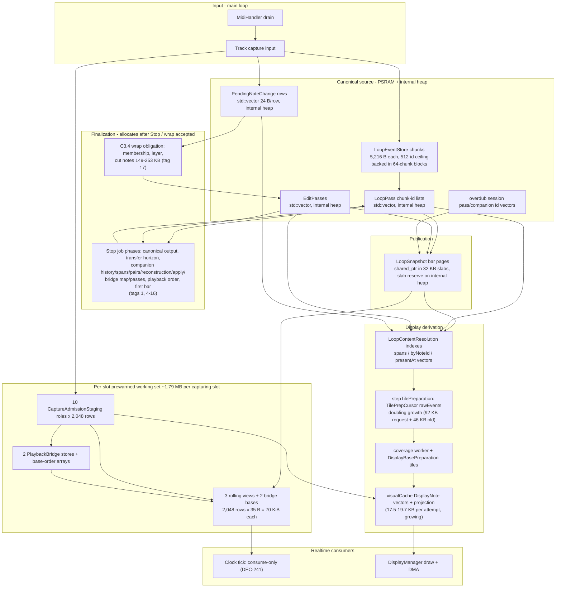
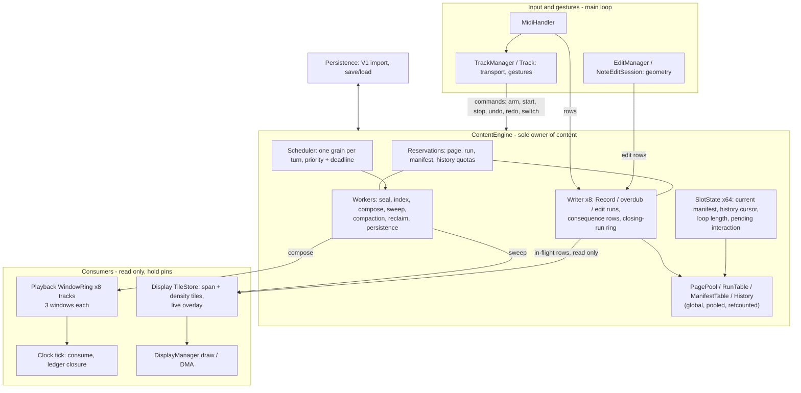
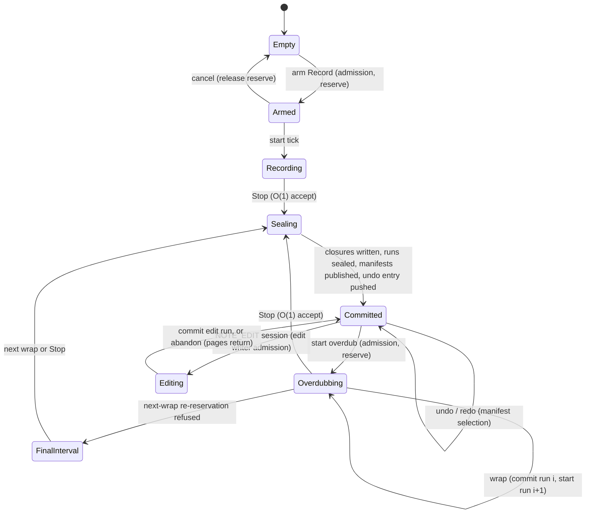

# Fixed-memory MIDI engine — direct cutover plan

Status: **revision 2, plan for owner review. No production code.** Revision 1 (staged, one routed track, legacy
coexistence) is withdrawn by the owner's "direct end-state cutover" ruling of 2026-11-04:
- no legacy/new coexistence, dual-writing, compatibility fallbacks, per-track routes or bridging;
- intermediate firmware may be RED or unbootable;
- one coherent architecture built on `RevisionStore`;
- Git history, tests, evidence, musical contracts and proven algorithms are kept; components that conflict with the
  target are deleted, not wrapped.

C3.4 / DEC-251 containment work stays paused (DEC-250 — wrap obligation off the Clock, DEC-251 — non-fatal
tile-preparation allocation); both mechanisms are deleted by this plan. Not authority: approval records a `DEC-###`
and an OpenSpec change (§ 12).

Contents:
1. Current state (input evidence)
2. Target invariants and supported workload
3. Module boundaries and ownership
4. Boot-time memory budgets (PSRAM, RAM2, RAM1)
5. Pages, reclamation and source pinning
6. Event encoding and the consequence-reservation proof
7. Composition and worker scheduling bounds
8. Record / overdub / Stop / undo / redo state transitions
9. Playback and display consumer contracts
10. Implementation milestones
11. Final acceptance gates
12. Reuse / delete, DEC disposition, owner decisions

Evidence base: intense lane-cadence run on DEC-251 image `3b95b40e…` (`captures/session_20261104_190805.log`);
B.5b session high-water; stage A/B `RevisionStore` qualification; ELF section and symbol sizes of `3b95b40e…`;
`RevisionStore` struct sizes compiled with the Teensy toolchain (32-bit).

---

## 1. Current state (input evidence)

### Why the current model cannot be bounded

1. **Every derived representation copies content into its own growable container.** One accepted note is held as
   event-chunk rows, capture-staging rows, rolling-view rows, snapshot bar-page membership, `visualCache`
   `DisplayNote`s, tile-preparation `rawEvents`/layer, wrap-cut notes and stop-job canonical/companion buffers.
   Measured in the intense run: PSRAM grows about **240 B per accepted note** against 32–40 B of source rows, so
   roughly **6–7 simultaneous copies plus per-note indexes**.
2. **The derived copies are sized by content, not by window.** Several derivations widen to the whole loop under
   dense overdubs, and `std::vector` doubling makes the transient peak up to 3×.
3. **Accepted work allocates after acceptance.** Stop, wrap obligations, snapshot publication, undo entries and display
   rebuilds allocate after the interaction was accepted; at exhaustion they wait without end (Stop in
   `AtomicTransfer` for 176 s) or degrade (piano roll `win=0` for 55 beats).
4. **Two heaps run out independently.** PSRAM at about 200 s; the internal heap at its 4 KB floor from about 70 s.

The resource map below (from revision 1) is the input the end-state is sized against.

### 1.1 Resource and dependency map (revision 1, unchanged)

#### 1.1.1 Data flow and owners

Reading the arrows: each one is a **copy into a growable container owned by the receiving box**, except the
`TICK` and `PAINT` reads. Whether a consumer can serve depends on a chain of upstream derivations being current
(DEC-073 — coverage, not revision stamp; DEC-108 — windowed playback generation), each with its own retry and
fallback rules.

#### 1.1.2 Inventory: bounded vs unbounded terms

| # | Owner | Unit cost | Growth | Bound today |
|---|---|---|---|---|
| 1 | Event chunks | 5,216 B per chunk (256 × 20 B rows + header); a pass takes whole chunks | per pass | ceiling 512 chunks = 2.67 MB; ~5 KB waste per short pass (B.5b: 1,000 rows cost 63 chunks) |
| 2 | Chunk-id lists, bar index | 2–8 B per chunk/bar | `std::vector`, internal heap | no |
| 3 | Capture stagings | 10 roles × 2,048 rows per capturing slot | prewarmed at Record admission | fixed per slot (part of 1.79 MB) |
| 4 | Rolling views + bridge bases | 2,048 rows × 35 B = 70 KiB each, 5 per slot | prewarmed; DEC-243 — boot reserves the three rolling views per enabled slot | fixed per slot, × enabled slots |
| 5 | Bridges | 2,048 records + ~11 order/rank arrays | prewarmed | fixed per slot |
| 6 | `PendingNoteChange` | 24 B/row | `std::vector` per session, internal heap | no |
| 7 | `EditPasses` | per edit pass + id lists | `std::vector`, internal heap | no |
| 8 | Session pass/companion ids | 2–4 B/id | `std::vector` | no |
| 9 | `LoopSnapshot` | bar-page membership; 32 KB slabs; slab reserve 8 KB from internal heap | per published root, older roots while pinned | no — *measured* 292–378 KB here |
| 10 | Stop job (tags 1, 4–16) | O(rows of the session and its base) | allocates during `CanonicalOrder`…`DeferredCleanup` | no — tag 1 *measured* 336 KB at boot → 630 KB |
| 11 | C3.4 wrap cut (tag 17) | O(loop rows owed at the wrap) | per obligation, 2 slots | no — *measured* 166 KB live, 150,400 B + 78,560 B refused 42/41× |
| 12 | Content-resolution indexes | O(rows in derive window); the window widens to the loop | per derive | no |
| 13 | Tile preparation | 20 B per raw event, doubling | per tile; per-lane cursor | no — 92,160 B request + 46,080 B live at failure |
| 14 | `visualCache` / display projection | ~16 B per `DisplayNote` | per slot; projection rebuilt on refusal | no — request grew 17.5 → 19.7 KB across retries |
| 15 | `RevisionStore` shadow (probe image only) | 320 pages × 1 KiB | fixed | ≤ 0.5 MiB (DEC-246 — stage C reader cap) |
| 16 | Session capture ring (capture builds only) | 1 MiB | fixed | fixed |
| 17 | Undo (global + session) | entries + prepared publication | `std::vector`; depth 99 / 32 | no |

Codebase-wide: 522 `std::vector`, 49 `std::shared_ptr`, 34 `std::unordered_map`, 12 `std::map`, 3 `std::deque` uses;
the densest content-path files are `NoteUtils.cpp`, `LoopSnapshot.cpp`, `LoopContentResolution.cpp`, `EditApply.cpp`
and the NOTE_EDIT focus code.

#### 1.1.3 Measured timeline of the intense run (one slot, track 8 slot 4, 300 BPM)

| Time | PSRAM live | Internal heap free | What happened |
|---|---|---|---|
| 10 s | 4,459 KB (260 blocks; > 128 KB: 1,381 KB, 32–128 KB: 1,879 KB in 45 blocks) | 172 KB | after boot restore; includes the 1 MiB capture ring; the 32–128 KB class is *inferred* to be mostly DEC-243 boot views (~215 KB per enabled slot) |
| 40 s | 6,946 KB | 96 KB | Record admission prewarm (~1.79 MB) + take |
| 70 s | 7,232 KB | → 4 KB | first `snapshot_reserve` refusal (internal heap) at 69.3 s |
| 175 s | ~7,810 KB | 4 KB | first wrap-cut refusal (150,400 B) |
| 200 s | 7,876 KB (high 8,032 KB) | 4 KB | pool at its ceiling; DEC-251 refusals instead of the old abort |
| 209 s | 7,911 KB | 4 KB | Stop accepted → companion path skipped ("canonical derivation unavailable") → `AtomicTransfer` waits on the wrap obligation |
| 385 s | 7,866 KB | 4 KB | Stop still in `AtomicTransfer`; 396 `#MEM_DENIED`; piano roll `win=0` in 55 beats, 248 slow frames |

#### 1.1.4 Duplication of the same content

| Copy | Lifetime | Retires when |
|---|---|---|
| chunk rows (canonical) | slot lifetime | pass deleted |
| capture staging rows (live + frozen roles) | interval → stop finalization | role released after finalization |
| rolling views / bridge bases | per window / per bridge | window retired; bridge base on bridge retirement |
| snapshot membership | per published root | last pin released |
| `visualCache` notes + projection | per slot | rebuild |
| tile-prep `rawEvents` + layer + notes | per tile step | tile done (DEC-251 releases early) |
| wrap cut | per obligation | sealed |
| stop canonical output / companion history | per stop job | job retired |
| RevisionStore pages (probe only) | per import | re-import |

#### 1.1.5 Source retention that blocks reclamation

- A **pinned snapshot root** keeps its bar pages and the chunks they reference while any reader or bridge holds it.
- **Frozen capture stagings** stay until finalization releases the role; a stuck finalization holds them forever.
- **Stop job prepared companion horizons** survive a superseded base (`restoreSupersededPreparedCompanionHistory`).
- **Wrap obligations** keep the interval's pending set and cut until sealed; a refused cut keeps everything.
- **Undo entries** keep passes, edit passes and prepared publications for depth 99.
- **Chunk refcounts** keep a chunk while any pass, snapshot or persistence job names it.

#### 1.1.6 Allocations after Stop has been accepted

From the allocation tags (scoped to these phases) and the growth sites in the stop, publication and undo paths:

1. stop job: canonical output, transfer horizon, companion history, playback order, reset pass timeline, prepare
   first bar, companion pair lookup / spans / reconstruction / apply / bridge map / passes, canonical pass inputs
   (tags 4–16, in `TrackOverdubLifecycle.cpp`, `TrackPlaybackRuntime.cpp`, `TrackPlaybackWindowBuild.cpp`,
   `TrackCaptureInput.cpp`);
2. C3.4 wrap cut for the stopping session's owed obligations (tag 17), which `AtomicTransfer`/`DeferredCleanup`
   wait on (DEC-250);
3. snapshot publication of the stopped revision (slab pages; 8 KB slab reserve on the internal heap;
   45 growth sites in `LoopSnapshotPublish.cpp`);
4. `EditPasses` / session id vector appends and the session-exit receipt;
5. the undo entry (`TrackUndo.cpp`, 9 growth sites; protected undo prewarm is the only reserved part);
6. `visualCache` / display projection rebuild for the new revision;
7. persistence queue staging for the save.

Every item can be refused after the user's Stop was accepted. DEC-078 (every interaction is accepted) holds only
because the work is allowed to wait, and under exhaustion it waits without end.

---

## 2. Target invariants and supported workload

The ten owner invariants (I1–I10) are the acceptance definition. They are restated where each is discharged:

| | Invariant | Discharged in |
|---|---|---|
| I1 | All MIDI content and edit history in fixed PSRAM pages, immutable runs, versioned manifests | § 5, § 6 |
| I2 | No dynamic content-path heap allocation after boot | § 4, gate H2 |
| I3 | Record, overdub, NoteOff, wrap, Stop, undo, redo fully accounted and pre-reserved | § 6.3 |
| I4 | Stop acceptance O(1); completion bounded, never waits for allocation | § 8.3 |
| I5 | Playback only from qualified moving windows, deterministic succession, source identity | § 9.1 |
| I6 | Piano roll from independent fixed raster/density tiles; never blanks on delay or exhaustion | § 9.2 |
| I7 | Clock path: no content-sized work, scans, allocation or historical resolution | § 9.1, gate H5 |
| I8 | Deferred workers bounded, with progress or a defined capacity outcome | § 7.3 |
| I9 | Budget fits the hardware under the worst supported workload | § 4 |
| I10 | Musical behavior equivalent to the ratified DEC contracts | § 10 E0, gate H1 |

**Supported workload W** (every bound below is computed for W; anything beyond W gets a named capacity outcome at
admission, never a failure after acceptance). Values are proposals for the owner (§ 12.3):

| Parameter | W |
|---|---|
| Tracks × slots | 8 × 8 = 64 slots |
| Concurrent writers (Record / overdub / NOTE_EDIT) | 8 (one per track) |
| Loop length | ≤ 64 bars (49,152 ticks at 768 ticks/bar) |
| Tempo | ≤ 300 BPM (2 bars = 1.6 s) |
| Committed source rows, all slots and history | ≤ 131,072 (today's admission ceiling) |
| Live runs, all slots and history | ≤ 512 |
| Committed runs per manifest | ≤ 60 (+ ≤ 3 writer runs = 63, inside the 6-bit merge key) |
| Hidden note ids per manifest | ≤ 4,096 |
| Effective rows per 2-bar window | ≤ 2,048 (DEC-108 — window admission limit `L`) |
| Source rows per 2-bar window (incl. hidden) | ≤ 8,192 |
| Open notes per writer | ≤ 128 (`ActiveNoteLedger::kMaxOpenNotes`) |
| Undo history | 99 global entries (configurable 8–512), 32 per NOTE_EDIT session |
| Playing tracks | 8 (one slot each) |
| Displayed piano roll | 1 focused slot + 1 successor; detailed window ≤ 16 bars |

---

## 3. Module boundaries and ownership

| Module | Owns | May call | Never |
|---|---|---|---|
| `ContentEngine::PagePool` | pages, free stack | — | resize; heap |
| `ContentEngine::RunTable` / `ManifestTable` / `History` | runs, manifests, undo entries (global pools, refcounted) | PagePool | per-slot tables (today's `StoreCore` is 49,592 B per slot; × 64 does not fit) |
| `ContentEngine::Reservations` | every quota counter in § 6.3 | — | grant past a reserve |
| `ContentEngine::Writer` (×8) | the active run, ≤ 2 closing runs, open-note ledger, consequence generation (overlap-resolve, ledger, C1 owed pitches) | PagePool via Reservations | allocate after acceptance |
| `ContentEngine::SlotState` (×64) | current manifest, history cursor, loop length, one queued interaction | ManifestTable | read pages |
| `ContentEngine::Workers` + `Scheduler` | job cursors, boot scratch | engine tables | run on the Clock path |
| `Playback::WindowRing` (×8) | 3 window buffers, stamps | — (filled by the compose worker) | read pages; compose |
| Clock tick (`ClockManager` → `Track` playback) | sounding ledger | WindowRing | anything content-sized |
| `Display::TileStore` | span tiles, density tiles, overlay | — (filled by the sweep worker and the writer overlay) | read pages on the draw path |
| `Persistence::EngineIo` | file cursors, I/O scratch | engine tables | write user files outside the save rule (§ 12.3) |
| `TrackManager` / `Track` | transport, gesture routing, interval timing | engine commands | touch content |
| `EditManager` / `NoteEditSession` | edit geometry over a fixed selection | edit writer | own content |

Rule: only `ContentEngine` mutates pages, runs and manifests; consumers read prepared outputs and hold pins; the Clock
reads only `WindowRing`.

---

## 4. Boot-time memory budgets

All regions are carved once at boot, sized by `constexpr`, checked by `static_assert` and reported by one
`#CAP,MEM_REGION` census row per region. After boot no content-path code calls `malloc`, `new`, `extmem_malloc` or a
growing container.

### 4.1 PSRAM (measured pool 8,376,828 B = 8 MiB − 11,776 B `.bss.extram` statics)

| Region | Bytes | Sizing |
|---|---|---|
| Page pool data | 4,096,000 | 4,000 pages × 1,024 B (64 rows × 16 B) — split in § 5.1 |
| Page free stack | 8,000 | 4,000 × 2 B |
| Playback windows | 786,432 | 8 tracks × 3 windows × 2,048 rows × 16 B |
| Display span tiles | 337,920 | (2 slots × 64 bars + 4 spares) × 2,560 B |
| Display density tiles | 262,400 | 64 slots × 64 bars × 64 B + 4 spares |
| Live overlay raster | 8,192 | 256 × 64 px × 4 bit |
| Worker scratch | 58,368 | persistence 2 × 16 KiB, import 16 KiB, sweep carry 16 ch × 128 pitch × 4 B, merge heap 64 × 16 B |
| **Engine total** | **5,557,312** | |
| Session capture ring (capture builds only) | 1,048,576 | existing |
| Non-content residual (SD, USB, storage library), declared ceiling | 1,048,576 | measured by milestone E1's census; today it is inside the 4.46 MB boot figure |
| **Total, capture build** | **7,654,464** | margin **722,364 B** |
| Total, shipping build | 6,605,888 | margin 1,770,940 B |

Retired relative to today: event chunks (up to 2.67 MB), per-slot capture stagings, rolling views and bridges
(~1.79 MB per capturing slot; DEC-243 boot views ~215 KB per enabled slot), snapshot slabs (≤ 378 KB measured), stop-job
buffers (630 KB tag 1 measured), wrap cuts, `visualCache`, tile preparation, content-resolution indexes.

### 4.2 RAM2 (DMAMEM, 524,288 B)

| Item | Bytes |
|---|---|
| Today's statics (`.bss.dma`) | 186,597 |
| − `RevisionShadow` `gShadow` (deleted) | −98,304 |
| − `RollingSuccessorProbe::gCounters` (deleted) | −4,920 |
| + RunTable 512 × 128 B (ceiling; today's `PassRun` is 84 B, grows with 16 inline pages) | +65,536 |
| + ManifestTable 256 × 148 B | +37,888 |
| + History ring 512 × 8 B | +4,096 |
| + SlotState 64 × 32 B | +2,048 |
| + Writers 8 × 1,024 B (open-note ledger, cursors, reservations) | +8,192 |
| + Window, tile and index-slot headers | +5,376 |
| **Statics after cutover** | **206,509** |
| Heap left for libraries (USB, SD, Serial) | 317,779 (today 337,568 arena, 172 KB free at boot) |

Content code never allocates from this heap (gate H2 traps it).

### 4.3 RAM1 (512 KiB: ITCM + DTCM)

Today (`3b95b40e…`, succprobe): DTCM variables 96,224 B; ITCM 393,216 B (code 392,040 + padding 1,176); free for
locals 34,848 B.

| Budget (enforced by the build gate) | Value |
|---|---|
| DTCM variables | ≤ 96,224 B (no growth; engine counters on the hot path ≤ 2 KiB, paid for by deleted statics) |
| ITCM | ≤ 393,216 B (12 banks), padding ≥ 840 B (existing floor) |
| Free for locals | ≥ 34,848 B |
| Engine hot code in ITCM | append, NoteOff, wrap handover, window consume, tick; everything else `FLASHMEM` |

ITCM is expected to shrink: the hot parts of the snapshot, stop-job, overlay and window-builder code are deleted. The
exact final numbers are recorded at milestone E8 against these ceilings.

---

## 5. Pages, reclamation and source pinning

### 5.1 Page pool split (4,000 pages)

| Part | Pages | Bound it serves |
|---|---|---|
| Content quota | 3,072 | 131,072 rows / 64 = 2,048 full pages + ≤ 2 partial pages (Midi + hide region) × 512 live runs |
| Directory reserve | 256 | runs beyond 16 inline pages: ≤ 3,072 / 17 Midi + hide directories |
| Writer reserve | 64 | 8 writers × 8 pages (§ 6.3) |
| Compaction reserve | 256 | one history-closed range in flight (design D5c) |
| Edit-index reserve | 352 | 11 index slots × 32 pages (4,096 hidden ids × 8 B) |

Pages are non-contiguous (design D0); acquire and release are O(1) on the free stack.

### 5.2 Reference counting and reclamation

- A **run** counts the manifests that list it; a **manifest** counts history entries, slot currents, writer bases and
  reader pins (design D6).
- When a count reaches zero the object is queued for the **reclaim worker**, which returns its pages in grains of 64.
  Nothing is freed on the Clock path or inside a command.
- Pages return only through reclamation (released runs, dropped redo branches, aged undo history, superseded
  compaction inputs). There is no other way content memory comes back, and no way it grows.

### 5.3 Source pinning

| Holder | Pins | Released when |
|---|---|---|
| Slot current | 1 manifest | next commit / undo / redo selects another |
| History entry | 1 manifest | entry evicted (depth) or redo branch dropped |
| Writer | its base manifest P (the interval's immutable source cut) | its last closing run seals |
| Playback window | the manifest it composed + the open-run prefix ordinal | window retired at succession |
| Display tile | the manifest it swept | tile replaced |
| Worker job | its source manifest | job ends or is superseded |

Pins per consumer are fixed (24 windows, 2 swept slots, ≤ 4 jobs), so the ManifestTable bound is: 64 currents + 99
history + 32 edit-session + 16 writer (base + next) + 30 pins ≤ 241 ≤ 256.

---

## 6. Event encoding and the consequence-reservation proof

### 6.1 Rows (16 B, `PassEvent`, unchanged)

`tick u32 | noteId u32 | seq u32 | status u8 | data1 u8 | data2 u8 | origin u8`. Two regions per run:
- **Midi rows** (NoteOn, NoteOff, CC, pitch bend, program, aftertouch), kept as ≤ 8 sorted segments while appending
  (design D5b);
- **HideNote rows** (`noteId` target), sorted by noteId at seal. A hide applies to every earlier run (design D4); a
  replacement is a Midi row with the same `noteId` in the hiding run.

Overlap-resolve outcomes per affected earlier note `e` (port of today's rules, DEC-030 / 031 / 033 / 034):
`Hide` = 1 row; `Shorten` = hide + replacement NoteOn + NoteOff = 3 rows. So **c_max = 3 rows per affected note.**
SysEx stays unsupported (design Q6).

Playback window rows use the same 16-byte layout; `seq` carries the composed rank (DEC-244 — equal-tick order).

### 6.2 What every accepted input can cost

| Accepted | Immediate rows | Owed later | Owed rows are reserved |
|---|---|---|---|
| Writer admission | 0 | closure for ≤ 128 open notes; next-wrap run start | at admission |
| NoteOn | 1 | its NoteOff (1); consequences at NoteOn for earlier notes sounding at that pitch (≤ 3 each) | at acceptance, before the row is written |
| NoteOff of an open note | 1 (from its reservation) | — | already |
| Consequence discovered during a hold (an earlier note starting inside the new note's span) | ≤ 3 | — | at discovery, before the condition is entered |
| Other channel messages | 1 | — | at acceptance |
| Wrap | 0 rows; 1 manifest slot + 1 run descriptor + next run's first pages | next wrap's start | the next wrap is re-reserved at each wrap |
| Stop | ≤ 128 generated NoteOffs | seal, publish, undo entry | all already held |
| Undo / redo | 0 | reclamation of a dropped redo branch (frees only) | n/a |

### 6.3 Reservation invariant and proof

Counters (all in `Reservations`, all O(1)):
- `F` = free pages; `Rg` = global reserved pages (directory 256, compaction 256, index 352);
- per writer `w`: `Hw` = free rows inside pages the writer already holds, `ow` = open notes, `Kw` = consequence rows
  reserved but not yet written; `Nw` = next-wrap reservation held (bool);
- `Ms`, `Rs` = free manifest slots and run descriptors, with reserved counts `Mr`, `Rr`.

**Invariant R:** `F ≥ Rg` and, for every writer, `Hw ≥ ow + Kw`; `Ms ≥ Mr`, `Rs ≥ Rr`.

Every operation checks before it mutates and is all-or-nothing:

1. **admit(w):** requires `F − Rg ≥ 8`, `Ms − Mr ≥ 2`, `Rs − Rr ≥ 2`. Moves 8 pages into `w` (so `Hw` = 2 pages of
   closure rows + current page + hide page + directory margin + next-wrap first pages), reserves 2 manifest slots
   (this interval's commit, next wrap's commit) and 2 run descriptors. Otherwise a named denial before arming.
2. **NoteOn(n):** let `c` = rows of its immediate consequences (`≤ 3 × sounding earlier notes at that pitch`). Requires
   `ow < 128` and `Hw − (ow + Kw) ≥ 2 + c`; if short, take one page from `F − Rg` (if `≥ 1`). Then write the row,
   `ow += 1`, write the immediate consequences. Otherwise the NoteOn is refused by name (capacity latch, § 8.5). R holds:
   `Hw` drops by `1 + c` and the requirement `ow + Kw` grows by 1, with `2 + c` checked.
3. **NoteOff(n open):** writes 1 row, `ow −= 1`. `Hw − 1 ≥ (ow − 1) + Kw` follows from R. **Never fails, never acquires.**
4. **Consequence during a hold:** requires `Hw − (ow + Kw) ≥ 3` or one page from `F − Rg`. If neither, the new note
   `n` is closed at this tick with its reserved NoteOff (so it no longer overlaps `e`, and no consequence is owed) and
   the writer latches. R holds in both branches.
5. **Wrap:** commits the active run with the reserved slot and descriptor, starts the next run on the held next-wrap
   pages, then re-reserves the following wrap (`F − Rg ≥ 2`, one slot, one descriptor). If that fails the writer
   enters **FinalInterval**: at the next wrap it stops as in 7 (named outcome). Nothing accepted is lost.
6. **Seal:** sorts the hide region in place. No rows, no pages.
7. **Stop:** writes `ow` closure NoteOffs (`≤ Hw` by R), seals (6) and publishes with the reserved slot, pushes the undo
   entry into the history ring (eviction of the oldest entry is the normal depth rule), returns unused pages and
   reservations. **No step acquires anything, so Stop cannot wait for memory.**
8. **Undo / redo:** move the history cursor and the slot's current pin. A commit after undo drops the redo branch:
   refcounts fall, pages return through reclamation. Frees only.
9. **Workers:** compaction uses its 256-page reserve and the index builder its 352; neither ever touches writer pages or
   `F − Rg`, so a stalled worker cannot block a writer and a writer cannot starve a worker below its reserve.

By induction over these operations R holds at every step, and every owed row has a reserved home before the input that
owes it was accepted (I3). Gate H3 fuzzes this.

---

## 7. Composition and worker scheduling bounds

### 7.1 Window composition

Input: manifest M (≤ 60 runs) plus the writer's open-run prefix (≤ 3 runs) → ≤ 63 runs, each ≤ 8 sorted segments.
Output: ≤ 2,048 effective rows for one 2-bar window, in DEC-244 order.

| Step | Bound |
|---|---|
| Seek every segment to the window start | ≤ 63 × 8 × ⌈log2 131,072⌉ = 8,568 comparisons, one grain |
| Merge | ≤ 8,192 source rows × ⌈log2 63⌉ = 6 heap steps |
| Hide test per row | edit index, ≤ ⌈log2 4,096⌉ = 12 comparisons |
| Total per window | ≤ 8,568 + 8,192 × 18 = 156,024 comparisons; **≤ 64 grains of 128 source rows + 1 seek grain** |

The edit index for M is built once per manifest identity: ≤ 4,096 entries, 256 per grain (1.12 ms measured, B.5d) →
≤ 16 grains.

### 7.2 Display sweep

Sequential over the loop with a carry table of open notes (≤ 16 ch × 128 pitches), so notes crossing bars are clipped
correctly per bar. Per slot ≤ 64 bars × 4,096 source rows = 262,144 rows → ≤ 2,048 grains. Each finished bar swaps
its tile atomically.

### 7.3 Scheduler

One grain per main-loop turn, from the highest-priority ready job. Target grain ≤ 500 µs; device-measured.

| Priority | Job | Grain | Worst job |
|---|---|---|---|
| 1 | Seal of an owed commit | 256 swaps | per-run hides ≤ 4,096 → ≤ 192 grains |
| 2 | Edit index for a manifest a window needs | 256 entries | 16 grains |
| 3 | Compose the next window of a playing track (earliest deadline first) | 128 rows | 65 grains |
| 4 | Display sweep: focused slot, visible bars first in loop order from the carry start | 128 rows | 2,048 grains per slot |
| 5 | Persistence | 16 KiB I/O | file-size bound |
| 6 | Compaction | 256 rows | range-size bound |
| 7 | Reclamation | 64 pages | run-size bound |

**Deadline proof (playback):** each playing track needs its next window within one window period. Worst case per
period: 8 tracks × 65 grains = 520 grains, plus one index (16) and one owed seal on a commit. At 300 BPM a period is
1.6 s, so 536 grains fit if the main-loop turn is ≤ 2.98 ms with one grain each — the engine then uses ≤ 17 % CPU at
500 µs grains. Gate D4 measures grain time and turn period. A missed deadline beyond W is a named miss, never a
fallback.

**Progress (I8):** every job has a step counter and a declared worst-case step count (table above). Each owed item
either completes within it or ends in a named outcome (`CapacityDenied`, `Superseded`). The scheduler reports any job
whose steps exceed its bound.

---

## 8. Record / overdub / Stop / undo / redo state transitions

### 8.1 Slot and writer states

### 8.2 Record

- **Arm:** admission (§ 6.3 step 1) or a named denial; nothing is half-started.
- **Recording:** rows append to run R0; NoteOn/NoteOff per § 6.3. The Clock plays the take through windows composed
  over (base manifest = empty, open run R0 prefix).
- **Stop:** sets the loop length from the stop tick, writes closures by today's Record-stop closure rules (DEC-136 /
  137 / 138 — held-leg Stop terminals), seals, publishes manifest M1 = {R0}.

### 8.3 Overdub and wrap

- **Start:** admission pins the base manifest P (the interval's source cut, immutable by construction).
- **Writing:** rows and consequences go to the active run; consequences are computed against P plus the writer's own
  rows (DEC-250 cut rule: records before P visible, P's and later excluded) using windowed composition, never
  whole-loop.
- **Wrap** (DEC-069 — the wrap is a revision transition; DEC-051 — the wrap seals at loop end): constant-time
  handover. The active run becomes a *closing run* if it still has open notes, otherwise it seals at once. A closing
  run keeps accepting only its own NoteOffs and their consequences (DEC-250 — late companions belong to the
  originating record P) and seals when its last note closes. Manifests publish in run order.
- **Closing ring full (2 closing runs):** the wrap's commit is owed (DEC-069 owed commit): the active run continues
  across the wrap as a new segment, and the revision is not advanced until the ring has room. Bounded by 8 segments per
  run, after which the run seals with its counted commit-time sort (design D5b).
- **C1 owed pitches:** NoteOn/NoteOff on a pitch owed by a closing run is deferred exactly as today's C1 rule, inside
  the writer, with no separate obligation queue.

### 8.4 Stop

- **Acceptance, O(1):** record the stop tick, close input for this interval (DEC-233 — input closes independently of
  finalization), mark the writer `Sealing`. The user's gesture is done (DEC-078).
- **Completion, bounded:** ≤ 128 closure rows, seal of ≤ 3 runs (≤ 192 grains each), ≤ 3 manifest publishes, 1 undo
  entry. **≤ 128 + 3 × 192 + 4 = 708 grains, from reserved resources only** (§ 6.3 step 7). At a 3 ms turn that is
  ≤ 2.1 s in the worst case; typical runs have few hides and seal in a few grains.
- Gestures arriving while `Sealing` follow DEC-096 (slot gestures during pending finalization select, they do not undo
  or clear), queued one per slot in `SlotState`.

### 8.5 Capacity latch

When a NoteOn or a consequence cannot be reserved, the writer latches: new NoteOns are refused by name; open notes still
close; the take stays valid and every accepted row is kept. Whether the pass then continues for NoteOffs only or ends
at the next wrap is an owner decision (§ 12.3).

### 8.6 Undo / redo

- Acceptance O(1): history cursor move and slot current swap (DEC-095 — one undo entry per interval; DEC-038 — wrap
  commit and session undo).
- Audible at the next window boundary once that manifest's windows are composed (§ 9.1).
- A new commit after undo drops the redo branch to the reclaim worker.
- Undo during `Sealing` is queued (DEC-096) and applies after the seal.
- NOTE_EDIT session undo (32) selects among the session's edit-run manifests; the session commit publishes one.
- Load rebuilds history from saved runs (DEC-088 — undo reconstructed from saved passes on load).

---

## 9. Consumer contracts

### 9.1 Playback

- **Window** = `{slot, manifest identity, open-run serial and append ordinal, loop length, index k, [start, end), rows,
  status}`. It is filled only by the compose worker and is immutable once `Complete`.
- **Succession is deterministic:** at a window boundary the tick switches to the prepared window whose stamp names the
  slot's current source and whose start equals the boundary. A new manifest (commit, undo, redo, switch) becomes audible
  at the first boundary after its window is `Complete`; § 7.3 bounds that to one window period.
- **Writer rows are audible on the next cycle** because windows compose over the open-run prefix; a row appended at
  tick t is composed long before the playhead returns to t, except in loops shorter than the two-window lead, which the
  geometry clamp (DEC-242 — length is window geometry) already handles.
- **Clock tick:** advance through due rows of the current window, emit, update the sounding ledger (DEC-148 — a NoteOff
  behind the served position ends the sounding instance; a closure the ledger no longer holds is suppressed), swap the
  window pointer at the boundary. Work is proportional to the rows due at this tick. No composition, scan, lookup into
  pages or allocation (DEC-241 — consume-only tick).
- **Capacity:** effective rows per window are counted at writer acceptance against `L` (DEC-108), so `OutputFull`
  cannot occur inside W.

### 9.2 Piano roll

- **Span tile** per (slot, bar): ≤ 256 note segments × 8 B (start, length, pitch, velocity, flags) + a 32 × 128 × 1-bit
  raster = 2,560 B, stamped `(manifest identity, sweep id)`. A bar with more than 256 notes draws its raster in a named
  **dense** state.
- **Density tile** per (slot, bar): 16 columns × 32 pitch bands × 1 bit = 64 B, for all 64 slots, maintained by the same
  sweep.
- **Draw rule:** for each visible bar, the span tile if the slot has one, else its density tile. Tiles are replaced
  only by a complete tile (atomic swap with a spare), so a delayed or starved sweep shows the previous content, a
  focus switch shows density at once and detail when swept, and exhaustion cannot affect drawing because nothing on the
  display path allocates (I6).
- **Live overlay:** writer rows for the visible bars are painted O(1) per appended row into an 8 KiB overlay raster;
  NOTE_EDIT selection draws from `EditManager` geometry.
- An empty slot is legitimately empty; a loaded slot always has density tiles, built during load before it becomes
  playable.

---

## 10. Implementation milestones (dependency order)

Branch `rewrite/fixed-memory-engine` from `feature/revision-manifest-prototype` at `7cc0901e`. Intermediate states may
be RED and unbootable; there is no scaffolding to keep them green. Each milestone is a series of small, reviewable
commits with its own host checks; the device is used from E8.

| # | Milestone | Depends on | Content | Host checks at the milestone |
|---|---|---|---|---|
| **E0** | Semantic oracle corpus | — | Before anything is deleted: run today's native model over a scenario set covering every musical DEC (§ 12.2) and record golden outputs (effective content per revision, emitted MIDI stream, undo/redo results, closure behavior) as data fixtures. Classify all 147 native suites as *semantic* (port) or *mechanism* (deleted with its component). | corpus reviewed; every musical DEC has ≥ 1 scenario |
| **E1** | Engine core and memory map | E0 | `ContentEngine` with global PagePool, RunTable, ManifestTable, History, SlotState, Reservations; boot region carve + census; allocation trap. Promote `RevisionStore` code; split `StoreCore`'s per-slot tables into the global pools. | conservation; invariant R under random admit/append/stop; zero allocation after init |
| **E2** | Writer | E1 | Record, overdub, NoteOff, wrap, closing ring, Stop, FinalInterval, latch; overlap-resolve, ledger and C1 ported as pure functions; `LanePairer` NoteOff attribution reused | corpus content parity for record/overdub/stop scenarios; H3 fuzz |
| **E3** | History and edits | E2 | undo/redo selection, redo drop, depth eviction; NOTE_EDIT edit runs and session undo; fixed-size selection in `NoteEditSession` | corpus parity for undo/redo and NOTE_EDIT |
| **E4** | Workers and scheduler | E1 | seal, index, compose, sweep, compaction, reclaim; scheduler with priorities and deadlines; per-job step bounds | H4 bounds; progress or named outcome for every job |
| **E5** | Playback | E2, E4 | `WindowRing`, succession, tick consumer, ledger closure; delete the snapshot readers, rolling-view builders, bridges and stagings | emitted-MIDI parity with the corpus; H5 tick-work bound |
| **E6** | Display | E4 | `TileStore`, sweep, overlay, renderer; delete `visualCache`, display projection, `DisplayBasePreparation`, the coverage worker, tile preparation, `LoopContentResolution` | H6 no-blank tests |
| **E7** | Persistence | E3 | V1 file import into runs (reuse `RevisionImport` / `LanePairer`); save per § 12.3 decision; history reconstruction (DEC-088) | round-trip; import parity on copies of the device card's files (read-only) |
| **E8** | Integration and deletion | E5, E6, E7 | wire `TrackManager` / `Track` / `EditManager` / `ClockManager` to engine commands; delete `LoopEventStore`, `LoopPass` lists, `LoopSnapshot`, stop job, `PendingNoteChange`, `EditPasses`, wrap obligation, `CheckedCapacity`, pressure reclaim; **first bootable image** | full native suite (remaining + ported) green; RAM1/RAM2 build gates |
| **E9** | Device bring-up | E8 | boot, census = budget, owner chain on track 8 slot 4 | — |
| **E10** | Final qualification | E9 | § 11 gates | all |

E1 → E2 → E3 and E1 → E4 are independent chains, so E4 can be built alongside E2/E3. The tests that verify deleted
mechanisms go with their component in the same commit, after E0 has captured their musical assertions.

---

## 11. Final acceptance gates

### Host

| Gate | Pass condition |
|---|---|
| H1 Semantics | 100 % of the E0 corpus: effective content per revision, emitted MIDI stream, undo/redo, closures |
| H2 No allocation | `operator new`, `malloc` and the PSRAM allocator trap after boot init across the whole corpus and fuzz: 0 calls |
| H3 Reservation | fuzz random accepted inputs and gestures at pool fill 0–100 %: invariant R at every step; every accepted NoteOn gets its NoteOff; every Stop completes in ≤ 708 grains; no failure after acceptance |
| H4 Workers | every grain within its declared rows/steps; every job completes or ends named within its bound |
| H5 Clock | instrumented tick touches only due rows; 0 engine or page calls from the tick |
| H6 Display | zero-budget sweep, exhausted pool, focus switch, undo: every visible non-empty bar drawn from a span or density tile on every frame |
| H7 Budget | `static_assert` per region; a fixture filled to every W limit runs the corpus |
| H8 Suite | full native suite green |

### Device (track 8 slot 4, authoritative HITL entry points)

| Gate | Pass condition |
|---|---|
| D1 Build | DTCM ≤ 96,224 B; ITCM padding ≥ 840 B; locals ≥ 34,848 B; RAM2 statics ≤ 206,509 B; PSRAM census = § 4.1 per region |
| D2 Boot | `boot_reset,crash=0`, `BOOT,load,ok`; the card's existing slots import and play; no file written before the owner's save decision |
| D3 Owner chain | HITL parity with the corpus |
| D4 Intense | lane-cadence intense at 300 BPM to W: 0 `MEM_*` refusal rows, PSRAM flat after boot, Stop complete within bound, piano roll 0 `win=0` beats and 0 blank frames, `tick_playback_miss` = 0, MIDI gaps ≤ the qualified baseline; grain time and turn period inside § 7.3 |
| D5 Saturation | drive past W: named capacity outcome, all accepted content kept, Stop completes |
| D6 Restore | reboot-restore parity; undo/redo on device |

---

## 12. Reuse, deletion, DEC disposition and owner decisions

### 12.1 Reuse vs delete

**Reused (moved into the engine or kept as is):**
- `RevisionStore`: `PassEvent`, `PagePool`, run append with sorted segments, seal, composition merge, edit index,
  compaction, `ManifestWindowCursor`, `RevisionImport`, `LanePairer`.
- `ActiveNoteLedger`, `ClockManager`, `MidiHandler`.
- `DisplayManager` drawing and DMA transport; `DisplayWindowUtils` geometry.
- `EditManager` geometry and `NoteEditFocus` (their vectors become fixed selections in E3).
- `StorageManager` queueing, budgets and SD I/O.
- `NoteUtils` order comparators.
- HITL, `#CAP` telemetry, the profiler.

**Deleted:**
- `LoopEventStore` and `LoopPass` chunk-id lists.
- `CaptureAdmissionStaging`, `RuntimePlaybackViewSet` views, bridges and bridge bases.
- `LoopSnapshot`, its slabs and publication; the merged fallback; overlay and frozen Record readers.
- `PendingNoteChange`, `EditPasses`, session id vectors.
- The stop job's canonical and companion phases (`TrackPreparedStopCommit` phases, `RuntimeCompanion*`,
  `RuntimeCanonicalPassInputs`).
- `LoopWrapObligation` and the C2 flip journal (DEC-250 mechanism); `CheckedCapacity` and DEC-251's checked growths.
- `MemoryMonitor` pressure and reclaim (reporting kept).
- `visualCache`, display projection, `DisplayBasePreparation`, coverage worker, `stepTilePreparation`,
  `LoopContentResolution`.
- `RevisionShadow`, the probe routes and `RollingSuccessorProbe`.
- `ExternalMemoryFirstAllocator` / `InternalHeapFirstAllocator` on content paths.
- `Loop` shrinks to a slot facade over `SlotState` or goes entirely.

### 12.2 DEC disposition

- **Musical — kept, each with E0 corpus scenarios:**

  | DEC | Short name |
  |---|---|
  | DEC-030 | sticky overlap end of participation |
  | DEC-031 | overlap pending buffer encoded to the edit pass |
  | DEC-033 | overlap ignores per-note channel |
  | DEC-034 | overlap shorten seals at the user commit |
  | DEC-038 | wrap commit and session undo |
  | DEC-051 | wrap seals at loop end |
  | DEC-068 | a session belongs to one interval |
  | DEC-069 | wrap is a revision transition |
  | DEC-078 | every interaction accepted |
  | DEC-088 | undo from saved passes on load |
  | DEC-095 | one undo entry per interval |
  | DEC-096 | gestures during pending finalization select |
  | DEC-136–138, DEC-144 | held-leg Stop terminals |
  | DEC-148 | closure by served position |
  | DEC-233 | Stop closes input independently |
  | DEC-244 | equal-tick order |
  | DEC-245 | lossless source |
  | DEC-108 | window admission limit `L` |
  | DEC-241 | consume-only tick |
  | DEC-250 | the semantic rules only: late companions to P, cut rule, C1 owed pitches |

- **Mechanism — superseded by the cutover, recorded as such in the new DEC:**

  | DEC | Short name |
  |---|---|
  | DEC-047 | bounded wrap publication |
  | DEC-049 | stop accelerates publication |
  | DEC-055 / DEC-056 | NOTE_EDIT overlay on snapshot |
  | DEC-058 | runtime-owned views |
  | DEC-063 | protected stop undo publication |
  | DEC-066 | stop working-set capacity |
  | DEC-070 / DEC-071 | stop retarget, stale-root view |
  | DEC-073 | snapshot coverage |
  | DEC-076 | role-owned working sets |
  | DEC-102 / DEC-106 | switch occupancy owner |
  | DEC-161 / DEC-164 / DEC-166–168 / DEC-172 / DEC-173 / DEC-176 | stop-job variants |
  | DEC-243 | boot view reservation |
  | DEC-246 | the probe routing part only |
  | DEC-250 | the obligation queue and cut |
  | DEC-251 | checked growths |

- E0 completes this classification for all 253 entries. A DEC that mixes both kinds keeps its musical clause.

### 12.3 Owner decisions before E1

1. **Supported workload W** (§ 2), in particular 8 concurrent writers, 64-bar loops, 300 BPM, 512 live runs, 60 runs
   per manifest, 4,096 hidden notes per manifest.
2. **Capacity latch:** after a refused NoteOn, keep the pass open for NoteOffs only, or end it at the next wrap.
3. **Undo history under pool pressure:** keep 99 and refuse new writers (default), or age history out (named).
4. **Save format:** write a new run/manifest format (older firmware can no longer read saved slots; V1 import stays for
   the card's existing files), or keep writing V1 from runs. Either way the first device boots import read-only until
   you approve saving.
5. **Dense bars:** draw the raster in a dense style beyond 256 notes per bar, or another rendering.
6. **Record:** a new `DEC-###` "one bounded content engine" superseding the mechanism DECs, and a new OpenSpec change
   for the cutover (`revision-manifest-prototype` closes as its investigation).
