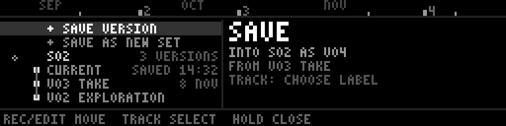
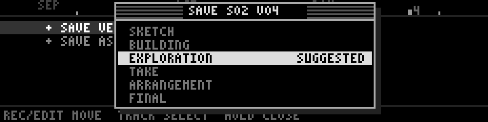
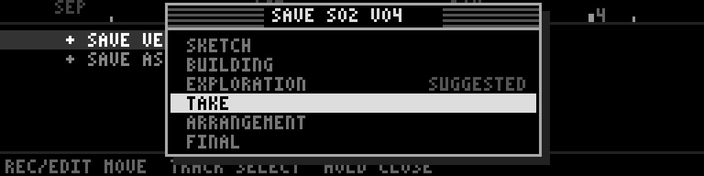
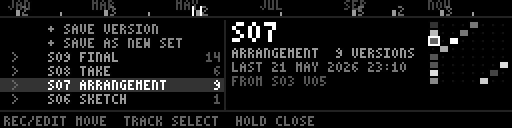
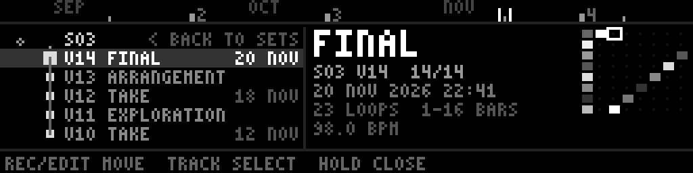
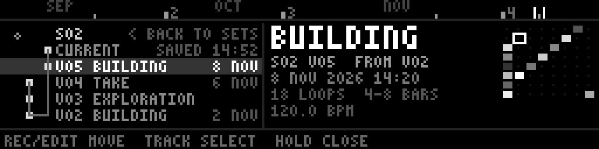
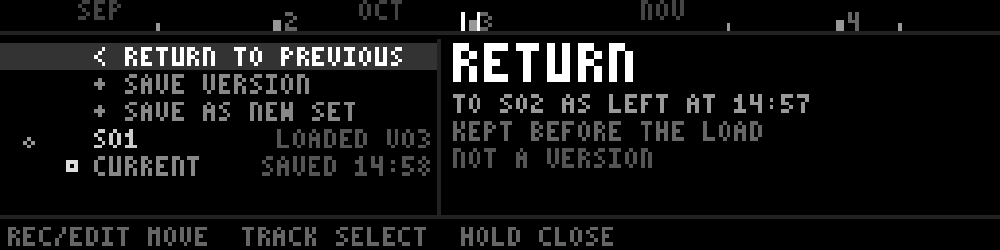
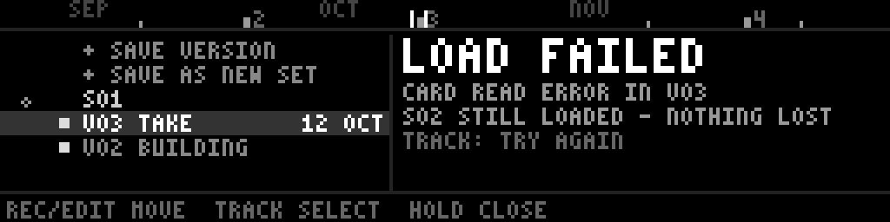

# Engine sets browser: musical milestones, background recovery, timeline (proposal, revision 2)

Status: proposal for the owner (2026-11-08), not implementation authority. Revision 2 follows the owner's brief on the
musical workflow, labels and usability goals; it replaces revision 1 (actions "above CURRENT" drawn below the list,
Play/Stop as select, Set / Version modes). Interaction paths come first; implementation slices last.

## 1. The workflow and its labels

A set holds the whole journey: build source loops → explore by playing → capture loops and takes → develop an
arrangement → keep a final version. Jams and their loops stay inside the set; **Save as new set** starts an alternative
direction and records its origin.

Each manual version carries one label, chosen when it is saved and never changed afterwards:

| Label | Meaning |
|---|---|
| Sketch | an initial idea worth keeping |
| Building | developing the source loops and parts |
| Exploration | trying combinations, variations and directions |
| Take | a captured result worth returning to |
| Arrangement | shaping the material into a song structure |
| Final | the final version of the song |

Labels are milestones, not a pipeline: versions skip or revisit them, and a spontaneous take may be Final at once.
Ancestry and labels are independent — a branch may hold a Sketch, a Take or a Final.

## 2. Saving: the suggestion is highlighted, confirming it is one press

The save popup lists all six labels with a **suggested** one highlighted. Confirming takes one Track press; choosing
another is Record / Edit first. The suggestion keeps a `SUGGESTED` marker when the highlight moves.

Suggestion, from what the engine actually observed since the set's last manual save (opening screens counts for
nothing; a suggestion never creates a version and never relabels one):

| Observed since the last save | Suggested |
|---|---|
| the set has no version yet | Sketch |
| a Record take ended while another track played (playing captured as a take) | Take |
| loops recorded or overdubbed, notes edited (NOTE_EDIT), loops created, resized or rotated | Building |
| only launches, slot switches, mutes and solos — existing loops combined, nothing new | Exploration |
| — (the engine has no arrangement features yet; suggested once one exists) | Arrangement |
| — (never suggested; a choice) | Final |

Priority when several apply: Take, then Building, then Exploration. With nothing observed since the last save, the
previous version's label is suggested.

## 3. The goals, in order, and what serves each

1. **Protect ongoing work automatically** — the engine's store (below); no button.
2. **Save a milestone quickly** — hold Track, Track, Track (open on `+ SAVE VERSION`, open the popup, confirm).
3. **Find and load the right starting point** — sets collapsed to one row each, labelled with the furthest label
   reached; a set opens to its versions with labels in the list and a large label in the details.
4. **Return after loading the wrong thing** — `< RETURN TO PREVIOUS` is the first row after a load, one press.
5. **Develop alternatives without losing work** — real parent records; loading an older version and saving forks.
6. **Understand history visually** — the timeline strip (when) and the local graph (what developed from what).

## 4. Autosave versus musical history — checked against the engine

* **Engine (as built, DEC-253):** the working set lives in `/MidiLooper/engine/store.bin`; each changed slot is written
  sector by sector to the copy that is not current (A / B), only after saving is approved; at boot every slot's later
  valid copy loads, so an interrupted write falls back to the previous copy. The engine reports pending / writing /
  failed (`Persistence::unsaved`, `writing`, `stats().saveFailed`, the status band's dots). It keeps no versions and
  no checkpoints, and does not record the time of a completed write (needed for `SAVED 14:32`: to add).
* **Shown as:** one hollow endpoint `CURRENT` with `SAVING`, `SAVED 14:32` (the RTC time of the last completed write),
  `UNSAVED` (changes pending) or `NOT SAVED !` (a write failed). No rows, no timeline marks.
* **Before a load:** the working set is copied into a recovery checkpoint (a full copy, not a version, not a set),
  which `< RETURN TO PREVIOUS` loads. Retention: the latest 4 (a proposed default, open). Older checkpoints are reached
  through a `RECOVERY` row at the end of the set list, which opens like a set.
* **Legacy differences:** legacy "auto-save before load" (`StorageManager.cpp`, `saveNewSetInternal`) wrote a new
  *set* on every load from a changed workspace — not ported. Legacy's dirty prompt ("save then load / discard /
  cancel", `openspec/specs/revision-load`) is not needed: the checkpoint makes every load returnable. The legacy
  catalog (`/sets/S####/`) records no ancestry; the new library is a new folder (owner).

## 5. Screen hierarchy (256 × 64)

Musical identity first: the list shows the set and each version's label; the details pane shows the **label large**,
then supporting facts, each once:

* line 1: set, version, origin (`S02 V05  FROM V02`) — not repeated from the list row's wording;
* line 2: the full timestamp (`8 NOV 2026 14:20`), only here;
* line 3–4: `18 LOOPS  4-8 BARS`, `120.0 BPM`;
* the 8 × 8 mosaic (tracks × slots, brightness by note count, the slot playing at save time outlined) at the right.

Definitions: **LOOPS** = slots with content; **BARS** = the shortest to the longest loop length (`4-8 BARS`; one
value when all are equal; fractions under a bar as `3/4`). The list shows a date once per day, on the day's first row.
The timeline strip labels months once, merges overlapping saves into counted marks, keeps calendar spacing and
brackets the selection's mark; it follows the selection and has no cursor of its own.

## 6. Controls — one model, matching what is drawn

The list runs top to bottom: action rows (`< RETURN TO PREVIOUS` when there is one, `+ SAVE VERSION`,
`+ SAVE AS NEW SET`), then the sets. Record moves the highlight **up**, Edit **down** (assumed: Record sits above or
left of Edit; swapped if the hardware says otherwise). One selection; movement stops at both ends.

| Button | In the browser | In the save popup |
|---|---|---|
| Record / Edit | up / down, on press; held 400 ms: repeat at 8 a second | label up / down |
| Track, short (released < 600 ms) | select: open the save popup · open a set · `< BACK TO SETS` · load a version · return · open `RECOVERY` | confirm the highlighted label |
| Track, hold 600 ms | close (fires while held, nothing changes) | cancel the popup |
| Play/Stop | transport, as everywhere — stops at once | transport |
| encoder (when present) | turn = Record / Edit; push = Track short | the same |

* **Single versus double:** inside the browser no button has a double. Record / Edit act on press, Track acts on
  release before 600 ms — nothing waits for a second press. Outside the browser double press keeps undo / clear / mute.
* **Two levels, no modes:** sets collapsed; Track opens one (its `< BACK TO SETS` row on top). A large library is
  crossed set by set (hold-repeat: 60 sets in under 8 s). Month / year jumps are deferred until a real library shows
  the need.
* **Opening and leaving:** a Track hold opens the browser from performance, NOTE_EDIT or LOOP_EDIT (the track
  switch's mute moves to the track button's double — owner, agreed). **Review:** an open edit is left on entry with its
  changes kept as one undo step, as a track switch does; the alternative is to refuse opening until the edit is left.
* **Loading:** refused while a take records or overdubs (`RECORDING - STOP FIRST`). **Review:** with the transport
  stopped the load is immediate; while it runs the destination loads in the background and switches in at the first
  bar line after it is ready (the row shows `LOADING`); the alternative is to stop the transport for a load.

## 7. Walkthroughs (frames at the panel's resolution and font)

| 1 Opened on SAVE VERSION | 2 Save popup, suggestion highlighted |
|---|---|
|  |  |
| **3 Another label chosen** | **4 Another set in a large library** |
|  |  |
| **5 A Final in a long history** | **6 Continuing from an earlier version (fork)** |
|  |  |
| **7 Return after an accidental load** | **8 A failed load** |
|  |  |

1. **Normal save with its suggested label** — hold Track (frame 1: `+ SAVE VERSION` selected, details say
   `INTO S02 AS V04`, `FROM V03 TAKE`) → Track (frame 2: popup, `EXPLORATION` highlighted and marked `SUGGESTED`,
   because only launches and mutes happened since V03) → Track: S02 V04 Exploration is saved, its mark joins the
   strip, `CURRENT` now hangs under it. Three presses after the hold.
2. **Choosing another label** — in the popup Edit once (frame 3: `TAKE` highlighted, `SUGGESTED` stays on
   Exploration) → Track.
3. **Another set in a large library** — hold Track → Edit past the actions onto the set rows (frame 4: one row a set
   with its furthest label and version count; the details show the set's latest version and mosaic) → hold Edit to
   run down → Track opens S07.
4. **A Take or Final in a long history** — in an open set the labels are the row text (frame 5: `V14 FINAL` selected,
   `FINAL` large, `14/14`; `^` above the lane: older versions continue above the view). "Which take did I like?" is
   answered by the TAKE rows and their mosaics; Track loads one.
5. **Continuing from an earlier version and forking** — load V02, work, save: V05 records parent V02 (frame 6: V05's
   lane joins V02; V03 and V04 remain on their own lane, untouched).
6. **Return after an accidental load** — after any load the first row is `< RETURN TO PREVIOUS` (frame 7, selected
   when the browser opens): Track puts back the workspace exactly as it was left (`TO S02 AS LEFT AT 14:57`). It is
   not a version and adds nothing to the history.
7. **A failed load** — frame 8: `LOAD FAILED`, the reason, that the previous set is still loaded and nothing was lost,
   and `TRACK: TRY AGAIN`. If the checkpoint before a load cannot be written the load does not start (`COULD NOT KEEP
   CURRENT - LOAD CANCELLED`); if a version cannot be written nothing changes (`SAVE FAILED`, Track retries).

## 8. Model and storage (after the interaction paths)

* `/MidiLooper/library/S####/V####.mlv` — a version: header (label, parent set / version, RTC time, metrics, mosaic)
  and every slot with its undo history (the engine's set file, version 3, framed per slot), tempo and surface state.
* `/MidiLooper/library/index.bin` — one record a version (set, version, label, parent, time, BPM, shortest / longest
  loop, loop count, 8 × 8 note-count nibbles); rebuildable from the headers; the browser reads only this.
* `/MidiLooper/library/recovery/R####.mlv` — checkpoints, the same file format, never indexed as versions.
* The workspace base (the version the work developed from, set by a load or a save) and the observed-activity flags
  for the suggestion live in the store's state record. That record is 27 bits today (track selections): it needs a
  wider record, a store format change (a DEC).
* Library writes, like the store, only after saving is approved.

## 9. Open decisions for the owner

1. Entering the browser during NOTE_EDIT / LOOP_EDIT: leave the edit keeping it (proposed) or refuse.
2. Loading while playing: switch at the next bar line once loaded (proposed) or stop the transport.
3. Recovery depth: 4 checkpoints (proposed).
4. Record above Edit on the hardware (assumed for up / down).
5. The Take heuristic: "a Record take ended while another track played" — right signal for "a captured result"?
6. Set names: numbers only for now (`S07`), or a name entered later?

## 10. Slices (once the paths above are agreed)

1. Version and checkpoint files, index, labels and parent records; RTC time of completed store writes; serial
   commands to save / load for tests.
2. Load with checkpoint and restore on failure; `< RETURN TO PREVIOUS`; the state record's base and activity flags.
3. The browser: list (actions, sets, versions), details with the large label, mosaic, `CURRENT` endpoint; controls of
   section 6; opened by a Track hold.
4. The save popup with the suggestion.
5. The timeline strip (months, counted marks, selection bracket) and the graph lanes for forks.
6. `RECOVERY`, hold-repeat tuning, the encoder when the patch sends it.
