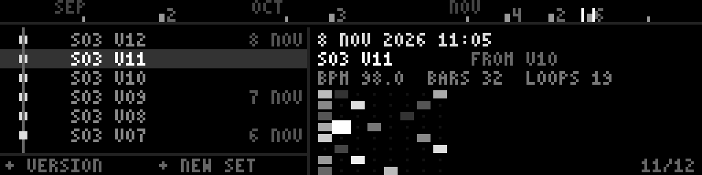
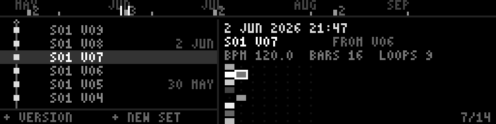
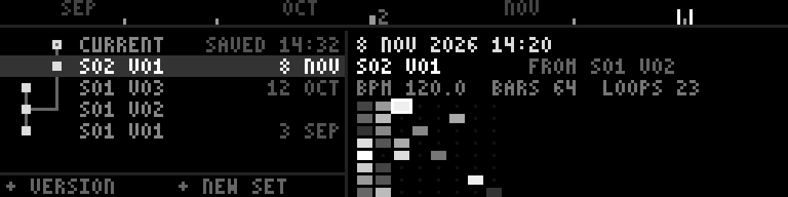
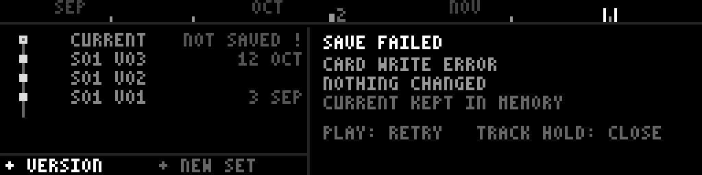

# Engine sets browser: manual versions, background recovery, graphical timeline (proposal)

Status: proposal for the owner (2026-11-08), not implementation authority. Supersedes the earlier chat proposals
("timeline of all versions", "step sizes"). Fixed-memory engine (`openspec/changes/fixed-memory-engine`), DEC-253 store.

## What exists (checked, not assumed)

* **The engine has no sets or versions yet.** Its persistence (DEC-253) keeps one working set in
  `/MidiLooper/engine/store.bin` — every slot with its undo history, A/B copies, written continuously, sector by
  sector — and reports pending / writing / failed (`Persistence::writing`, `unsaved`, `stats().saves / saveFailed`;
  the status band's save dots). That is the background autosave; it produces no versions.
* **Legacy catalog** (`SetRevisionCatalog.h`, `/sets/S####/set.bin` + `revisions/v####`): a set record holds id,
  latest revision, revision count, created / updated time, subtitle, favourite and 15 reserved bytes; a revision holds
  an id and its creation time. **No ancestry is recorded anywhere** — neither a revision's parent nor a set's origin.
* **Legacy automatic producers:** "auto-save before load" (`StorageManager.cpp`, `saveNewSetInternal`) writes a whole
  new *set* folder every time a changed workspace is left by a load — the main source of clutter; the dirty prompt's
  "save then load" commits a revision. No idle failsafe was found. None of these exist in the engine; the proposal
  does not port them.
* Owner decisions so far: a new folder (legacy sets are not listed); the RTC keeps time (battery fitted); long hold
  opens and cancels everywhere; double press is undo / clear / mute; a single tap acts; a version carries everything
  the working set has (every slot with its undo history, tempo, surface state).

## Model

* **Version** — immutable, manual, a full copy of the working set (all slots with history, tempo, selected slots),
  `S####/V####.mlv` under a new `/MidiLooper/library/` (one file a version: the existing per-slot set file, version 3,
  framed per slot, plus a header). Its header records **`parent`: the set and version the work developed from**, or
  none for a set started empty.
* **Set** — a lineage. "Save as new set" creates S+1 whose V01 has `parent` = the workspace's base (the branch); a set
  started from an empty workspace has no parent.
* **Workspace base** — the version the current work developed from: set by a load or a save, kept in the store's
  surface state so it survives a reboot. "Save version" appends V+1 to the base's set with `parent` = the base, so
  loading V02 and saving gives V05 with parent V02 (a fork inside the set), never "after V04".
* **Index** — `/MidiLooper/library/index.bin`: one 48-byte record a version (set, version, parent set/version, RTC
  time, BPM, bars, loop count, 8 × 8 note-count nibbles for the mosaic, flags). Rebuildable from the version headers.
  The browser reads only the index; it never opens version files to draw.
* **Recovery checkpoints** — not versions, not in the history graph. Taken automatically before a load replaces the
  workspace (`R####.mlv`, the last 4 kept, oldest dropped). Shown only in a separate Recovery view.
* **Autosave** — unchanged (the store). The graph shows it as one hollow endpoint: `○ CURRENT  SAVED 14:32` (the RTC
  time of the last *completed* store write), `○ CURRENT  SAVING` while a write is open, `○ CURRENT  NOT SAVED !` after
  a failed one.

## Screen (256 × 64, rendered from the firmware's 3 × 5 font)

Top strip: month labels once, a mark per save, overlapping saves merged into a counted block, calendar spacing kept,
the selection bracketed. Left: the local history graph (newest first), the selected row inverted; `+ VERSION` and
`+ NEW SET` pinned at the bottom. Right: full date and time, identity and origin, BPM / bars / loops, the 8 × 8 mosaic
(brightness by note count; the slot playing at save time outlined), position `n/N`.

| Dense month | Long history |
|---|---|
|  |  |

| Fork | Failed save |
|---|---|
|  |  |

* **Dense month** — November aggregated by day; `4` and `6` are counted blocks. The list shows a date once per day
  (`8 NOV`, `7 NOV`, …), not on every row.
* **Long history** — `^` above the lane: ancestors continue above the viewport; position `7/14`.
* **Fork** — S02's lane joins S01 at V02 (its recorded parent); the hollow `CURRENT` hangs under S02 because the
  workspace base is S02 V01.
* **Failed save** — the details pane becomes the error: what failed, that nothing changed, what to do.

## The seven decisions (proposed answers)

1. **Moving between sets, versions and branches (4 buttons).** One selection, one list: the rows of the local graph.
   Record = up (newer), Edit = down (older); the list scrolls at its edge and stops at both ends (no wrap, never onto
   an action). Track short toggles the **mode**: *Version* (every row) ↔ *Set* (one row a set: its newest version and
   the fork points), so a long library is crossed a set at a time. Forks are rows like any other: stepping onto
   `S02 V01` under its parent and tapping loads it. Month / year jumps are deferred until a real library needs them.
2. **Hold to repeat.** In the browser Record and Edit step on *press*, and repeat after 400 ms at 8 steps a second
   while held. Long-hold-to-cancel stays on the screen's own button (Track) and the encoder push only.
3. **Single vs double.** Inside the browser Record and Edit are arrows: a press steps at once, there is no double. Undo
   of a load is not a double press here — the workspace that was left is the newest Recovery checkpoint, one tap away.
   Outside the browser double press keeps its meaning (undo / clear / mute).
4. **Play/Stop while browsing.** A single tap acts on the selected row: load a version, or run `+ VERSION` /
   `+ NEW SET`. The two actions are the navigation's first stop above `CURRENT` (Record up from `CURRENT`; Edit and
   Record move between them), drawn pinned at the bottom so they never scroll away — a stop, not a wrap. Holding
   Play/Stop stops the transport — always available, and a hold is never a selection. Scrolling never loads or saves.
5. **When a load may happen.** Refused while a take records or overdubs ("RECORDING — STOP FIRST"); opening the browser
   ends NOTE_EDIT / LOOP_EDIT (their edits kept as one step, as when leaving). During playback the load runs in the
   background and switches at the first bar line after it completes; the row shows `LOADING` meanwhile.
6. **Failures.** Before a load, a recovery checkpoint is written; if that write fails the load does not start
   ("COULD NOT KEEP CURRENT — LOAD CANCELLED"). Store writes are held during the load, so the store still holds the
   departing workspace; if the destination fails to load, the workspace is reloaded from the store ("LOAD FAILED —
   RESTORED"). A failed `+ VERSION` changes nothing and says so (mockup 4); Play/Stop retries.
7. **Encoder push and NOTELEN are not identical.** Checked: NOTELEN short toggles position ↔ length in NOTE_EDIT
   (pitch and velocity have their own faders), creates on an empty step, and opens the length popup when held in
   LOOP_EDIT. A fader-less unit needs a field cycle that includes pitch and velocity. Proposal: one *Next field* action,
   bound to the encoder push and to NOTELEN short; each surface defines its own field list (with faders: position ↔
   length; without: position → pitch → length → velocity). In the browser Next field = the Track short mode toggle.

## Walkthroughs

* **Save a milestone:** hold Track (the browser opens with `CURRENT` selected) → Record once (up, onto `+ VERSION`) →
  tap Play/Stop. `S02 V02` appears in the lane with its mark in the strip; `CURRENT` now hangs under it. Three
  actions, no fader.
* **Go back one version and branch:** hold Track → Edit down to `S02 V01` → tap: the workspace is kept as R0003 and V01
  loads at the next bar. Work, then `+ VERSION`: `S02 V03` with parent V01 — the graph shows V03 forking from V01
  beside V02.
* **Dense month:** Track short (Set mode) jumps a set at a time; the strip's counted blocks show where the activity
  was; the list shows `8 NOV` once over the day's rows.
* **Undo a load:** hold Track → Track short until `RECOVERY` → the newest checkpoint `BEFORE LOAD 14:31` → tap.

## Slices (each committed, flashed and testable)

1. Version files and index on the card (`+ VERSION` / `+ NEW SET` from a serial command): header with parent, RTC
   time, metrics, mosaic; index rebuild. Native: round trip of a two-set library with a fork.
2. Workspace base in the store's surface state; load a version (store writes held, recovery checkpoint first, restore
   on failure; refused while recording). Native: load / fail / restore.
3. The browser window: strip, graph rows, details, mosaic, `CURRENT` endpoint and its save state; Record / Edit / Track
   / Play/Stop as above; opened by a Track hold (mute moves to the track button's double).
4. Set mode, hold-to-repeat, position indicator, counted strip blocks.
5. Recovery view.
6. Encoder (when the patch sends it) and the *Next field* action across NOTE_EDIT / LOOP_EDIT / browser.

Open for the owner: the 4-checkpoint recovery depth; whether `+ NEW SET` from a loaded version should ask for nothing
(proposed) or show the origin first.
