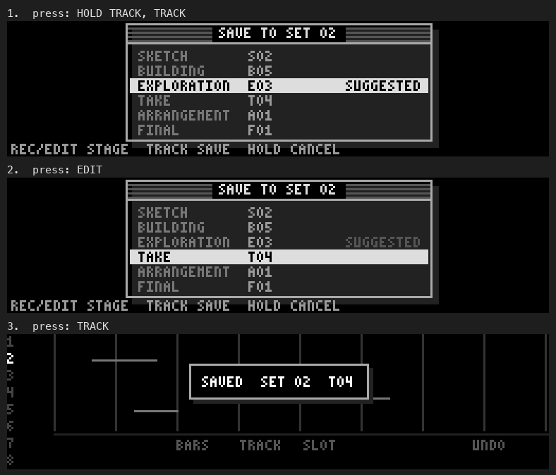

# Engine sets browser: stages, saving, loading, returning (proposal, revision 3)

Status: proposal for the owner (2026-11-08), not implementation authority. Revision 3: stages without ranking,
conservative suggestions, one fixed starting selection, each screen reduced to its task, and every walkthrough as an
exact button sequence. Revision 2's model (versions with recorded parents, recovery checkpoints, autosave shown as one
`NOW` row) stands; its storage notes are kept in section 7.

## 1. Stages

Each version captures a creative stage, chosen when it is saved and never changed afterwards:

**Sketch** · **Building** · **Exploration** · **Take** · **Arrangement** · **Final**

Stages have no order and no rank: they can be revisited or skipped, and a spontaneous take may be Final at once. Nothing
on the screen sorts, colours or summarises sets by stage; a set row shows the stage of its **latest** version, as a
fact, not a "furthest" one.

## 2. The rules that keep every sequence meaning the same

1. **The browser always opens on `+ SAVE VERSION`.** After a load a `< RETURN TO PREVIOUS` row sits above it, but the
   selection still starts on `+ SAVE VERSION`. So `HOLD TRACK, TRACK, TRACK` always saves.
2. **The save popup always opens on one stage, by one rule:**
   * the set's first version: **Sketch**;
   * otherwise the stage of the version you are working from (the one you loaded or last saved) — **unless everything
     the engine observed since that save points to one other stage**:
     * only loops recorded / overdubbed, notes edited, loops created, resized or rotated → **Building**;
     * only launches, slot switches, mutes and solos → **Exploration**;
     * only Record takes made while another track played → **Take**;
   * mixed or no evidence keeps the stage you came from. Arrangement and Final are never suggested.
   The suggestion is marked `SUGGESTED`; moving the highlight never moves the mark. Opening a screen is not evidence.
3. **TRACK does what the hint line says for the selected row** — `CHOOSE STAGE`, `SAVE`, `OPEN S07`, `LOAD V09`,
   `RETURN`, `TRY AGAIN`. **HOLD TRACK closes or cancels**, everywhere, and changes nothing.
4. **RECORD moves up, EDIT moves down** (one row a press, repeating while held); the list stops at both ends. The
   buttons sit in a row — `REC  TRK  EDIT  PLAY` (owner) — so the outer two either side of TRACK step, TRACK in the
   middle selects, and PLAY at the end stays the transport.
5. **A successful save, load or return closes the browser** and shows one line on the performance screen (`SAVED  S02
   V04  EXPLORATION`, `LOADED  S07 V09  TAKE`, `RETURNED  S02 AS AT 14:57`). Nothing stays open half-done.
6. **A failure keeps the screen and the selection:** the large word says what failed, the next line why, then
   `NOTHING CHANGED`; TRACK tries the same action again, HOLD TRACK closes.
7. **PLAY/STOP is the transport, always.** Browsing never changes its meaning, so playback can be stopped at once.
8. **Opening a set selects its newest version.** The top level lists the two save actions, then the working set
   (`S02 NOW` with its save state), then the other sets, newest first.

How the meaning holds after each outcome:

| After | Next `HOLD TRACK` opens on | `TRACK, TRACK` then | Extra row |
|---|---|---|---|
| a save | `+ SAVE VERSION` | saves the next version | — |
| a load | `+ SAVE VERSION` | saves into the loaded set, from the loaded version | `< RETURN TO PREVIOUS` above (one RECORD) |
| a return | `+ SAVE VERSION` | saves into the returned set | — |
| a failure (closed) | `+ SAVE VERSION` | as before the failure | — |

## 3. Each screen, reduced to its task

| Screen | Task | Shows | Hint |
|---|---|---|---|
| Top level, on a save action | save now | the large `SAVE`, `INTO S02 AS V04`, `FROM V03 TAKE` | `TRACK: CHOOSE STAGE  HOLD: CLOSE` |
| Save popup | pick the stage | the six stages, highlight, `SUGGESTED` | `REC/EDIT STAGE  TRACK SAVE  HOLD CANCEL` |
| Top level, on a set | find a set | its latest stage large, versions, last save, mosaic | `TRACK: OPEN S07  HOLD: CLOSE` |
| Inside a set, on a version | pick a version | its stage large, `S03 V12  12/14`, the timestamp once, loops / bars, mosaic | `TRACK: LOAD V12  HOLD: CLOSE` |
| On `< RETURN TO PREVIOUS` | undo the load | `RETURN`, `TO S02 AS LEFT AT 14:57`, `NOT A VERSION` | `TRACK: RETURN  HOLD: CLOSE` |
| A failure | understand, retry | what failed, why, `NOTHING CHANGED` | `TRACK: TRY AGAIN  HOLD: CLOSE` |

The timeline strip (months once, counted marks, the selection bracketed) shows on the list screens only — not over the
popup, not on the performance screen. **LOOPS** = slots with content; **BARS** = shortest to longest loop (`2-8 BARS`).

## 4. Walkthroughs

Each frame is the panel at its own resolution and font; the line above it is what was pressed to get there.

**1. A normal save with its suggested stage** — `HOLD TRACK, TRACK, TRACK`. Since V03 only launches and mutes happened,
so Exploration is suggested.

**2. Choosing a different stage** — `HOLD TRACK, TRACK, EDIT, TRACK`. The highlight moves to Take; `SUGGESTED` stays on
Exploration.

**3. Another set in a large library, and a version of it** — `HOLD TRACK, EDIT x5, TRACK, TRACK`. Sets are one row
each, so no versions are traversed; opening S07 selects its newest version.

**4. A Take in a long history** — `HOLD TRACK, EDIT x9, TRACK, EDIT x2, TRACK`. The stage is the row text and the large
word, so "which take did I like" is read down the list; the mosaic and date tell takes apart.

**5. Continuing from an earlier version: a fork** — load V02 (`HOLD TRACK, EDIT x2, TRACK, EDIT x2, TRACK`), record a
loop, save (`HOLD TRACK, TRACK, TRACK`: Building, since the evidence is one new loop and V02 was Building). V05 records
V02 as its parent; V03 and V04 stay, on their own lane.

**6. Return after an accidental load** — `HOLD TRACK, RECORD, TRACK`. The browser still opens on `+ SAVE VERSION`; the
return row is one step up.

**7. A failed save and a failed load** — the failure keeps the selection; `TRACK` tries again (the save then works);
`HOLD TRACK` closes with S02 still loaded and nothing changed.

## 5. Autosave and recovery (unchanged from revision 2, checked against the engine)

* The engine's store already protects the working set: every changed slot is written to its spare A / B copy after
  approval, and boot loads each slot's newer valid copy. It reports pending / writing / failed; it does not yet record
  the time of a completed write (needed for `SAVED 14:32`).
* No autosave appears as a version, a row or a timeline mark. The working set is one row, `S02 NOW`, with `SAVING`,
  `SAVED 14:32`, `UNSAVED` or `NOT SAVED !`.
* Before a load the working set is copied into a recovery checkpoint (not a version, not a set); `< RETURN TO PREVIOUS`
  loads the latest one. Older checkpoints: a `RECOVERY` row at the end of the set list, opened like a set (4 kept, a
  proposed default).
* Legacy's auto-save-before-load (a new set on every load) and its dirty prompt are not ported.

## 6. Decided (owner 2026-11-08) and still open

1. **Opening during NOTE_EDIT / LOOP_EDIT is refused.** `HOLD TRACK` there opens nothing; the status band shows
   `LEAVE EDIT FIRST` for a moment. The edit is untouched.
2. **Loading while playing switches live**, so songs can be changed in performance: the destination loads in the
   background (the row shows `LOADING`) and switches in at a global **load switch** point — **the next bar** or **the
   loop end** (the next start of the longest playing loop) — one setting for the whole instrument (default: next bar;
   a settings screen later, a serial command until then). With the transport stopped the load is immediate.
3. **The buttons sit in a row: `REC  TRK  EDIT  PLAY`.** RECORD (left of TRACK) moves up, EDIT (right) moves down.
4. **Still open:** how many recovery checkpoints to keep (4 proposed).

## 7. Storage and slices (after the paths above are agreed)

* `/MidiLooper/library/S####/V####.mlv` (a version: header with stage, parent, RTC time, metrics, mosaic; every slot
  with its undo history; tempo; surface state), `index.bin` (one record a version; the browser reads only this),
  `recovery/R####.mlv` (checkpoints, same format, never indexed as versions).
* The working set's base version and the observed-evidence flags for the suggestion live in the store's state record —
  27 bits today, so a wider record (a store format change, with a DEC).
* Slices: (1) version / checkpoint files, index, stage and parent, the store's completed-write time, serial save / load;
  (2) load with checkpoint and restore, `< RETURN TO PREVIOUS`; (3) the browser lists and controls; (4) the save popup
  and its suggestion; (5) the timeline strip and fork lanes; (6) `RECOVERY`, the encoder when the patch sends it.
