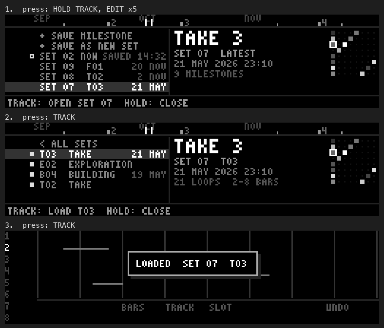
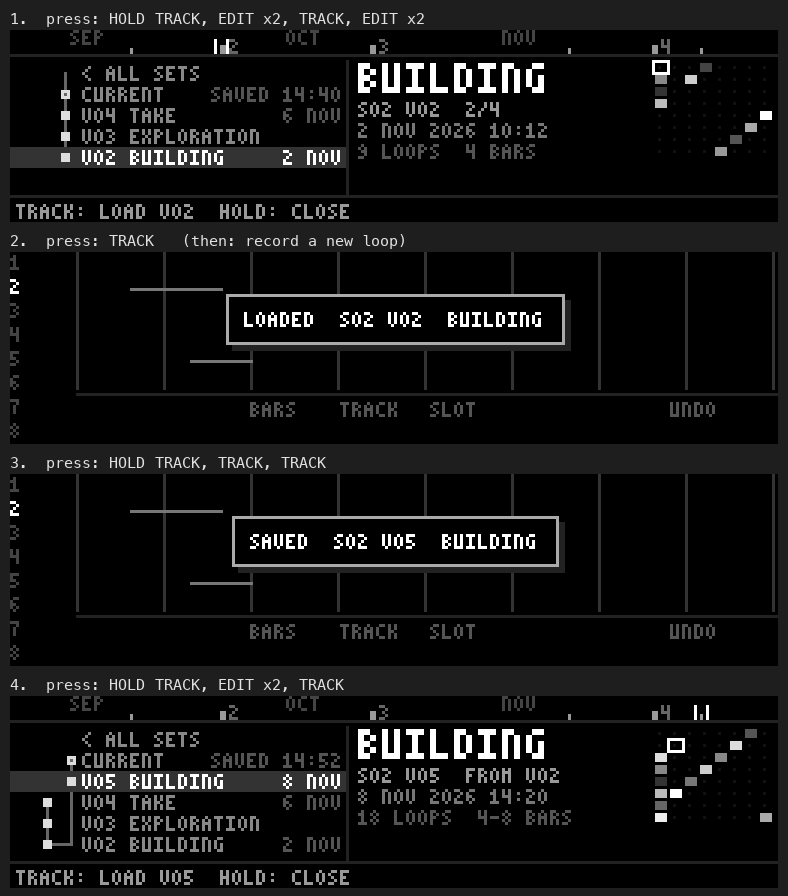
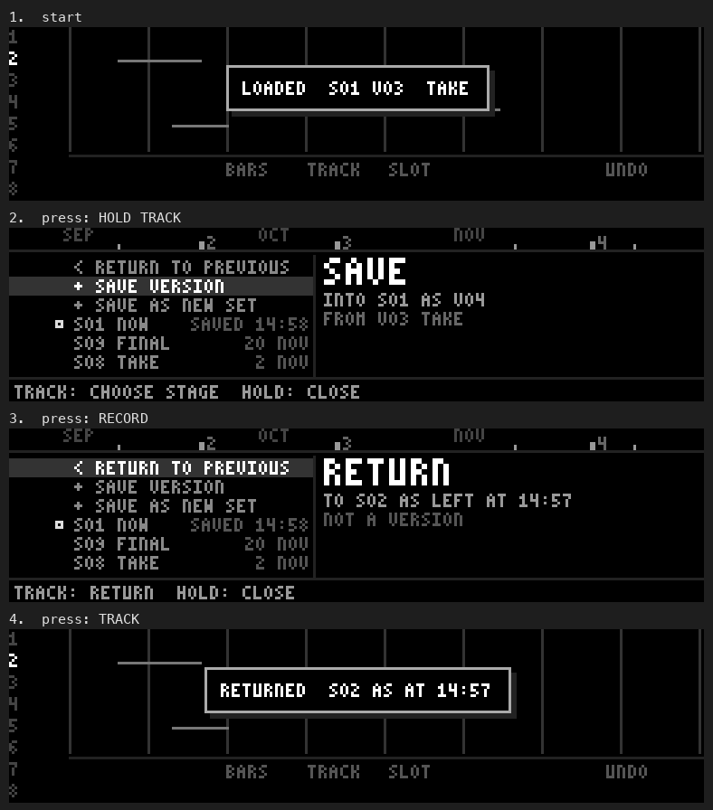
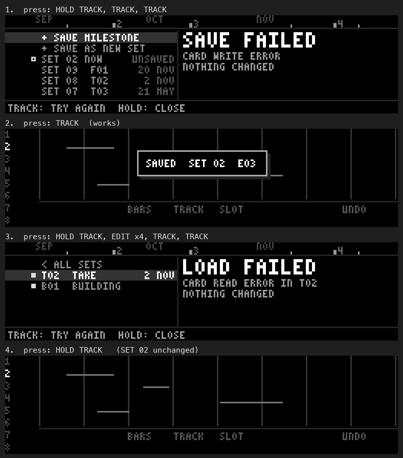
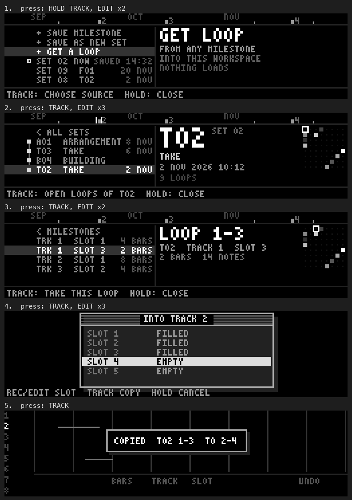

# Engine sets browser: milestones, saving, loading, returning, getting loops (proposal, revision 4)

Status: proposal for the owner (2026-11-08), not implementation authority. Revision 4 makes musical milestones the
identity inside a set, adds the next-id preview to the save popup, tightens the suggestion rules, and connects the
browser to the planned loop retrieval (`openspec/changes/set-revision-persistence/specs/slot-loop-import/spec.md`,
tasks §4.8–4.10). Revision 3's controls and walkthrough structure stand, with the owner's decisions since: the browser
opens from any mode (an open edit is closed and kept first), loads switch live at a global point, and the buttons sit
in a row `REC TRK EDIT PLAY`.

## 1. Milestones

A **milestone** is an immutable snapshot of the whole set at the moment it is saved — every slot with its undo history,
tempo and surface state — described by one creative stage. Stages are unordered and can be revisited or skipped:

| Stage | Id | | Stage | Id |
|---|---|---|---|---|
| Sketch | S01, S02 … | | Take | T01, T02 … |
| Building | B01, B02 … | | Arrangement | A01, A02 … |
| Exploration | E01, E02 … | | Final | F01, F02 … |

* Numbers count per stage within a set: saving B04 does not use a Take number. The set heading is `SET 02`, never
  `S02`, so it is not mistaken for Sketch 2.
* The browser speaks in milestones: rows read `T02  TAKE`, the details say `TAKE 2`, messages say
  `SAVED  SET 02  T04` — "return to Take 2", "continue Arrangement 1". Dates, the timeline and the mosaic support.
* Nothing is converted or renamed. Save T02, keep working, save A01 (parent T02): T02 stays, loadable and a source of
  loops; A01 is another snapshot.
* Every milestone records its **parent** (the milestone the work developed from: the last one loaded or saved), so
  ancestry never depends on list order. A history can interleave stages (`T02, B04, T03, A01`); loading an earlier
  milestone and saving forks from it. Storage keeps an internal sequence number as well; the browser never shows it.

## 2. Rules that keep each sequence meaning the same

1. **The browser opens on `+ SAVE MILESTONE`, from any mode.** An open NOTE_EDIT or LOOP_EDIT is closed first with its
   changes kept (owner). After a load, `< RETURN TO PREVIOUS` sits one step above; the selection still starts on save.
2. **TRACK does what the hint says for the selected row; HOLD TRACK closes or cancels and changes nothing.**
3. **RECORD moves up, EDIT moves down** (the buttons either side of TRACK in `REC TRK EDIT PLAY`); the list stops at
   both ends; no button has a double press in the browser.
4. **PLAY/STOP is the transport, always.**
5. **Opening a set selects its newest milestone;** a set row shows that same milestone (`SET 07  T03`, 21 May).
6. **A successful save, load, return or loop copy closes the browser with one line on the performance screen.**
7. **A failure keeps the screen and the selection:** what failed, why, `NOTHING CHANGED`; TRACK tries again.
8. **The return point:** a load keeps the departing workspace as a recovery checkpoint and shows
   `< RETURN TO PREVIOUS`; a manual save keeps that return point; the next successful load replaces it.

## 3. The save popup

All six stages, each with the id it would get (`TAKE  T04`), one highlighted and one marked `SUGGESTED`. The common path
is `HOLD TRACK, TRACK, TRACK`; RECORD / EDIT choose another stage first. The confirmation names the result:
`SAVED  SET 02  T04`. `+ SAVE AS NEW SET` opens the same popup, numbering in the new set.

The suggestion — one stage, by one rule, never a milestone by itself and never a relabel:

* **New work with no saved origin** (a fresh set, nothing loaded): **Sketch**.
* **A new set branched from a milestone:** that milestone's stage.
* **Otherwise the base milestone's stage** (the one loaded or last saved), **unless everything observed since that
  save is of one kind:**
  * recording, overdubbing, editing notes, creating, resizing or rotating loops → **Building** — this includes
    recording while other tracks play, which is ordinary loop building;
  * only launches, slot switches, mutes and solos → **Exploration**;
  * provisional **Take**: every recording since the save was made while another track played. It overlaps Building
    by design and is marked provisional; a dedicated performance / jam slot would make it a clear signal once that
    workflow exists.
* **Arrangement and Final are never inferred** from activity; they stay suggested when inherited from the base.
* Mixed evidence keeps the base stage. Opening screens is not evidence.

## 4. Screens

| Screen | Shows | Hint |
|---|---|---|
| Top level, on `+ SAVE MILESTONE` | `SAVE`, `INTO SET 02`, `FROM E02`, the save state | `TRACK: CHOOSE STAGE  HOLD: CLOSE` |
| Save popup | six stages with their next ids, highlight, `SUGGESTED` | `REC/EDIT STAGE  TRACK SAVE  HOLD CANCEL` |
| Top level, on a set | `TAKE 3` (its latest), `SET 07 LATEST`, date, count, mosaic | `TRACK: OPEN SET 07  HOLD: CLOSE` |
| Inside a set, on a milestone | `TAKE 2`, `SET 03  T02`, the timestamp once, loops / bars, mosaic | `TRACK: LOAD T02  HOLD: CLOSE` |
| `< RETURN TO PREVIOUS` | `RETURN`, `TO SET 02 AS LEFT 14:57`, `NOT A MILESTONE` | `TRACK: RETURN  HOLD: CLOSE` |
| A failure | what, why, `NOTHING CHANGED` | `TRACK: TRY AGAIN  HOLD: CLOSE` |

**LOOPS** = slots with content; **BARS** = shortest to longest loop. The timeline strip shows on the lists only.

## 5. Walkthroughs (initial browser)

Each frame is the panel at its resolution and font; the line above it is what was pressed to reach it.

**1. Save with the suggestion** — `HOLD TRACK, TRACK, TRACK` → `SAVED  SET 02  E03` (only launches and mutes since
E02).

**2. Another stage** — `HOLD TRACK, TRACK, EDIT, TRACK` → `SAVED  SET 02  T04`; the popup previews T04 before saving.

**3. Another set in a large library** — `HOLD TRACK, EDIT x5, TRACK, TRACK`. The row `SET 07  T03` and the opened set
both describe T03, its latest milestone (revision 3 showed Building on the row — fixed).

**4. Return to Take 2 in an interleaved history** — `HOLD TRACK, EDIT x9, TRACK, EDIT x4, TRACK`.

**5. Continue Take 2 into Arrangement 1** — load T02, arrange, then `HOLD TRACK, TRACK, EDIT x2, TRACK` (Exploration
was suggested from the launches; Arrangement chosen). A01 records T02 as its parent; T03 and B04 stay on their lane.

**6. Return after an accidental load** — `HOLD TRACK, RECORD, TRACK`.

**7. A failed save and a failed load** — the screen and selection stay; TRACK retries; HOLD TRACK closes, nothing
changed.

## 6. Load a milestone versus get a loop (planned extension)

* **Load milestone** — restore its complete saved set (the initial browser).
* **Get a loop** — bring selected material from any milestone into the current workspace; nothing else changes, the
  workspace's base milestone stays (still developing A01).

**8. While developing A01, get a loop from Take 2** — `HOLD TRACK, EDIT x2, TRACK, EDIT x3, TRACK, EDIT x2, TRACK,
EDIT x3, TRACK` → `COPIED  T02 1-3  TO 2-4`, back to arranging A01.

How the legacy loop-import intent maps onto the engine and the agreed controls:

| Legacy spec (`slot-loop-import`) | Here |
|---|---|
| Browse source loops without loading the source set | `+ GET A LOOP` opens the working set's milestones (`< ALL SETS` for others); a milestone opens to its loops, read from the index and the milestone file, never loaded |
| Choose an older revision first (long press on a set) | the source is any milestone in the list — no long press needed (a long press is cancel) |
| Short press = add, double press = overwrite | no double press: after the source loop, a destination popup (`INTO TRACK 2`, slots `FILLED` / `EMPTY`); an empty slot copies; a filled slot asks `ADD AS LAYER` or `REPLACE` (ADD highlighted) |
| Track mode: long press toggles a multi-selection | later: TRACK on a loop row toggles a mark, a `GET 3 LOOPS` row applies them into matching slots; the first version takes one loop at a time |
| Apply only after a successful source read | the loop's rows are read into reserved content memory first; only then is the destination changed, as one undo step; a failed read changes nothing (`GET FAILED`, `NOTHING CHANGED`) |
| Marks the workspace dirty | the engine's store saves the change like any other; the next save suggestion counts it as Building |

Engine meaning of the three outcomes: **copy** makes the destination slot's new state from the copied rows;
**add as layer** appends them as a new pass on the slot's state (overlap rules apply as for an overdub, the slot keeps
its loop length — the play window of DEC-257 covers a longer source); **replace** makes a new state from the copied
rows with the source's length. Each is one undo step on that slot.

**Initial versus extension:** the first implementation builds the list component, the top level, sets, milestones,
the save popup, load, return and failures (§5). The extension adds the `+ GET A LOOP` row, a milestone's loop list and
the destination popup, reusing the same list and popup components — the browser needs no redesign for it.

## 7. Autosave, recovery and live switching

* The engine's store protects the working set already (A / B copies, boot loads each slot's newer copy; pending /
  writing / failed). It does not yet record the time of a completed write (`SAVED 14:32`): to add. Autosave appears
  only as the working set's row, `SET 02 NOW`, with `SAVING`, `SAVED 14:32`, `UNSAVED` or `NOT SAVED !`.
* Recovery checkpoints are not milestones; `< RETURN TO PREVIOUS` loads the latest; older ones under a `RECOVERY` row
  at the end of the set list. How many to keep is open.
* **Live switching** (owner: songs change in performance): the destination loads in the background and switches in at
  the global switch point — next bar or loop end. To make the switch seamless, the playing content of the destination
  is staged first (current slot states only, not histories) in spare memory; at the switch point each track launches
  from it through the existing launch path (its first window composed ahead, committed at the point); then the old set
  is released and the destination's histories load in the background. Open: when even the two playing contents do not
  fit, refuse a live switch (load at stop) or accept a short gap.

## 8. Storage and slices

* `/MidiLooper/library/SET####/M####.mlv` — a milestone (header: stage, stage number, parent, RTC time, metrics,
  mosaic; every slot with its undo history; tempo; surface state); `index.bin` (one record a milestone; the browser
  reads only this); `recovery/R####.mlv` (checkpoints, same format, never listed as milestones).
* The working set's base milestone and the evidence flags for the suggestion live in the store's state record (27 bits
  today: a wider record, a store format change with a DEC).
* Slices: (1) milestone and checkpoint files, index, stage numbers and parents, the store's completed-write time,
  serial save / load; (2) load with checkpoint, return, failure restore, the global switch point and staged live
  switching; (3) the browser lists and controls; (4) the save popup with id preview and suggestion; (5) the timeline
  strip and fork lanes; (6) the loop retrieval extension (§6), then multi-select.

## 9. Open

1. Recovery depth.
2. A live switch that does not fit: refuse (load at stop) or a short gap.
