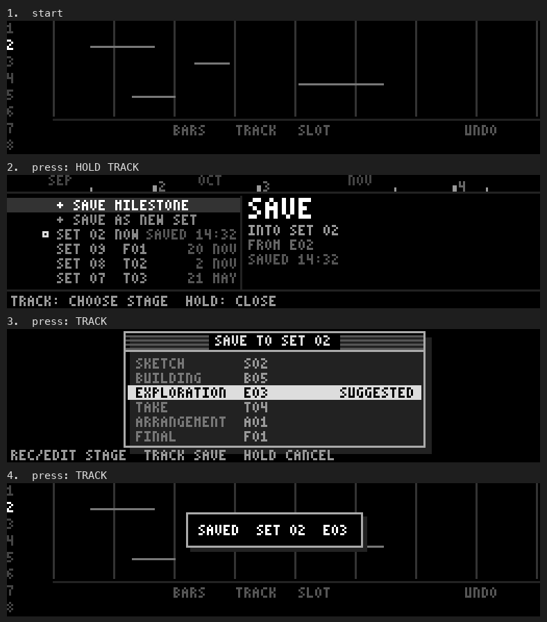
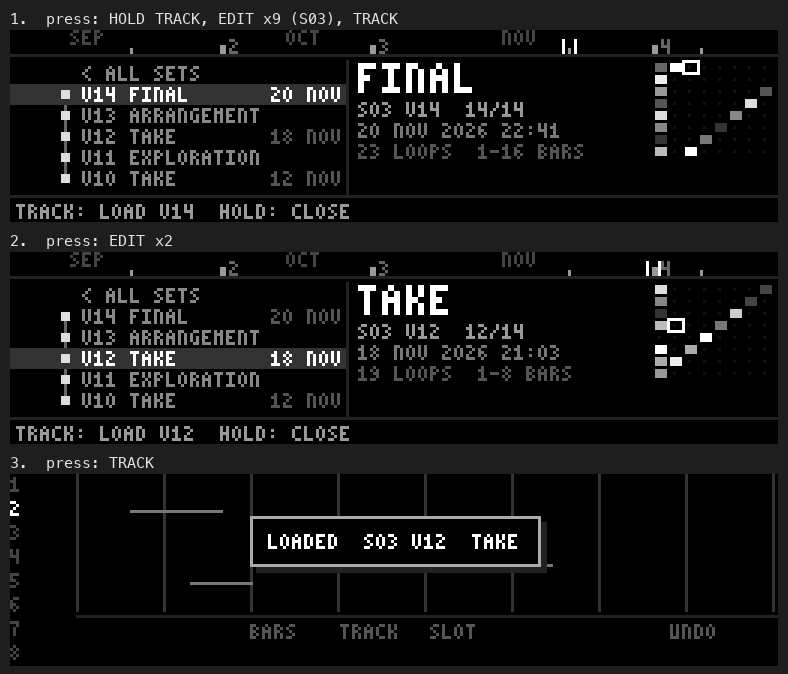

# Engine sets browser: milestones, saving, loading, returning, getting loops (proposal, revision 4)

Status: proposal for the owner (2026-11-08), not implementation authority. Revision 4 makes musical milestones the
identity inside a set, adds the next-id preview to the save popup, tightens the suggestion rules, and connects the
browser to the planned loop retrieval (`openspec/changes/set-revision-persistence/specs/slot-loop-import/spec.md`,
tasks §4.8–4.10). Revision 3's controls and walkthrough structure stand, with the owner's decisions since: the browser
opens from any mode (an open edit is closed and kept first), loads switch live at a global point, and the buttons sit
in a row `REC TRK EDIT PLAY`.

## 1. Milestones

A **milestone** is an immutable snapshot of the whole set at the moment it is saved — every slot with its undo history,
tempo and surface state — described by one creative stage. Stages are unordered and can be revisited or skipped:

| Stage | Id | | Stage | Id |
|---|---|---|---|---|
| Sketch | S01, S02 … | | Take | T01, T02 … |
| Building | B01, B02 … | | Arrangement | A01, A02 … |
| Exploration | E01, E02 … | | Final | F01, F02 … |

* Numbers count per stage within a set: saving B04 does not use a Take number. The set heading is `SET 02`, never
  `S02`, so it is not mistaken for Sketch 2.
* The browser speaks in milestones: rows read `T02  TAKE`, the details lead with the id `T02` (largest), the stage
  `TAKE` beneath it and the date third (owner 2026-11-09), messages say
  `SAVED  SET 02  T04` — "return to Take 2", "continue Arrangement 1". Dates, the timeline and the mosaic support.
* Nothing is converted or renamed. Save T02, keep working, save A01 (parent T02): T02 stays, loadable and a source of
  loops; A01 is another snapshot.
* Every milestone records its **parent** (the milestone the work developed from: the last one loaded or saved), so
  ancestry never depends on list order. A history can interleave stages (`T02, B04, T03, A01`); loading an earlier
  milestone and saving forks from it. Storage keeps an internal sequence number as well; the browser never shows it.

## 2. Rules that keep each sequence meaning the same

1. **The browser opens on `+ SAVE MILESTONE`, from any mode.** An open NOTE_EDIT or LOOP_EDIT is closed first with its
   changes kept (owner). After a load, `< RETURN TO PREVIOUS` sits one step above; the selection still starts on save.
2. **TRACK does what the hint says for the selected row; HOLD TRACK closes or cancels and changes nothing.**
3. **RECORD moves up, EDIT moves down** (the buttons either side of TRACK in `REC TRK EDIT PLAY`); the list stops at
   both ends; no button has a double press in the browser.
4. **PLAY/STOP is the transport, always.**
5. **Opening a set selects its newest milestone;** a set row shows that same milestone (`SET 07  T03`, 21 May).
6. **A successful save, load, return or loop copy closes the browser with one line on the performance screen.**
7. **A failure keeps the screen and the selection:** what failed, why, `NOTHING CHANGED`; TRACK tries again.
8. **The return point:** a load keeps the departing workspace as a recovery checkpoint and shows
   `< RETURN TO PREVIOUS`; a manual save keeps that return point; the next successful load replaces it.

## 3. The save popup

All six stages, each with the id it would get (`TAKE  T04`), one highlighted and one marked `SUGGESTED`. The common path
is `HOLD TRACK, TRACK, TRACK`; RECORD / EDIT choose another stage first. The confirmation names the result:
`SAVED  SET 02  T04`. `+ SAVE AS NEW SET` opens the same popup, numbering in the new set.

The suggestion — one stage, by one rule, never a milestone by itself and never a relabel:

* **New work with no saved origin** (a fresh set, nothing loaded): **Sketch**.
* **A new set branched from a milestone:** that milestone's stage.
* **Otherwise the base milestone's stage** (the one loaded or last saved), **unless everything observed since that
  save is of one kind:**
  * recording, overdubbing, editing notes, creating, resizing or rotating loops → **Building** — this includes
    recording while other tracks play, which is ordinary loop building;
  * only launches, slot switches, mutes and solos → **Exploration**;
  * provisional **Take**: every recording since the save was made while another track played. It overlaps Building
    by design and is marked provisional; a dedicated performance / jam slot would make it a clear signal once that
    workflow exists.
* **Arrangement and Final are never inferred** from activity; they stay suggested when inherited from the base.
* Mixed evidence keeps the base stage. Opening screens is not evidence.

## 4. Screens

| Screen | Shows | Hint |
|---|---|---|
| Top level, on `+ SAVE MILESTONE` | `SAVE`, `INTO SET 02`, `FROM E02`, the save state | `TRACK: CHOOSE STAGE  HOLD: CLOSE` |
| Save popup | six stages with their next ids, highlight, `SUGGESTED` | `REC/EDIT STAGE  TRACK SAVE  HOLD CANCEL` |
| Top level, on a set | `T03` large (its latest) with `SET 07` beside, `TAKE  LATEST`, date, count, mosaic | `TRACK: OPEN SET 07  HOLD: CLOSE` |
| Inside a set, on a milestone | `T02` large with `SET 03` beside, `TAKE`, the timestamp once, loops / bars, mosaic | `TRACK: LOAD T02  HOLD: CLOSE` |
| `< RETURN TO PREVIOUS` | `RETURN`, `TO SET 02 AS LEFT 14:57`, `NOT A MILESTONE` | `TRACK: RETURN  HOLD: CLOSE` |
| A failure | what, why, `NOTHING CHANGED` | `TRACK: TRY AGAIN  HOLD: CLOSE` |

**LOOPS** = slots with content; **BARS** = shortest to longest loop. The timeline strip shows on the lists only.

## 5. Walkthroughs (initial browser)

Each frame is the panel at its resolution and font; the line above it is what was pressed to reach it.

**1. Save with the suggestion** — `HOLD TRACK, TRACK, TRACK` → `SAVED  SET 02  E03` (only launches and mutes since
E02).

**2. Another stage** — `HOLD TRACK, TRACK, EDIT, TRACK` → `SAVED  SET 02  T04`; the popup previews T04 before saving.

**3. Another set in a large library** — `HOLD TRACK, EDIT x5, TRACK, TRACK`. The row `SET 07  T03` and the opened set
both describe T03, its latest milestone (revision 3 showed Building on the row — fixed).

**4. Return to Take 2 in an interleaved history** — `HOLD TRACK, EDIT x9, TRACK, EDIT x4, TRACK`.

**5. Continue Take 2 into Arrangement 1** — load T02, arrange, then `HOLD TRACK, TRACK, EDIT x2, TRACK` (Exploration
was suggested from the launches; Arrangement chosen). A01 records T02 as its parent; T03 and B04 stay on their lane.

**6. Return after an accidental load** — `HOLD TRACK, RECORD, TRACK`.

**7. A failed save and a failed load** — the screen and selection stay; TRACK retries; HOLD TRACK closes, nothing
changed.

## 6. Load a milestone versus get a loop (planned extension)

* **Load milestone** — restore its complete saved set (the initial browser).
* **Get a loop** — bring selected material from any milestone into the current workspace; nothing else changes, the
  workspace's base milestone stays (still developing A01).

**8. While developing A01, get a loop from Take 2** — `HOLD TRACK, EDIT x2, TRACK, EDIT x3, TRACK, EDIT x2, TRACK,
EDIT x3, TRACK` → `COPIED  T02 1-3  TO 2-4`, back to arranging A01.

How the legacy loop-import intent maps onto the engine and the agreed controls:

| Legacy spec (`slot-loop-import`) | Here |
|---|---|
| Browse source loops without loading the source set | `+ GET A LOOP` opens the working set's milestones (`< ALL SETS` for others); a milestone opens to its loops, read from the index and the milestone file, never loaded |
| Choose an older revision first (long press on a set) | the source is any milestone in the list — no long press needed (a long press is cancel) |
| Short press = add, double press = overwrite | no double press: after the source loop, a destination popup (`INTO TRACK 2`, slots `FILLED` / `EMPTY`); an empty slot copies; a filled slot asks `ADD AS LAYER` or `REPLACE` (ADD highlighted) |
| Track mode: long press toggles a multi-selection | later: TRACK on a loop row toggles a mark, a `GET 3 LOOPS` row applies them into matching slots; the first version takes one loop at a time |
| Apply only after a successful source read | the loop's rows are read into reserved content memory first; only then is the destination changed, as one undo step; a failed read changes nothing (`GET FAILED`, `NOTHING CHANGED`) |
| Marks the workspace dirty | the engine's store saves the change like any other; the next save suggestion counts it as Building |

Engine meaning of the three outcomes: **copy** makes the destination slot's new state from the copied rows;
**add as layer** appends them as a new pass on the slot's state (overlap rules apply as for an overdub, the slot keeps
its loop length — the play window of DEC-257 covers a longer source); **replace** makes a new state from the copied
rows with the source's length. Each is one undo step on that slot.

**Initial versus extension:** the first implementation builds the list component, the top level, sets, milestones,
the save popup, load, return and failures (§5). The extension adds the `+ GET A LOOP` row, a milestone's loop list and
the destination popup, reusing the same list and popup components — the browser needs no redesign for it.

### 6.1 Get a loop — agreed flow (owner 2026-11-09; supersedes the list design above for 6b)

The engine half is built (DEC-270: read one slot of a stage for another slot, place it as one undo step). The browser
half:

* **Two ways in, one grid.** (1) From the sets browser: a stage row's `GET LOOP` (no controller needed), destination
  = the selected slot. (2) From a slot on a controller: a slot gesture opens the sets browser with that slot as the
  destination remembered; choosing a stage enters the same grid. The destination is fixed on entry and always shown:
  `INTO TRACK 3 SLOT 2`. The grid cursor chooses the source only. Entry is refused while a take is open or armed on
  any track (`STOP THE TAKE FIRST`: in the picker REC is a move, so a take could not be ended), during NOTE_EDIT or
  LOOP_EDIT, and while a library job or a load runs.
* **The grid** is the stage's mosaic: tracks as rows, slots as columns. Moves: REC up, PLAY/STOP down, NOTELEN left,
  EDIT right (on this screen PLAY/STOP is a move; the footer names the moves, and the global transport button stays
  the transport; a press of it stops everything and cancels the audition). Cells are drawn about 7 px (8 slots in
  56 px), not the panel mosaic's 3 px, so the cursor shows. An `EMPTY LOOP` tile comes first, drawn unlike an empty
  source cell: taking it makes the destination an empty loop of the destination's length when it has one, else the
  new-empty-loop length — shown before KEEP (one undo step). The cursor starts on `EMPTY LOOP` only when the
  destination is empty; otherwise on the grid cell of the destination's own track and slot, and an empty loop kept
  over a filled destination asks once more (`REPLACE 3-2 WITH AN EMPTY LOOP?`), so two reflex presses never wipe a
  loop.
* **The panel** shows the loop under the cursor: its piano roll, length and bars (in ticks: the stage's tempo is not
  applied, the loop plays at the current tempo), after a short `READING…` state. A read starts only once the cursor
  has rested about 150 ms, never for cells passed over. One
  read in flight; its result is shown or auditioned only when it matches the request in full — the same picker
  session, source stage and cursor request — else it is released (a cursor that came back, or a picker reopened,
  starts a read of its own).
* **Audition:** TRACK auditions the loop under the cursor without touching the history, switching in on the next beat
  line (footer `AUDITION AT BEAT`), not mid-beat: a swap at an arbitrary tick plays nothing that started before it
  until the next cycle and would mislead; a cancel switches back on the same grid. Once the preview is ready the
  footer reads `[TRK] KEEP` — also when it cannot sound, then with `STOPPED · PREVIEW ONLY`, `NOT PLAYING · PREVIEW
  ONLY`, `MUTED` or `SOLO ON 2`; a fresh TRACK press keeps it (one undo step), back to the performance screen with `COPIED TO 3-2` (the
  destination is fixed: staying would only invite replacing what was just kept). HOLD TRACK cancels and goes back.
  Moving the cursor ends the audition (browsing never changes the sound); the next TRACK auditions the new loop. After
  leaving, undo still brings the slot's previous loop back.
* **Whether it sounds:** the audition sounds only when the destination's track is playing the destination slot: it
  replaces that slot's loop in place. A track playing another slot, or stopped, is not switched (that would be a
  launch nobody asked for, left in place by KEEP): the audition is the piano roll only (`NOT PLAYING · PREVIEW ONLY`).
  With the transport stopped, the same. A muted track stays muted, a solo elsewhere silences it; the footer says so.
* **Cancel restores the playback state, not the time:** the track resumes the destination slot's own loop at the
  current musical position (on the next beat line, as the audition switched in). A cancel caused by the transport stopping
  never restarts anything. Mute and solo changes made during the audition stay.
* **The audition's contract (engine):** the original stays the history's current state throughout; the auditioned
  state is held by the audition alone. Cancel, a cursor move, HOLD, the browser closing, a transport stop, a failed
  read or no memory for it all put the track back as it was and release it. While it lasts, nothing else may change
  the destination: its track's takes, clear, undo / redo, NOTE_EDIT, LOOP_EDIT and launches are refused. Not enough
  memory to hold both: refused before it sounds (`NOT ENOUGH MEMORY`).

### 6.2 Red team of §6.1 (2026-11-09) — fixes adopted into the plan

Blockers found against the code; each fix is part of slice 6b (the engine ones first, since 6a's serial `get` shares
them):

1. **A preview read must not starve live takes.** The detached read (DEC-261's path, reused by DEC-270) loads the
   source slot's whole history — every run and every state, up to 99 — then keeps the current state. While it runs it
   takes rows (`RowReservations`), runs (520) and manifests (256) from the pools live takes rely on; the manifest
   budget's static assert has no preview in it, so browsing could make an overdub fail its admission. **Fix:** read
   only the current state's runs (the slot file lists the runs before the rows and the states last: read the states
   first, then only the rows the current state lists), within a fixed preview budget of its own (rows, runs, one
   manifest) outside what takes rely on; a source larger than it is refused (`TOO BIG TO PREVIEW`), never borrowed.
   The same reader serves `get` (DEC-270 amended).
2. **The piano-roll preview needs its own render path.** Display tiles are per working-set slot
   (`DisplayTiles::request(slot, manifest)`), so a source loop would overwrite the destination's tiles; and `request`
   keeps a manifest id without a reference, so a preview released while its sweep is pending or running could be
   drawn from a reused or freed entry. **Fix:** a dedicated preview tile buffer; the preview's manifest pinned until
   the display drops it; the destination's tiles requested again on cancel.
3. **Entering with a take open would trap it** (REC is a move in the picker). **Fix:** refused on entry (§6.1).

High:

4. **A mid-loop swap misleads.** **Fix:** audition and cancel switch on the next beat line (§6.1). To test: notes held
   across both swaps, since a loop from an older stage of the same slot can share note ids with what plays.
5. **`EMPTY LOOP` selected first wipes a loop in two presses.** **Fix:** start there only on an empty destination; an
   empty loop over a filled one asks again (§6.1).
6. **Switching a track to the destination for the audition is an unasked launch.** **Fix:** sound only when the track
   already plays the destination; else preview only (§6.1).

Medium:

7. **Autosave pauses while a library job reads** (`EngineRoot`: the store is not serviced while `libraryWorking()`), so
   steady browsing delays saving other tracks' takes. **Fix:** read only after the cursor rests ~150 ms, and let the
   store run between reads (a preview read yields to a due store grain).
8. **Reclaim churn** from abandoned previews. **Fix:** the same debounce, and one preview buffer reused.
9. **PLAY/STOP muscle memory:** a reflex stop moves the cursor. **Fix:** the footer names the moves; the transport
   button still stops everything and cancels the audition without restarting anything (§6.1).
10. **A solo elsewhere silences the audition.** **Fix:** footer `SOLO ON 2` (§6.1).
11. **The source changing under the picker** (serial `get`, `load`, `trash`, `empty-trash`, a live load's staging).
    **Fix:** while the picker is open those are refused (`BUSY`), and no library job starts.

Notes: the stage's tempo is not applied (loops are ticks; said where the length shows); the picker's cells are about
7 px (§6.1).

**Order:** (a) the current-state reader with its preview budget (fixes 1, and `get`) — a1, the reader, done
(DEC-270 amendment 1); a2, the preview partition (8,192 rows), done (amendment 2); (b) the audition owner in the
engine — hold, beat-line switch, cancel and KEEP, the refusals while it lasts, cancellation on transport stop; (c) the
preview render path (2); (d) the picker screen with 3, 5, 6, 9–11; mockups alongside (b)–(c).

## 7. Autosave, recovery and live switching

* The engine's store protects the working set already (A / B copies, boot loads each slot's newer copy; pending /
  writing / failed). It does not yet record the time of a completed write (`SAVED 14:32`): to add. Autosave appears
  only as the working set's row, `SET 02 NOW`, with `SAVING`, `SAVED 14:32`, `UNSAVED` or `NOT SAVED !`.
* **One recovery checkpoint** (owner 2026-11-08): just before a load replaces the working set, the whole working set is
  written as a checkpoint — every slot with its undo history, tempo, selected slots and its base milestone — with the
  real time and what it was (`BEFORE LOAD 14:57 · SET 02 FROM T02 → SET 07 T03`). `< RETURN TO PREVIOUS` restores it
  exactly, as a load does, without touching milestone history. A manual save keeps it; the next load replaces it.
  Crashes and power loss are the store's job, intentional states the milestones': the checkpoint only undoes a load.
  A `RECOVERY` list of older checkpoints is deferred until it proves needed. The checkpoint write precedes the load,
  so a live switch waits for it (longer for a larger set).
* **Real time only.** The engine reads the RTC (it does not yet); a time is shown only when the clock is valid, else
  `TIME NOT SET` — never the firmware's build time (legacy `RtcTime` seeds an invalid clock from `__DATE__`, which is
  why its dates were not real). Times are stored UTC and shown with a time-zone offset; a serial command (or host
  script) sets the clock and the offset. Whether the Teensy loader sets the RTC at upload is checked in slice 1.
* **Live switching** (owner: songs change in performance): the destination loads in the background and switches in at
  the global switch point — next bar or loop end. To make the switch seamless, the playing content of the destination
  is staged first (current slot states only, not histories) in spare memory; at the switch point each track launches
  from it through the existing launch path (its first window composed ahead, committed at the point); then the old set
  is released and the destination's histories load in the background. Open: when even the two playing contents do not
  fit, refuse a live switch (load at stop) or accept a short gap.

## 8. Storage and slices

* Storage (DEC-258, accepted 2026-11-08): one preallocated 1 GiB `/MidiLooper/library/library.bin` — index header
  A / B, 4,096 index records, two checkpoint regions, an append-only milestone log — whole-set snapshots captured at one
  instant, a transactionally replaced checkpoint, a durably published index, stopped-only preallocation, a 4,300-sector
  bound per set and `LIBRARY FULL` refused before writing.
* The working set's base milestone and the evidence flags for the suggestion live in the store's state record (27 bits
  today: a wider record, a store format change with a DEC).
* Slices: (1) the RTC (read, validity, `TIME NOT SET`, set-time command, offset), milestone and checkpoint files, index,
  stage numbers and parents, the store's completed-write time, serial save / load; (2) load with checkpoint, return, failure restore, the global switch point and staged live
  switching; (3) the browser lists and controls; (4) the save popup with id preview and suggestion; (5) the timeline
  strip and fork lanes; (6) the loop retrieval extension (§6), then multi-select.

## 9. Open

1. A live switch that does not fit: refuse (load at stop) or a short gap.
