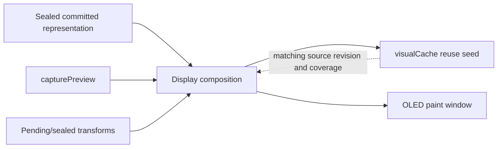

# Overdub display snapshot handoff bugfix

**Status:** Implemented and verified; focused native and full native PASS. RAM1 PASS (6848 locals); HITL PASS.  
**Evidence:** [`session_20260907_230846.log`](../../captures/session_20260907_230846.log)  
**Scope:** Display-source authority only. MIDI-boundary Stage 3/4 remains out of scope.

## Goal

Use the authoritative sealed committed representation to compose the requested
paint window. Keep `visualCache.notes` as a thin reuse/handoff cache only; it
must not determine whether committed notes exist.



## Proposed source priority

For the requested paint window:

1. Current complete `LoopSnapshot`.
2. Existing bounded prepared/committed representation.
3. Never stale or incomplete `visualCache` as committed-content authority.

A cache miss invalidates cache authority, not committed-content existence.
Do not synchronously construct or publish a new snapshot per overdub wrap solely
to repair display composition. Consider that transition only if architecture
review proves the existing sealed/prepared representation cannot satisfy the
requested-window invariant.

At overdub stop, `LoopContentResolution::resolveDisplayNotes` finalizes the
sealed committed handoff. Cache adoption is not final: the effective
resolution is repeated after adoption, and the first PLAYING draw-source
resolve preserves that revision-matched handoff before normal source/cache
resolution resumes.

## Implementation stages

### 1. Draw-source composition

Extend `gatherCommittedDrawSourceBars()` and
`resolveDisplayNotesByDrawSource()` in
[`DisplayNoteWindowGather.cpp`](../../src/DisplayManager/DisplayNoteWindowGather.cpp):

- Reject stale or incomplete snapshot/cache content as the committed prefix.
- Include the just-sealed overdub pass before companion transforms.
- Preserve bounded windowed gathering; do not restore whole-loop reconstruct
  during OVERDUBBING.
- Keep the first overdub frame from replacing a complete handoff with a
  smaller published snapshot.

Required sequence:

```text
complete sealed source
    → include new overdub pass
    → apply only companions not already represented
    → compose paint frame
```

### 2. Revision-based overdub handoff

Refine `DisplayManager::rebuildOverdubCommittedDisplayLayer()` in
[`DisplayNoteResolveLiveCapture.cpp`](../../src/DisplayManager/DisplayNoteResolveLiveCapture.cpp):

- On source-revision change, select the current sealed/prepared committed source.
- Reuse `visualCache` only when source revision and requested-window coverage
  match.
- Preserve capture-preview and playhead-tail behavior.
- Do not treat a cache miss as an empty committed representation.

### 3. Companion overlay correctness

Extend `Loop::applyPendingNoteChangesToDisplayNotes()` and
`sealedCompanionOverlayRequired()` in
[`LoopPendingNoteChange.cpp`](../../src/Loop/LoopPendingNoteChange.cpp):

- Apply sealed Hide/Shorten companions only when the selected committed source
  does not already contain their transforms.
- Preserve later pending Shorten precedence over older sealed Length rows.
- Prevent the `123 → 58` frame collapse caused by hiding old rows before the
  replacement overdub content is present.

### 4. Cache as optimization

Retain `rebuildVisualCacheIdleSlice()` and
`applyDeferredVisualCacheWrapAppend()` in
[`LoopVisualCache.cpp`](../../src/Loop/LoopVisualCache.cpp) for cache completion
and performance. Delayed cache append may affect reuse latency, but must not
create empty bars or remove committed notes from the painted frame.

No new realtime unbounded owner and no full-loop reconstruct on the MIDI
interval path.

## Architecture gate

- **Owner:** `Loop` owns sealed display representation and cache lifecycle;
  `DisplayManager` owns draw composition.
- **Invariant:** committed coverage is complete for the requested paint window
  before companion transforms can remove rows from the painted frame.
- **Ownership transfer:** NO.
- **New state transition:** NO by default. First prove whether the current
  snapshot or bounded prepared/committed representation satisfies the invariant.
  Only then may architecture review consider per-wrap snapshot publication.
- **Execution bound:** NO change; retain existing bounded display/deferred owners.

## Validation

Extend native coverage in `test_display_window_utils` and
`test_loop_take_survival` for:

- stale smaller snapshot versus complete visual handoff;
- wrap-sealed overdub pass with companion Hide/Shorten rows;
- replacement content present before companion transforms;
- cache revision mismatch selecting sealed/prepared content;
- cache reuse when revision and coverage match.

Use capture `170537` as the source-composition regression and
[`session_20260907_230846.log`](../../captures/session_20260907_230846.log) as
the overdub-stop handoff regression:

- no `draw_src` collapse from `123` to `58` caused by `hidden=66`;
- no `id=112` omission at first overdub entry;
- no empty bars after overdub wrap;
- every Hide/Shorten has replacement content in the same painted frame.
- first `OVERDUBBING → PLAYING` `DISP` frame equals effective/cache counts;
- later deferred-save frames do not change that geometry.

Run focused native tests, then
`pio run -e teensy41-capture-serial`, then `pio test -e native`, followed by
the HITL display verification. Focused tests pass, firmware RAM1 locals are
6848, and the full native suite passes with 1724 succeeded and 1 skipped.

## Documentation closeout

Documentation closeout is complete in
[`docs/Authority/Architecture/Display.md`](../Authority/Architecture/Display.md)
and
[`docs/Guides/OVERDUB_OVERLAP_RESOLVE_NOTE_EVALUATIONS.md`](../Guides/OVERDUB_OVERLAP_RESOLVE_NOTE_EVALUATIONS.md).
No new sealed representation or snapshot-publication transition was required.
