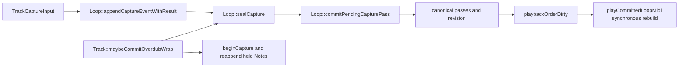

# Active-transport baseline and migration map

**Date:** 2026-09-13
**Scope:** OpenSpec task 1.2
**Firmware:** `teensy41-capture-serial`, DMA display enabled

## Overflow-free capture

The canonical Track 1 / Slot 1 two-bar record plus two overdubs fixture ran
from [`session_20260913_015235.log`](../../../captures/session_20260913_015235.log).
It produced 4,416 `#CAP` lines, zero `RING,overflow` lines, and three
non-essential `RING,shed` notices. The companion
[`host_midi_automation_baseline_20260913_015324.json`](../../../captures/host_midi_automation_baseline_20260913_015324.json)
records the fixture result. Its remaining second-overdub content failures are
not capture-integrity failures and do not erase the timing evidence.

Observed evidence includes one record stop, two overdub start/stop pairs,
undo/redo, 13 `DIAG,playback_order` rows, nine `DIAG,load_frame` rows, nine
record-stop stage rows, and 58 overdub-stop rows. Record and first-overdub
first-note latency were 11 and 9 clocks respectively (gate: at most 12).

## Current `playbackOrderDirty` causes

| Cause | Current owner | Active consequence |
|---|---|---|
| Canonical pass/cached-view invalidation | `Loop::markPassDerivedStale`, `Loop::invalidatePlaybackCaches` | Invalidates the direct `Loop` order after any pass or source mutation. |
| Snapshot restore/deep clone | `LoopEditPasses.cpp` | Resets the cursor and marks the order dirty after restoring canonical passes. |
| MIDI routing or deferred NOTE_EDIT projection | `TrackMidiEventRouting.cpp`, `NoteEditDisplayProjection.cpp` | Marks the active loop order dirty when the playable source changes. |
| Merged-source rebuild | `ensurePlaybackMergedMidiEventsBuilt` | Replacing `runtime.mergedMidiEvents` marks the direct `Loop` order dirty. |
| Last overdub-seal admission | `Loop::tryAdmitLastOverdubSealIntoMergedEvents` | Mutates the currently published merged vector and marks the direct order dirty. |
| Cursor detects invalid order entry | `PlaybackCursorAdvance` | Requests a direct rebuild from the active playback cursor. |

`Track::playCommittedLoopMidi` immediately calls `rebuildPlaybackOrder` and
`reanchorPlaybackIndex` whenever this bit is set. The builder resizes order,
allocates sort phases, calls `std::sort`, and performs equal-phase correction.
It is therefore the synchronous active-path operation replaced by task 2.

## Load-frame children

`main.cpp::runDeferredLoadAndDisplayFrame` can currently compose display
admission, `DeferredJobScheduler::runFrame`, focus-load prewarm, deferred
restore/autosave, and MIDI polls. `runFrame` itself selects submitted load jobs
and calls `StorageManager::stepSubmittedLoadJobs`. The current capture's
`DIAG,load_frame` rows establish the parent only; task 3 must expose exactly
one child and continuation per active turn.

## Capture and wrap transition map

The existing last-seal helper is not an immutable bridge: it appends the seal
directly into `runtime.mergedMidiEvents`, the same container read by the active
MIDI cursor. The wrap path also seals, commits, begins a new capture, and
re-appends held Notes in one synchronous operation. Neither can be reused as a
successor view or bridge.

## Stop-state baseline

The current state machine permits direct `OVERDUBBING → PLAYING|STOPPED`; it
has no `OVERDUB_STOPPING` state. Capture analysis must treat those direct edges
as **legacy baseline segments only**. The task 2.3 implementation replaces the
normal stop path with `OVERDUBBING → OVERDUB_STOPPING → PLAYING|STOPPED`; task
4.2 then scores STOPPING and its following PLAYING segment separately. A
baseline trace must never be mislabelled as proof of the deferred-stop design.

## Baseline conclusion

The fixture proves that the current capture transport can retain active timing
evidence without Tier-A loss. It also proves the migration target: active
playback still couples mutable merged data, direct order storage, full sorting,
and cursor reanchoring on the MIDI path. The proposed runtime view and bridge
must break that coupling before active admission is enabled.
