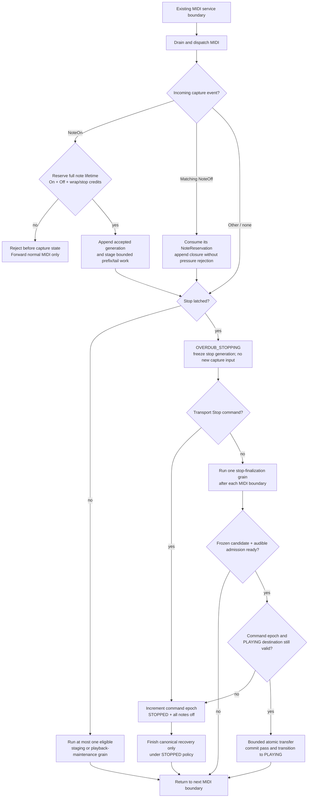

## Current implementation direction: reuse playback windows

The user's DRY correction supersedes the recording-only prototype described in
the historical increments below. First-record preparation must use the existing
RuntimePlaybackView, RuntimePlaybackViewFill/Build, RuntimePlaybackOrderBuilder,
coverage lifecycle, bridges and MIDI cursor path. Do not introduce another row
store, tick-bucket sorter, closure engine, stream adapter or recording-specific
memory pool. RuntimeRecordingWindow and its stream/runtime member were removed.

The shared fill/build path now accepts an explicit PlaybackCoverage scope. It
scans an immutable source in bounded entry quanta, retains only events whose
playback phase belongs to the existing coverage interval, and orders those rows
with the same builder as ordinary playback. Source extent can exceed window
capacity; matching events must fit the existing unpublished candidate or its
build is denied. This is candidate-build behavior, not permission to reject
recording input. AllSource remains the default for existing callers.

Production integration stays in TrackPlaybackWindowBuild / TrackDeferredMaintenance
and the existing Loop playback-source adapters; the live-capture source must
feed that path rather than create a second Track playback dispatcher.
The existing RuntimePlaybackViewLifecycle now supports retaining its current
immutable view while the other two views alternate current/successor builds.
Both already-complete and pending successor paths protect the retained buffer.
Returning to it changes roles and detaches the other views without clearing
ledger/event arrays; the next shared builder resets detached metadata. The owner
must discard in-flight workers and preflight canonical source/geometry/ledger
before that operation. Full runtime reset still invalidates all views, including
the retained role; do not preserve stale capture content through source changes.
Recording integration must distinguish cache refresh from source invalidation.
The runtime coverage-build wrapper now selects PlaybackCoverage fills.
These methods are not yet called by Track's recording/deferred-maintenance path.

Raw-tick preparation now uses the same fill and order workers. RawCoverage
requires an unknown projection length (zero) and filters the raw interval without
modulo. RawPlaybackTick uses the shared audible Off/On/other comparator, unlike
CanonicalCaptureTick's stable capture ordering. A completed raw view can bind its
final loop length without copying or reordering because all retained raw ticks
are already inside that non-wrapping coverage interval. This does not synthesize
or admit held-note closures; those remain part of owner/bridge preparation.

The existing lifecycle accepts an explicit Preparation handoff mode for rotating
unbound views while retaining bar 1. Default audible handoff and retained-return
activation reject unbound raw views. Binding must be serialized by the owner;
retained raw views are protected from fill mutation even though geometry remains
unbound. Tests cover eight preparation bars followed by final binding and return.
Track::startRecording now establishes the new raw tick origin before pre-roll is
ingested through recordMidiEvents; otherwise pre-roll used the previous origin.

Remaining first-record work belongs in the existing source adapter and owner
lifecycle: establish bar-1 preparation when capture starts; preserve raw capture
ticks until final geometry is known; keep accepted late input/held-note closures
ready through the existing preparation and bridge mechanisms; retain return
coverage while preparing successors; and select it on the original return
boundary. The new PlaybackCoverage mode requires valid final projection geometry
and must not modulo raw recording ticks by a provisional one-bar length.
Capacity, source lifetime and timing bounds must be solved for the shared path.
The no-delay/no-rewind/no-omission contract and all open HITL gates remain.

## Context

See [proposal.md](proposal.md) for the measured DMA baseline and motivation.
The active post-overdub timing window still contains an indivisible
`rebuildPlaybackOrder()` call on the `TrackManager::updateAllTracks()` path and
an indivisible `runDeferredLoadAndDisplayFrame()` turn in `main.cpp`.

`rebuildPlaybackOrder()` currently resizes and overwrites the Loop-owned order
vector, calculates phases, sorts all entries, fixes equal-tick ordering, then
clears its dirty flag before `playCommittedLoopMidi()` advances the MIDI
cursor. The one-shot incremental overdub-seal path also mutates the active
runtime merged-event vector before setting that dirty flag. The order and its
events are therefore mutable, separately owned data; neither can safely be
yielded while the clock path consumes it.

`runDeferredLoadAndDisplayFrame()` can stack display admission,
`DeferredJobScheduler::runFrame()`, first-commit playback prewarm, boot work,
and follow-up calls behind one `load_frame` measurement. Display itself already
advances through resolve, draw, and transfer phases one phase at a time, and
DMA transfer polling occurs independently; the remaining issue is parent-turn
stacking, not a missing display continuation.

The runtime architecture requires a timing-critical owner to be structurally
bounded or resumable. It also explicitly forbids a new scheduling class and
keeps `DeferredJobScheduler` as the non-realtime load-frame owner. This design
uses owner-local continuations and explicitly reassesses transfer of the
derived playback view from `Loop` to `LoopPlaybackRuntime`.

## Goals / Non-Goals

**Goals:**

- Make every active-transport playback-order and load-frame unit small enough
  to complete between MIDI services, with fixed continuation state and no
  allocation on the clock path.
- Keep the current published playback order and display/loop state usable
  until a fully constructed successor crosses its existing publish boundary.
- Give the post-overdub drain window a single owner-local continuation to
  resume, rather than allowing one selected owner to perform a compound turn.
- Establish a telemetry and HITL gate that can attribute remaining active
  boundary misses to one grain rather than a parent span.

**Non-Goals:**

- Expand `DeferredJobScheduler` beyond load jobs, add `RuntimeWorkBudget`, or
  introduce generic interval reservation/fairness policy.
- Change MIDI input dispatch order, persistence admission, slot switching, or
  the display-DMA transport lifecycle. `Loop` retains canonical ownership; the
  continuous deferred-stop service may defer its capture-pass commit for as many
  resumable turns as preparation requires.
- Use a wall-clock bailout around a still-indivisible sort, prewarm, or display
  resolve as evidence of a bound.

## Decisions

### Playback view binds event stream, order, identity, and cursor anchor

The current shape cannot satisfy the proposed contract: `Loop` owns a mutable
order while `LoopPlaybackRuntime` owns mutable merged events, and the
incremental seal path mutates the latter in place. This change therefore uses
an explicit ownership transfer for the derived playback view: the per-slot
`LoopPlaybackRuntime` owns the active, ready-successor, and build playback
views. `Loop` continues to own pass content, playback revision, and
invalidation requests; it no longer exposes independently mutable order storage
to the active clock path.

Each view contains its event source, order, source identity, projection
identity, cursor anchor, an explicit half-open phase-coverage interval, and a
bounded ledger-boundary summary. The active cursor may consume only the
published view. A fixed, prewarmed pending view holds a successor's source,
phase data, input cursor, merge-pass state, output cursor, ledger-boundary
summary, and target coverage interval.

The pending builder uses a deterministic incremental ordering algorithm: fill
source indexes/phases in fixed entry quanta, then use bounded bottom-up merge
grains that retain Off-before-On equal-phase ordering. A completed successor is
atomically selected only when its source identity is still current. Promotion
uses an `EmissionCursor` of `(projectionCycle, phase, samePhaseOrdinal,
eventProvenance, effectiveSourceGeneration)`, not a source-wide event identity.
It reanchors at that cursor and then replaces the published view. The cursor
makes an instance already reported in its current projection cycle ineligible
after promotion, while allowing the same source event to fire again after wrap.
A source change discards only unpublished successor work and begins a successor
for the newest identity.

This avoids yielding `std::sort` in place, which would corrupt cursor meaning
and event ordering. Active long-loop playback reserves three complete fixed
views (current, ready successor, and build successor-after-next), plus two
fixed immutable bridge buffers (selected and candidate) and the capture-source
admission staging needed to build them. The source-change successor uses the
build view; a new source change coalesces its build before that view is
published. This capacity is prewarmed before transport and is preferable to
clock-path allocation, a partial visible order, or mismatched event/order
indexes.

The existing incremental sealed-overdub helper is not a safe bridge because it
mutates the active event vector. It becomes a native oracle only. The runtime
`ActiveNoteLedger` remains the authoritative emitted-note state; a view's
ledger-boundary summary is an immutable proof of the state assumed at coverage
start and promotion. It is built in fixed work, compared to the live ledger at
promotion, and never reconstructed by a clock-path scan.

During active transport, a full copy-on-write successor is sufficient only when
it completes before the earliest not-yet-emitted event affected by the new
source. Otherwise the implementation SHALL install a prebuilt immutable delta
bridge as follows:

1. At the source-publication boundary, snapshot the changed pass/event inputs
   into fixed external storage and build a phase-sorted overlay in the same
   bounded fill/merge grains as a full view. Overlay records are explicit
   `insert`, `suppress`, or `replace` records keyed by canonical event identity
   or pass provenance, so an edited event cannot remain visible in both sides.
2. The bridge is selectable only after it covers the earliest affected,
   not-yet-emitted instance in the current projection cycle. The playback tick
   consumes the published view and bridge through a bounded two-way cursor
   merge; it compares phase, same-phase ordinal, and provenance, preserves
   Off-before-On ordering, applies suppression/replacement before emission, and
   advances the same `EmissionCursor`. It performs no gather, sort, allocation,
   or scan proportional to loop content.
3. A bridge may not suppress, replace, or orphan the partner of a NoteOn that
   the live ledger has already emitted. Such a compound note change becomes
   effective at its next safe boundary: after the retained original NoteOff, or
   at the next projection cycle. The bridge retains the base NoteOff required
   to close that ledger entry. A candidate whose ledger-boundary summary does
   not match the live ledger cannot promote and is rebuilt from the current
   emission cursor.
4. A complete successor for the new source builds concurrently. Once it covers
   the current cursor phase, promotion atomically retires the bridge and uses
   the cycle-qualified cursor to exclude output already emitted through either
   cursor.
5. A second source change leaves the selected bridge immutable. It invalidates
   only the unpublished full successor and candidate bridge, then builds a new
   candidate overlay from the published view plus the selected bridge to the
   newest identity. The candidate may replace the selected bridge only when it
   covers its earliest affected un-emitted event. Further changes coalesce to
   the newest candidate identity; no third mutable overlay is exposed.

### Capture admission freezes before seal and makes commit constant-bounded

`LoopPlaybackRuntime` owns a versioned `CaptureAdmissionStaging` pipeline while
capture is in progress. Before `appendCaptureEvent` accepts an active-overdub
event into `capture.store`, it proves a `CaptureAdmissionContract`. A NoteOn
creates a `CaptureNoteReservation` keyed by its capture NoteId/channel/pitch.
That reservation owns fixed capacity for the On, its matching terminal Off,
and any required wrap-continuation or synthetic-finalization record, together
with their staging, bridge, and stop-finalization work credits. A later NoteOff
that matches an accepted NoteOn consumes this reservation and is never rejected
for ordinary staging pressure.

If a NoteOn cannot reserve its complete note lifetime, it is rejected at input
ingestion before it enters `capture.store`, `PendingNote` state, capture preview,
or the runtime ledger. Its later unmatched NoteOff is forwarded as ordinary MIDI
input but does not mutate capture state. Non-note capture events reserve their
own fixed staging entry. A rejected non-note event likewise never becomes part
of the captured source. This makes input rejection incapable of leaving an
accepted captured note without a closing path.

Each accepted append advances a capture generation. Staging constructs an
immutable candidate from stable capture prefixes and records the unprepared tail
generation; it never reads mutable `capture.store` from the active clock path.
Before an overdub wrap or stop can seal, `freezeCaptureAdmissionCandidate`
closes that tail and runs the semantic equivalents of capture sorting, NoteId
assignment, wrap finalization, and minimum-length filtering against staging
storage in bounded grains. It produces immutable chunk references, companion
edit identity, bridge coverage, and successor inputs for exactly one final
capture generation. A new accepted append invalidates only the unsealed
candidate and resumes from its recorded prefix/tail cursor.

`commitCapturePass` therefore receives a frozen, generation-matching candidate:
its atomic body transfers preprepared references and installs the already-ready
audible admission, but does not sort, finalize, assign IDs, detach mutable
capture chunks, or build a bridge. `Loop` then advances the canonical revision
and exposes it to persistence, undo/redo, and display. The normal wrap/stop
state machine calls the freeze/preflight before `sealCapture`; on a rejected
event it does not mutate capture state. An incomplete or generation-mismatched
candidate is a contract violation: it retains capture state without clear,
detach, restart, or false wrap commit, then takes the deterministic
all-notes-off/stop path before an accepted event can be silently omitted.

For an active overdub, the frozen candidate must cover every affected
not-yet-emitted instance through its effective cycle boundary before
`maybeCommitOverdubWrap` can cross that boundary, including phase zero. An
accepted canonical commit installs this ready admission atomically. The runtime
may keep work pending only for a later-effective-cycle revision whose entire
current-cycle affected range is already covered by the selected source/bridge.
Display may show canonical content before that later revision is audible, but it
must report the pending-audible generation; no playback decision may treat
display freshness as audible-source admission.

### Companion application scope (approved canonical reference)

Historical Create rows follow DEC-061: append their stored payload to the
individual pass, then stably sort the complete pass by raw tick. Equal ticks
retain existing events before appended events and order within each group.
Empty Create rows still sort. This explicitly replaces the old unstable Create
reference; parity uses the revised reference. Create reactivates added nonzero
NoteOn identities after earlier Delete rows. It does not add an Off-before-On
stored-order tie-break or change DEC-059 pairing and DEC-060 merge scope.

Combined capture preparation applies the frozen companion sequence independently
to each participating canonical pass, including the frozen capture pass, before
merging pass results in canonical pass order. Preserve the existing stable
raw-tick merge and within-pass result order; do not flatten the inputs before
applying edits or add a sorting repair. A repeated NoteId in separate passes is
resolved separately in every pass. DEC-060 records user approval.

The producer retains immutable pass membership, pass order, source identity,
and original event provenance until preparation completes. Each pass uses the
bounded companion apply continuation; bounded pairwise merge carries pass/event
provenance into the aggregate candidate. Its publication, mapping to published
base indexes, capacity reservation, and aggregate stop-latency proof remain
required by task 2.3. Existing incremental append-then-edit admission is not the
parity reference for combined capture preparation.

### Companion pairing reference (approved semantic correction)

Companion note-pair lookup first filters the input sequence to the target
channel/pitch lane. Equal-tick runs are contiguous within that filtered lane;
equal ticks separated by a different tick remain separate runs. Each run
processes Offs before Ons, preserving input order within each kind. Existing
LIFO pairing and wrap fallback remain unchanged. This is an explicit semantic
correction to the former non-transitive comparator, not preservation of its
library-dependent output. Companion parity SHALL be measured against this
revised reference.

For lane [On@96, On@0, Off@96, Off@96, Off@0], target On index 0 pairs with
Off index 3 at tick 96. See `COMPANION-PAIRING-REASSESSMENT.md` for the approved
counterexample and rationale. Task 2.3 and all listed validation/HITL gates
remain open until their complete requirements pass.

### Stop requests latch a continuous deferred-stop service

An active overdub stop is not required to synchronously finish an arbitrary
fresh staging tail. On every overdub stop command, `Loop` latches `stopTick` and
enters `OVERDUB_STOPPING`: it stops accepting new capture NoteOns/non-note
events, uses already-reserved note closures to synthesize or preserve every
terminal Off at that tick, and holds the last committed audible view while MIDI
continues to be serviced. It does not call `sealCapture`, detach chunks, restart
capture, or change to PLAYING yet. The state is always entered after
`OVERDUBBING`; preparation length and note count determine how many resumable
turns are needed, never whether the stop is admitted.

At each existing post-MIDI boundary, `CaptureAdmissionStaging` executes one
declared stop-finalization grain against the frozen stop generation. The
`StopAdmissionContract` declares the per-turn quantum and fixed closure/storage
obligations; it does not cap the total number of service turns. Once the
candidate and bridge/successor are ready, one bounded atomic transfer commits
the pass and transitions to its still-valid requested destination. The display
and telemetry expose this pending-stop state and measured latency.

### DROID USB-host feedback is deferred from the real-time boundary

Playback deadline scoring covers the immediate Teensy USB and physical MIDI
serial sends. The DROID USB-host copy is feedback traffic for LEDs, faders, and
controller state; it may be delayed and paced from the existing main-loop drain.
Playback emission SHALL enqueue that copy without waiting for
`MIN_PACKET_GAP_MICROS`, and the queue SHALL have fixed storage, coalescing for
replaceable feedback, preserved order for non-coalescible messages, and explicit
age/depth/overflow telemetry. A DROID queue delay SHALL never cause a real-time
playback deadline miss or be hidden by rebasing the service deadline.

`TransportStop` has higher priority than pending stop completion. Each
`PendingStopAdmission` stores a `transportCommandEpoch` and requested
destination, initially `PLAYING`. At every grain and immediately before atomic
transfer, `main.cpp` processes transport commands first and validates that
epoch. If transport Stop arrived between grains, it increments the epoch, sets
the destination to `STOPPED`, emits the normal all-notes-off transport stop,
and invalidates every continuation that could enter PLAYING. The frozen capture
generation may finish canonical recovery only under STOPPED policy; it may not
publish audible playback, restart capture, or resume transport. An explicit
later transport Start is required to play it.

This is a deliberate compatibility change: overdub stop is deferred for as many
MIDI-separated turns as the resumable service requires, but an accepted event is
never lost, delayed after its commit, or converted into a normal transport
fault. The all-notes-off/stop fault path is reserved for an invariant breach
such as a generation mismatch or corrupted reservation. Pass persistence is
metadata publication attached to this continuous record/play/overdub/stop
service; it does not create a separate finite admission path.

### MIDI-boundary capture and stop flow

### Long-loop coverage and refill are a publication precondition

For a long loop, a view does not claim to represent the entire loop. Its
coverage interval is explicit in modular phase space and includes the current
cursor phase through a declared handoff phase; the current two-bar gather is an
implementation candidate, not an implicit guarantee. Before a coverage window
is published, prewarm must reserve three view buffers: current coverage, a
complete next contiguous successor including wrap, and a separate build buffer
for the interval after that successor. It must also reserve selected/candidate
bridge buffers independently of all three views.

The continuation begins building the interval after that successor immediately
after the current/successor pair is published, rather than waiting for a source
revision. An active window is selectable only under a per-owner
`CoverageServiceContract` that declares all of the following: maximum phase
advance between eligible playback-order turns, maximum consecutive denied
noncritical turns, required fill/merge/promotion grain count, and phase lead
including a fixed safety margin. The contract is derived from a verified
existing main-loop/MIDI-dispatch bound, not the observed service cadence. It is
not a generic interval-reservation framework.

The active cursor may not advance beyond a coverage handoff phase unless the
next immutable interval is complete and selected at that phase. The coverage
contract must prove that the interval after the successor completes before the
successor reaches its own handoff, even after its declared maximum phase advance
and denied-turn allowance. Deterministic per-turn priority may implement that
contract, but “next eligible owner turn” alone is not proof.

### Source change preemption preserves the rolling coverage horizon

The normal rolling state is `Current(C)`, `Ready(N)`, and `Build(N+1)`. A
source change does not overwrite `C` or `N`: it first prepares a selected bridge
that covers every affected event instance from the effective cursor through the
end of `N` coverage. Only after that whole horizon is covered may it abandon
`Build(N+1)` and reuse that buffer to build the new-source interval `X` after
`N`.

`X` is allowed to remain pending across the `C → N` handoff. At that handoff,
`N + bridge` becomes current effective playback, `X` remains the pending next
successor, and retired `C` is idle; it is not reused yet. When `X` completes
(including if it completes midway through `N`), it is published as ready and
retired `C` begins building interval `Y` after `X`.

`Y` is likewise allowed to remain pending across `N → X`. At that handoff, `X`
becomes current, `Y` remains the pending next successor, and retired `N` is
idle. When `Y` completes (including midway through `X`), it becomes ready and
retired `N` begins the interval after `Y`. The same pending/idle sequence
repeats for later rolling handoffs: an incomplete build is never declared ready
at a handoff, and the just-retired buffer begins a later build only after the
pending successor is complete. Thus the three-view capacity never overwrites
current, ready, or pending-source coverage.

The source-change coverage contract must prove `X` is ready before `N` reaches
its handoff and must apply the normal refill proof to the retired-`C` build from
the latest permitted `X` completion point. It declares that point and proves `Y`
is ready before `X` reaches its own handoff, after the maximum phase advance and
denied-turn allowance. The succeeding normal refill proof begins from the latest
permitted `Y` completion point and proves the retired-`N` interval before `Y`
reaches its handoff. Ordinary unchanged-source proof is insufficient.

A second source change retains the selected bridge and `C`/`N` buffers. Its
candidate bridge must cover the remaining effective horizon through `N`'s end
before the mutation is accepted, then atomically replaces the selected bridge;
the build buffer restarts for the newest source. Fixed selected/candidate bridge
capacity is sized for this full two-window horizon, not only the first affected
event. If either bridge or new-source build cannot meet that source-change
coverage contract, the capture event is rejected at ingestion before it can
produce a canonical source revision.

If that contract cannot be established for a supported loop length, windowed
playback maintenance is excluded during active transport: prewarm must provide
a full-loop immutable view, or the operation remains STOPPED-only. A runtime
coverage-contract violation is a fail-safe transport fault with a deterministic
all-notes-off/stop path; it is never a silent event omission. At wrap, the
successor interval starts at phase zero and uses the same cycle-qualified cursor
and ledger rules. Capacity, grain-count, and coverage-contract feasibility for
every supported long-loop window are verification gates, not assumptions.

### Split load-frame orchestration into a resumable owner-local state machine

`main.cpp` remains the owner of loop-turn ordering;
`StorageManager`, `DisplayManager`, and `Track` retain their existing domain
steps and Commit/publish ownership. Replace the compound
`runDeferredLoadAndDisplayFrame()` turn with a fixed continuation that selects
at most one eligible child grain per active-transport opportunity:

1. perform the already-resumable admitted display phase, if selected;
2. run one existing `DeferredJobScheduler::runFrame(budgetUs)` load grain, if
   selected;
3. advance one bounded playback-prewarm grain after a load Commit, if
   selected; or
4. perform one small, separately measured boot/background admission unit only
   when that work is eligible for the current transport state.

Each child reports complete, pending, or yielded. During active transport the
parent selects exactly one expensive child. An admitted due or pending display
frame takes priority over a retained load child at the next eligible
`LoadAndDisplay` owner turn. Its resolve/draw/transfer phases retain their
continuation until the frame completes. Load progress remains in
`StorageManager`, so yielding between load slices for a display frame does not
restart reading or parsing. Once no display phase is due, eligible load work
resumes. Owner denial still leaves domain progress untouched. The existing
post-overdub policy continues to poll MIDI before and after the selected child
and continues to prevent persistence from stacking with the load/display owner.
STOPPED may retain its broader throughput policy, but its timing samples cannot
prove active-transport bounds.

Playback display starvation correction (2026-09-15):
`allowDeferredSlotRestore` is permission, not proof of unfinished work. During
active transport, load-child admission and retention also check actual pending
slot restoration via `StorageManager::hasPendingLoopSlotRestore()` (or focused
restore work). Previously an idle load turn stayed selected indefinitely during
PLAYING because permission remained true; RECORDING/OVERDUBBING disabled that
permission and therefore released the display. Due-display priority also covers
real queued background work that cannot progress during playback. This priority
applies after existing display admission gates; it does not override focused
slot-load display suppression or admit unbounded Commit/cleanup work. STOPPED
retains the broader load-frame path needed for idle housekeeping even with an
empty load queue.

For this change, **active transport** explicitly includes RECORDING, PLAYING,
OVERDUBBING, and `OVERDUB_STOPPING`. While STOPPING, playback continuity,
MIDI-drain priority, persistence non-stacking, one-child load-frame admission,
and every active-transport exclusion apply exactly as they do while
OVERDUBBING. STOPPING is not an idle cleanup state.

`DeferredJobScheduler::runFrame(budgetUs)` is not itself evidence that every
job phase is a grain. Before it may be selected during active transport, a load
job SHALL expose its next phase and use a continuation that separates
preparation, atomic Commit, and cleanup. Preparation and cleanup must each use
declared fixed quanta. Commit is selectable only if its complete publication,
bookkeeping, and cleanup-free handoff have a demonstrated content-independent
bound; its deadline check must cover the whole Commit body. A Commit that cannot
meet that proof is excluded from active transport and remains pending until
STOPPED. The parent may select `runFrame` only when its announced next phase is
one of these qualified grains, and it records the phase in telemetry.

This does not put `DisplayManager` or `StorageManager` under a new scheduler:
the continuation only replaces the parent orchestration in `main.cpp`.
`DeferredJobScheduler::runFrame()` remains the existing load-job child; this
change requires the job protocol it invokes to make active-eligible phases
observable and bounded.

### Boundary eligibility is owner-local and structural before it is predictive

At an existing `handleMidiInput()` return, `MidiServiceDrain`/`main.cpp` may
admit the selected owner-local grain only when active transport policy permits
it. The first implementation gate is structural: a grain must have a fixed
quantum, an enforced continuation, and a measured maximum below the active
MIDI-boundary target. It does not infer a budget from the observed 2.596 ms
service period and does not add shared remaining-interval reservation.

If later evidence needs a remaining-time fit check, it must be proposed as an
explicit per-owner amendment using the DEC-053 vocabulary and must prove that
denial does not starve live work. This keeps the current change compatible with
the parked snapshot-yield result.

### Telemetry names the grain and preserves parent attribution

`RuntimeTimingTelemetry` retains `track_order` and `load_frame` as parent
metrics for comparison with historical captures. New capture-only telemetry
will identify owner, grain kind, input quantum, duration, result
(complete/yield/denied/discarded), source identity generation, and active
transport state. The parent timing window must include only work actually run;
a zero-work denied turn must not appear as a successful bounded grain.

The verification harness scores RECORDING, PLAYING, OVERDUBBING, and
`OVERDUB_STOPPING` intervals. It replaces the direct
`ST,Track,OVERDUBBING,PLAYING` detector with two transition-aware windows:
`OVERDUBBING → OVERDUB_STOPPING` through its terminal
`OVERDUB_STOPPING → PLAYING|STOPPED`, and the subsequent PLAYING window when
present. `RING,overflow` invalidates either scored window. This prevents mixed
or lost samples from closing the 4b.3 gate.

## Invariants and falsification gates

1. **View identity:** an active cursor reads event stream, order, source,
   projection, and cursor anchor from one published view. A fixture that swaps
   only events or order must fail.
2. **Immutable publication:** pausing the successor after every grain leaves a
   byte-for-byte identical published view.
3. **Exactly once promotion and bridge retirement:** a complete-oracle MIDI
   trace matches the view-plus-bridge trace: no replayed completed event, no
   omitted newly due event, and no event emitted after its suppression or
   replacement record becomes effective. The `EmissionCursor` suppresses only
   the current cycle's instance and resets its instance eligibility at wrap.
4. **Ledger-safe admission:** a bridge cannot orphan a live ledger NoteOn.
   Candidate ledger-boundary summaries must match the live ledger at promotion;
   a changed pair that already emitted its NoteOn retains its original NoteOff
   until the safe boundary.
5. **Canonical order:** every promoted order is phase-sorted, preserves
   same-phase NoteOff-before-NoteOn, and retains non-note ordering.
6. **No active-path rebuild:** RECORDING, PLAYING, OVERDUBBING, and
   `OVERDUB_STOPPING` cannot call `std::sort`, grow a vector, full-gather, or
   full-reanchor from the clock path.
7. **Complete grain cost:** a grain includes copy, reserve, phase calculation,
   compare, merge, cursor reanchor, promotion, and every active-eligible load
   Commit bookkeeping cost. A timer after an indivisible stage does not
   establish a bound.
8. **One expensive load-frame child:** an active `LoadAndDisplay` turn runs at
   most one display phase, load job, prewarm, or boot/background unit;
   persistence does not stack in a post-overdub turn.
9. **MIDI-boundary stability:** no MIDI service call site is added and dispatch
   ordering does not change.
10. **Canonical/audible admission:** canonical pass commit, persistence, and
    undo/redo stay immediate only with a ready current-cycle audible admission.
    `PlaybackSourceAdmission` may coalesce only a later-effective revision.
    Display cannot be used as evidence of audible admission.
11. **Frozen capture candidate:** each accepted capture event has staging
    capacity before it enters `capture.store`. `commitCapturePass` may transfer
    only a frozen candidate matching the final accepted generation; an
    incomplete/mismatched candidate preserves capture state and cannot seal.
12. **Captured-note closure:** an accepted NoteOn holds a reservation for its
    matching Off and wrap/stop closure. Pressure can reject only an unreserved
    NoteOn or independent non-note event; it cannot reject the terminal Off of
    an accepted captured note.
13. **Deferred-stop normality:** a normal stop with a fresh tail enters
    `OVERDUB_STOPPING` and completes through reserved grains. The fault stop is
    reachable only from a declared contract/invariant breach.
14. **Transport Stop precedence:** a transport Stop increments the pending-stop
    command epoch, selects STOPPED, and invalidates every PLAYING transition.
    A stale completion may recover canonical data only under STOPPED policy.
15. **Coalescing and liveness:** a newer source invalidates only pending work.
   For an unchanged source, every accepted grain advances a monotonic cursor
   and completes after finitely many admissions.
16. **Evidence integrity:** `RING,overflow` invalidates every scored active
    window, including STOPPING; STOPPED telemetry cannot establish this
    active-transport bound.
17. **Coverage continuity:** every active long-loop cursor phase lies in its
    published view or selected bridge coverage. A verified coverage-service
    contract proves successor and successor-after-next readiness; a fixture
    that violates it must take the deterministic stop path before omission.
18. **Source-change coverage:** before build-buffer preemption, the selected
    bridge covers all affected instances through the ready-window handoff. The
    new-source successor may remain pending through `C → N`, but must be ready
    at `N`'s handoff. Every following build may likewise remain pending through
    its predecessor handoff; its retired buffer stays idle until that build is
    ready, and the coverage contract proves the next handoff from the latest
    permitted completion point.
19. **Active Commit exclusion:** a fixture with an unbounded Commit or cleanup
    phase must prove that `runFrame` is denied during active transport; it may
    run only after STOPPED.

## Risks / Trade-offs

- [A source change reaches a due event before a full successor is ready] → use
  a mandatory immutable insert/suppress/replace bridge in that case, retain it
  through a second-source candidate replacement, qualify its cursor by cycle,
  preserve ledger-closing NoteOffs, and test first event, wrap, same-tick
  Off/On, slots, and source changes while a builder is pending.
- [Three views plus selected/candidate bridges exceed external-memory or RAM1
  headroom] → reserve all fixed capacity during prewarm, verify simultaneous
  bridge/source-successor RAM1 and firmware-size budgets, and reject the active
  mutation before canonical commit when its admission staging cannot fit.
- [A nominal grain hides content-sized work in allocation, comparator, or
  publish] → make every scan/copy/merge/commit stage independently measured;
  a timer checked after the stage does not qualify it.
- [Load-frame children still stack through indirect calls] → allow exactly one
  child per active turn and retain before/after MIDI polls; add capture tests
  that assert no same-turn child stacking in the post-overdub drain window.
- [Per-owner continuations starve after a stream of new invalidations] → retain
  the newest source identity, coalesce obsolete requests, and treat a denied
  grain as pending rather than restarting it every turn; require a verified
  coverage-service contract or exclude windowed maintenance from active
  transport.
- [A load Commit hides content-sized bookkeeping or cleanup] → make its next
  phase observable, split preparation/cleanup into continuations, and exclude
  the job from active transport unless the complete Commit body is proven
  bounded.

## Migration Plan

1. Complete an architecture reassessment and ownership-transfer record for
   `Loop` direct order storage and `PlaybackSourceAdmission` to
   `LoopPlaybackRuntime` derived views. Capture a clean baseline that identifies
   every `playbackOrderDirty` transition, canonical-source publication path,
   and `load_frame` child.
2. Add fixed active/ready/build playback views, selected/candidate bridges,
   long-loop coverage/refill capacity, and the deterministic incremental
   builder behind a compatibility selection path. Prove output parity against
   the current complete order on native fixtures before allowing active
   transport to select it.
3. Replace direct clock-path rebuilding with request/consume behavior and the
   immutable source-change bridge; retain the existing complete/in-place
   builder as a stopped-state oracle. Verify cycle-qualified bridge retirement,
   ledger safety, canonical/audible revision separation, denied-refill, and
   wrap correctness.
4. Introduce the `main.cpp` load/display continuation and convert paint,
   qualified load-job phases, and prewarm children one at a time. Keep the
   existing direct orchestration as a temporary compatibility path only until
   each child has parity and bounded-grain evidence; keep unqualified Commit
   work STOPPED-only.
5. Remove the direct active-transport full order rebuild and compound frame
   path after native tests, firmware-size checks, and overflow-free capture
   gates prove the change. The removal trigger is the 4b.3 device closeout;
   STOPPED throughput remains separately measured.

## Open Questions

- The first active-transport quantum and resulting measured bound for each
  merge, phase-fill, display, load-job, and prewarm grain will be chosen from
  baseline measurement during implementation; the design requires them to be
  fixed and independently observable, not a particular numerical value.

## Provisional ranked-preparation allowance (DEC-062, 2026-09-14)

The user approves 6240 ranked-preparation grains for continued implementation
and integration testing. This is a measurement and scheduling allowance, not a
runtime admission ceiling or total-stop duration claim. A pass whose preparation
needs more than 6240 turns remains admitted and continues through the same
resumable service; only a real fixed-storage or generation-safety failure may
deny it. Keep source/capacity/epoch validation, bounded per-turn grains,
accepted-event preservation and MIDI-separated service. Determine realtime
reservations and latency limits using overflow-free HITL when the complete path
is runnable. Final realtime qualification and the existing validation/HITL gates
remain open.

### Accepted protected undo transaction (DEC-063)

The user accepted the recommended transaction and latest-request Undo/Redo rule
in [UNDO-PUBLICATION-REASSESSMENT.md](UNDO-PUBLICATION-REASSESSMENT.md).
The existing resource owners must implement bounded final-reference release,
per-entry pressure rechecks, reserved attachment storage and one final
canonical/audible/undo publication. Retired resources cannot be needed for rollback
past the no-fail point. Undo/Redo commands coalesce to the latest request per Track
and execute once after finalization under the destination policy. Transport Stop
remains immediate. This approval does not satisfy the native or HITL gates.

### First-record window preparation preserves the existing launch boundary

User decision (2026-09-15): first-record playback must remain synchronized with the running transport. A deferred first-record launch, including waiting for a later loop boundary, is rejected. This corrects the proposed remedy in `FIRST-RECORD-ADMISSION-PROPOSAL.md`; that document is rejected history.

At recording start, the slot runtime establishes prewarmed bar-1 playback coverage, initially empty, in the recording coordinate frame. Accepted input prepares that window as it arrives. “Ready from record start” means the window and its admission machinery already exist and remain current with accepted input; future notes are not assumed known. Preparation cannot wait for a record-stop command, canonical snapshot publication, or entry into PLAYING.

The implementation uses the existing `RuntimePlaybackViewFill`/`Build` and
lifecycle buffers. A borrowed source descriptor reads the chunked canonical
capture store with a capture-display generation token; one fill or order grain
is serviced from the existing VisualCache owner turn, and an append invalidates
the unpublished candidate so it can restart from the new source extent. The
retained raw bar survives playback-cache reset and is bound to final loop
geometry immediately before the normal audible handoff.

Maintain bar 1 independently of rolling preparation of later one-bar windows. A later-window build must not overwrite the prepared return window. Stable prepared prefixes and generation-matched bounded tails/bridges cover changes made by incoming input, minimum-length filtering, and final geometry. At the existing final-bar boundary, select the complete bar-1 source/order/cursor/ledger bundle atomically at phase zero on the existing transport clock. Do not rewind the global clock, launch on a later cycle, omit earlier notes, or replay them as delayed catch-up.

The one-bar take is the tightest case: input at the end of bar 1, a held note crossing the return boundary, and a stop command with no intervening maintenance turn must already have bounded admission/closure paths. A final NoteOff or geometry adjustment cannot introduce a full sort, full gather, allocation, or unbounded ledger reconstruction at that boundary. Final loop length may be unknown during recording; provisional bar coverage must therefore not be confused with a committed one-bar loop or bind event phases to the wrong modulo length.

After launch, the prepared window chain must cover each following bar without omission or delayed refill, including the final-bar-to-bar-1 handoff. Canonical record-pass publication and later snapshot replacement must refer to the same admitted audible content and preserve the cycle-qualified emission cursor and held-note closure path.

Implementation must extend the current overdub-only capture staging integration to first-record preparation. `startRecording()` currently reserves capacity but `recordMidiEvents()` stages only overdub input, and `stopRecording()` enters PLAYING while its first snapshot is still pending. These are the integration points; merely advancing `lastTickInLoop` on the empty-source early return does not implement this contract. No new first-record input rejection policy or numerical service reservation is implied by this decision; capacity and scheduling proofs must cover accepted input under the existing recording contract.

## Superseded recording-only prototype history

The following component increments are historical evidence, not the current
implementation plan. Their recording-only code and associated tests were removed
in favor of the shared playback-window path above. Their test counts do not prove
recording integration through the shared path.

First-record ordering implementation increment (2026-09-15): `RuntimeRecordingWindow`
now provides private, prewarmed tick/kind buckets for a single raw-tick bar.
Append and unlink each touch one event and a constant number of links; record
start resets bucket visibility through an epoch rather than scanning old rows.
Off, On, and other-event buckets preserve input order independently at each tick.
The fixed event storage's order/scratch arrays are private prev/next links while
this owner is live and cannot also be used by a merge-order builder. Sealing
makes the window immutable; explicit retirement permits reuse. The fixed bucket
cost is three 8-byte buckets per bar tick (18,432 bytes at 768 ticks), in addition
to event storage. Allocation remains a cold prewarm operation with a fallible
result. No production slot currently allocates or selects this component.

This component establishes append-ready ordering only. It does not certify
first-record note lifetime reservations, canonical filtering or geometry,
held-note closure, source identity, ledger summary, concurrent ownership transfer,
or coverage-service capacity. Those must be integrated before connecting this
private order to audible playback. A capacity failure here is not a newly
approved first-record input rejection policy.

The recording return window is now a member of `LoopPlaybackRuntime`, with explicit
cold allocation and record-session lifetime distinct from derived playback-cache
refresh. Its private same-window reservation API uses the fixed phase array for
closure ownership while the window is live; this array must not concurrently hold
projected phases for another builder. Each reserved On owns an invisible Off row.
Closure validates owner, recording epoch, identity, channel, pitch and raw tick before
linking that row. Full capacity cannot displace it. Sealing denies unresolved local
reservations. Notes spanning beyond this raw-tick bar still need a separately proven
closure handoff; this local reservation is not a cross-window admission receipt.

Recording-window closure continuation (2026-09-15): a later raw-tick window can
reserve an invisible incoming terminal row before ordinary events consume its
capacity. Cross-bar closure validates source identity/epoch and destination
credit/epoch before changing either private window. It consumes the source's
local closure obligation and links the Off in the destination, with no append
allocation or sort. Source and destination remain unsealed while their respective
obligations are unresolved. A foreign, stale, wrong-tick or wrong-identity attempt
preserves both halves. Canonical short-pair removal consumes both credits without
emitting either event.

Loop-end closure explicitly binds final whole-bar length and places the reserved
Off in bar 1's phase-zero bucket while preserving `event.tick == loopLengthTicks`.
A note originating in bar 1 uses its existing local terminal row; a note originating
in a later bar requires a reserved incoming row in bar 1. Bucket phase is stored
separately from raw tick in the private fixed phase array, so unlinking a loop-end
Off accesses phase zero rather than indexing beyond the bar. Ordinary cross-bar
closure does not apply modulo arithmetic to an unknown final length.

These are private owner operations, not concurrent atomic publication. The Track
integration still has to establish incoming credits before ordinary input,
carry obligations across rolling-window reuse, prove accepted-input capacity and
all end-boundary work, and atomically select canonical source/geometry/cursor/ledger.
Tests of one closure do not establish the bound for all simultaneously held notes.
The current capture/playback path is not changed by these new methods.

Final recording geometry and cursor extent (2026-09-15): the first explicit
loop-end closure now binds final loop length for the return window's epoch,
before any pair filtering. Conflicting subsequent closures deny before mutation.
Removing a terminal does not erase this binding; retire/begin creates a new epoch
and clears it. Ordinary rows remain constrained to their raw bar, and the only
projected exception is an explicitly bound loop-end Off. These invariants let
stream selection check geometry without walking retained events. Sparse initial
bucket seeking and optional after-phase seeking still have their documented
bounds; this is not yet a complete constant-time boundary activation.

The existing MIDI cursor advancement implementation now also accepts 32-bit
logical positions through a typed stream/state overload. Both widths use the
same emission, interval, jam and ledger implementation. Existing production
callers retain their 16-bit types. A synthetic stream spanning all 131,072 shared
pool rows verifies progress across 65,535, invalid-entry denial and recovery
without replay. The recording window's physical rows and reservation handles
remain 16-bit; pool-sized storage and capture admission are still integration
work. No new input cap or first-record rejection policy is introduced.

Recording physical extent continuation (2026-09-15): RuntimeRecordingWindow
now owns dedicated contiguous rows containing the event, 32-bit previous/next
links, phase/reservation tags and retained state. It no longer borrows the
16-bit sort arrays from FixedPlaybackEventStorage. Bucket links, reservation
handles and the borrowed stream use 32-bit positions. Cold prewarm checks
allocation-size overflow and reservation-tag index limits; active append,
closure and epoch reuse neither resize nor allocate. Failed cold allocation
preserves the prior reservation. reservedBytes() reports row/bucket payload
bytes, excluding allocator overhead, for subsequent device reservation work.

Native fixtures now fill actual storage to the shared pool's 131,072-row extent,
remove a row across 65,535 without breaking links, close a full-capacity reserved
loop-end Off, and traverse the resulting wide stream without replay. A separate
fixture closes an incoming terminal at destination row 65,536 under full
capacity. These are cardinality/identity tests, not claims that a same-tick flood
can meet MIDI deadlines.

The physical index limit is resolved, but memory admission is not: do not reserve
a full-pool copy per slot or silently reject existing capture input when a
window fills. Before Track wiring, establish how return and rolling windows
share prewarmed device memory, including simultaneous recording owners and
closure obligations, and prove that reservation against existing capture
admission. Sparse seeks and final boundary publication remain integration work.

The existing 2026-09-15 09:52 device capture reports an 8 MB PSRAM chip (8185 KB
pool). This rules out multiple full-pool event copies as the deployed return /
rolling reservation strategy. The dedicated wide rows above establish the index
and closure semantics, but device integration needs shared canonical event
references (or equivalent sharing), with an explicit immutable lifetime through
capture canonicalization, snapshot publication and window retirement. Merely
allocating the native fixture's capacity for each window is not the implementation
plan. Preserve existing record admission and the no-delayed-launch contract.

Button A stop ownership correction (2026-09-15): the accepted normal stop freezes
capture admission and publishes PLAYING while the prepared playback source remains
available. The pending transaction, rather than the visible Track state, owns
closure, ordering, canonical transfer, companion preparation and cleanup. New
capture cannot overwrite that frozen owner. Transport Stop retains precedence and
a stopped destination cannot publish a new PLAYING state edge.

An empty successor after wrap, or a capture fully removed by filtering, skips
canonical-tail and audible-bridge construction. At PrepareTransfer the shared
retirement helper releases unused companion credits only after closure/order
obligations have completed. Atomic transfer still checks destination and command
epoch. Without that retirement, the one setup credit left a permanent admission
barrier even though no pending capture pass existed.

Functional evidence includes two empty passes and two wrapped passes after upload.
UI state publication is not proof of canonical commit, audible handoff or deadline
success. Stop service/emission telemetry must cover the background transaction as
well as its early visible state edge; the full 4.1/5.3 gates remain open.
